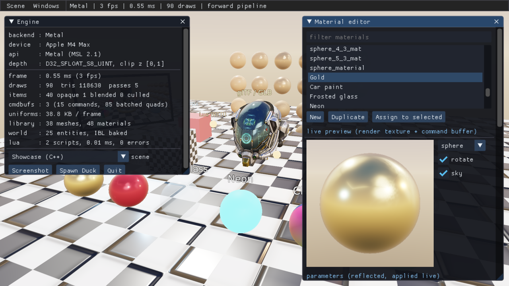

# Genesis Render

跨平台（macOS / Linux）实时渲染引擎：**OpenGL / Vulkan / Metal 三后端**严格对齐（三端逐像素一致），
ECS、glTF/GLB/FBX/OBJ 导入、PBR + IBL、HDR 色调映射与后处理、ImGui UI，
以及本版本新增的：

- **完整 RTTI 脚本系统**：Lua 通过通用反射绑定访问 19 个引擎类型（实体、全部组件、材质、渲染纹理、网格、CommandBuffer、渲染器、设置、输入），**可以完全用脚本搭建真实场景与渲染管线**；
- **引擎级 CommandBuffer**：录制（组织逻辑）与执行（渲染）分离；任意网格 × 任意材质 × 任意矩阵、渲染到纹理、带 12 种效果的 blit、2D/3D 图元与文字；可注入内置管线的 6 个时机，或以 **Custom 管线模式**由用户命令缓冲构建整帧；
- **材质系统**：可编辑材质对象（PBR 参数、Cook-Torrance/Blinn-Phong/Unlit、混合/剔除/深度状态、5 个纹理槽可接文件或渲染纹理、UV 变换、克隆），**UI 实时编辑 + 实时预览**；
- **SDF 文字**：2D 屏幕文字、3D 世界文字（公告牌/任意朝向）、实体文字标签、描边。



## 快速开始

```bash
# macOS
xcode-select --install
brew install cmake sdl2
# 可选：LunarG Vulkan SDK（MoltenVK + validation layers）；重新生成着色器需 glslang + spirv-cross

# Linux (Ubuntu 22.04)
sudo apt-get install -y build-essential cmake libsdl2-dev zlib1g-dev
sudo apt-get install -y libvulkan-dev mesa-vulkan-drivers xvfb   # 可选 Vulkan

./build.sh                     # Release，当前平台可用的全部后端 → build/bin/
./build.sh --test              # 构建 + 全部测试（三后端 + 跨后端像素比对）
./build.sh --test --validation # 同上，打开 Vulkan layer / GL 错误检查 / Metal 校验
./build.sh --demo metal        # 构建并运行 demo（gl | vulkan | metal）
```

## Demo

```bash
./build/bin/genesis_demo --backend vulkan                      # C++ showcase 场景 + 材质编辑器
./build/bin/genesis_demo --backend metal --scene lua           # 完全由 Lua(RTTI) 搭建的场景
./build/bin/genesis_demo --backend gl --scene commandbuffer    # Lua CommandBuffer / 自定义管线示例
./build/bin/genesis_demo --lab custom                          # 打开 CommandBuffer 实验室并启用自定义管线
./build/bin/genesis_demo --script my_scene.lua                 # 挂载任意 Lua 脚本（start/tick）
```

| 参数 | 说明 |
|---|---|
| `--backend gl\|vulkan\|metal` | 渲染后端（默认 gl；metal 仅 macOS） |
| `--scene showcase\|lua\|commandbuffer\|empty` | 初始场景（运行时可在菜单 Scene 切换） |
| `--lab material\|commandbuffer\|custom\|text\|inspector` | 启动时打开的功能面板 |
| `--script FILE.lua` | 额外挂载一个脚本实体 |
| `--screenshot out.png` / `--frames N` | 渲染若干帧后截图退出（含 UI） |
| `--showcase DIR` | headless 生成一组能力证明图 |
| `--validation` | 打开后端校验 |
| `--selftest` | 自动遍历全部场景、面板与交互路径后退出（有错误则非零退出码） |
| `--width/--height`、`--headless`、`--no-ui`、`--no-script`、`--asset-dir` | 常规选项 |

界面入口（菜单 Windows）：**Engine**（后端/设备/统计/截图）、**Render settings**（反射生成）、**Hierarchy / Inspector**（反射编辑任意组件）、**Material editor**（材质库、实时预览、参数、纹理槽、指定给实体）、**CommandBuffer lab**（渲染到纹理的安防摄像头、后处理、自定义管线效果链/画中画/分屏）、**SDF text lab**（2D/3D 文字）、**Lua console**（示例片段）、Log、Controls。
快捷键：拖拽左键环绕、滚轮缩放、F1 UI、F2 着色模型、F3 线框、F4 IBL、F5 自定义管线、F6 下一个后处理、ESC 退出。

## 脚本示例（纯 RTTI）

```lua
function start()
  local cam = world:create("Camera")
  cam:add("Camera").fov = 50
  cam:add("CameraController").distance = 8

  local sun = world:create("Sun"):add("Light")
  sun.type = "directional"; sun.intensity = 3.5
  world:create("Sky"):add("Environment").hdr = asset("textures/sky_equirect.hdr")

  local gold = renderer:createMaterial("gold")
  gold.base_color = color(1.0, 0.76, 0.33); gold.metallic = 1; gold.roughness = 0.2
  local ball = world:create("Ball")
  ball:setMesh(renderer:createMesh("sphere", 1.0), gold)
  local label = ball:add("Text")
  label.text = "gold"; label.offset = vec3(0, 0.8, 0)

  hud = CommandBuffer.new("hud")
  renderer:addCommandBuffer("overlay", hud)
end

function tick(dt)
  hud:clear()
  hud:drawText(string.format("%s  %.0f fps", engine.backend, engine.fps), 20, 20, 24, color(1, 1, 1))
end
```

更多：`assets/scripts/scene_builder.lua`（完整场景）、`assets/scripts/commandbuffer_demo.lua`（渲染到纹理 + 自定义管线），在 demo 的 Lua console 中还可运行内置示例片段。

## 架构

```
demo / tests
Engine            input → UI → device.beginFrame → world.update → render → endFrame
ECS · Script(Lua + RTTI 绑定) · Reflection · UI(ImGui on RHI + Inspector) · Text(SDF)
Renderer          RenderSystem · FrameExecutor(Forward/Custom) · CommandBuffer · Material
                  RenderTexture · FrameAllocator(动态 UBO 环) · PipelineCache · IBL
Resource          glTF/GLB · FBX · OBJ · stb_image · 程序化网格
RHI               OpenGL 4.1 core │ Vulkan 1.1 (MoltenVK) │ Metal (Obj-C++/MSL)
Platform          SDL2 窗口/输入/计时        Foundation: math / log / file
```

| 文档 | 内容 |
|---|---|
| [`架构设计文档.md`](架构设计文档.md) | **完整架构**：分层、类关系图、帧时序、三后端约定、材质/CommandBuffer/RTTI/文字/UI 设计、demo 入口、问题根因与修复 |
| [`ARCHITECTURE.md`](ARCHITECTURE.md) | 英文概要 |
| [`docs/BUILD.md`](docs/BUILD.md) | 构建、依赖、着色器生成、校验环境 |
| [`docs/TEST_REPORT.md`](docs/TEST_REPORT.md) | 本机编译运行与测试报告 |
| [`docs/VERIFICATION.md`](docs/VERIFICATION.md) | 每项能力的验证方法与效果图 |
| [`docs/PBR.md`](docs/PBR.md) | PBR / IBL 数学 |
| [`docs/legacy/`](docs/legacy) | 历史文档（v1、v2.0 架构与 Piccolo 差距分析） |

## 目录

```
CMakeLists.txt / build.sh           构建（后端开关、依赖探测）
scripts/build_shaders.py            单源 GLSL → GLSL410 / SPIR-V / MSL
assets/{models,textures,fonts,scripts}
src/genesis/rhi/{opengl,vulkan,metal}
src/genesis/renderer                渲染系统、CommandBuffer、材质、RT、帧资源、管线缓存、shaders/
src/genesis/reflection              RTTI 核心 + 引擎类型注册
src/genesis/script                  Lua VM、沙箱、通用反射绑定
src/genesis/text                    SDF 字体
src/genesis/ui                      ImGui RHI 渲染器 + 反射 Inspector
src/genesis/{ecs,resource,engine,platform_layer,foundation_layer}
demo/                               main.cpp · demo_app.{hpp,cpp} · demo_ui.cpp
tests/                              CPU + GPU(三后端) + 跨后端比对
docs/images/                        showcase 图（gl_/vk_/mtl_）与 features/ 功能截图
```

## 许可证

第三方依赖遵循各自许可证（imgui、Lua 5.4、cgltf、stb、VMA：MIT；SDL2、zlib：zlib）。引擎代码沿用仓库原有许可。
