# Genesis Render

跨平台（macOS / Linux）实时渲染引擎：**OpenGL / Vulkan / Metal 三后端**严格对齐（三端逐像素一致），
ECS、glTF/GLB/FBX/OBJ 导入、PBR + IBL、HDR 色调映射与后处理、ImGui UI，
以及本版本新增的：

- **完整 RTTI 脚本系统**：Lua 通过通用反射绑定访问 **25 个**引擎类型（实体、全部组件、材质、渲染纹理、网格、CommandBuffer、渲染器、设置、输入、物理系统、动画组件），**可以完全用脚本搭建真实场景与渲染管线**；
- **引擎级 CommandBuffer**：录制（组织逻辑）与执行（渲染）分离；任意网格 × 任意材质 × 任意矩阵、渲染到纹理、带 12 种效果的 blit、2D/3D 图元与文字；可注入内置管线的 6 个时机，或以 **Custom 管线模式**由用户命令缓冲构建整帧；
- **材质系统**：可编辑材质对象（PBR 参数、Cook-Torrance/Blinn-Phong/Unlit、混合/剔除/深度状态、5 个纹理槽可接文件或渲染纹理、UV 变换、克隆），**UI 实时编辑 + 实时预览**；
- **SDF 文字**：2D 屏幕文字、3D 世界文字（公告牌/任意朝向）、实体文字标签、描边。
- **v4 新增能力**
  - **运行时特效资源包（`.gpkg`）**：单文件携带 scene / 材质 / 三端 shader（GLSL、SPIR-V、MSL）/
    贴图 / Lua + JS 脚本 / 配置；离线制作工具 `tools/genesis_pack.py`，运行时动态挂载与解包；
  - **JavaScript（V8）脚本**：与 Lua 完全对齐的通用 RTTI 绑定，可建场景、改建材质、录制
    CommandBuffer、调用物理与输入；每个脚本独立 V8 Context + `start/tick` 生命周期；
  - **物理系统**：刚体、球/盒/平面/胶囊碰撞体、碰撞检测与响应、摩擦/弹性/休眠、铰链关节
    （限位/电机）、触发器、射线检测，以及独立 Physics lab 页面；
  - **完整小游戏 Cascade**：资产全部打包进 `.gpkg` 运行时加载，包含刚体/碰撞/铰链、JS 玩法脚本、
    HUD、计分/计时/胜负/重开；
  - **3D Gaussian Splatting**：PLY（3DGS 属性）解析、深度排序、屏幕空间高斯泼溅渲染，
    独立功能页与扩展文档 `docs/GAUSSIAN_SPLATTING.md`。
- **v5 新增能力**
  - **动画系统**：2D 序列帧（sprite sheet，批量纹理四边形）与 3D 顶点动画
    （compute shader 写入顶点流，支持 OpenGL 4.3+ / Vulkan / Metal 三端）；
  - **四大公共 API**：`RenderingAPI` / `ComputeAPI` / `RayTracingAPI` /
    `EncoderDecoderAPI`，旧 API 保持兼容，全部原有测试与像素比对继续通过；
  - **GPU Ray Tracing**：基于 Compute API 的跨后端光线追踪（球/平面求交、阴影、反射），
    独立 Ray tracing lab；原生 RT 扩展可在同一 API 后替换；
  - **Encoder & Decoder**：直接链接 libavcodec/libavformat，H.264 编解码与
    音视频播放全部进程内完成（无外挂 ffmpeg 进程）；自动探测 NVENC / VA-API /
    VideoToolbox，Raw/PNG 为全平台回退，独立 Media player / Codec lab。

## 效果展示

**同一场景在三个后端上的渲染结果**（自动化测试中三端逐像素比对，差异 0/255）：

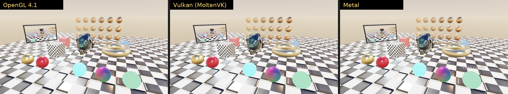

<table>
<tr>
<td width="50%"><b>材质实时编辑 + 实时预览</b><br>材质编辑器修改 Gold 的粗糙度与颜色，预览窗（CommandBuffer 渲染到纹理）与场景中所有使用该材质的物体同步变化<br>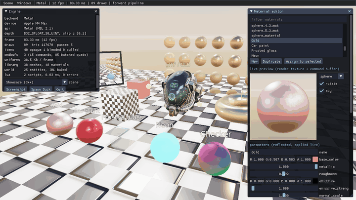</td>
<td width="50%"><b>CommandBuffer 自定义渲染管线</b><br>用户命令缓冲构建整帧：scene → HDR RT → tonemap → edge → backbuffer，画中画为原图，随后切到分屏对比；左侧为渲染到纹理的安防摄像头<br>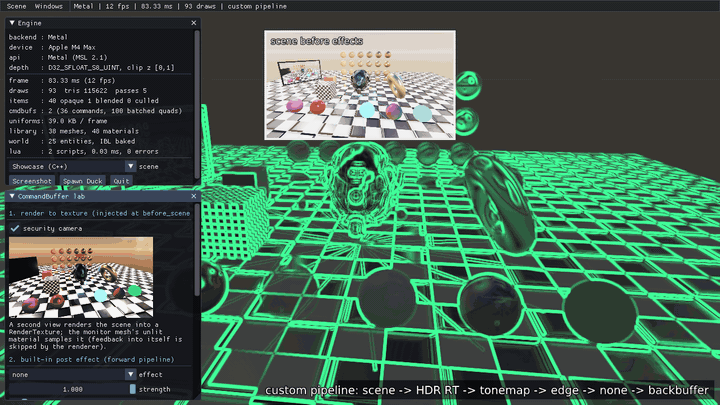</td>
</tr>
<tr>
<td width="50%"><b>SDF 文字（2D + 3D）</b><br>2D 文字字号实时变化并带描边，字号阶梯展示同一 SDF 图集的缩放清晰度；场景中为旋转的 3D 世界文字与实体标签<br>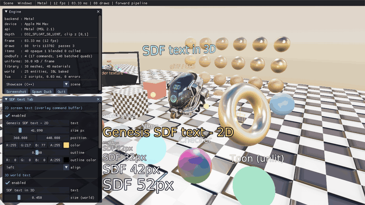</td>
<td width="50%"><b>纯 Lua（RTTI）搭建的场景</b><br><code>assets/scripts/scene_builder.lua</code> 只通过反射接口创建相机、灯光、HDR 环境、材质、网格、glTF 模型、3D 标签和 HUD 命令缓冲<br>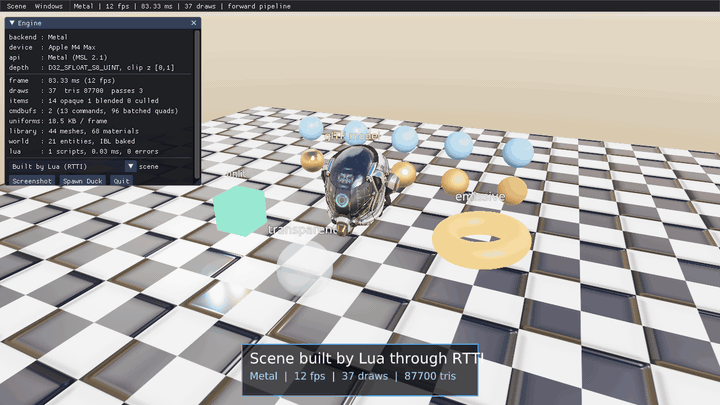</td>
</tr>
</table>

| 功能截图（Metal） | |
|---|---|
|  | 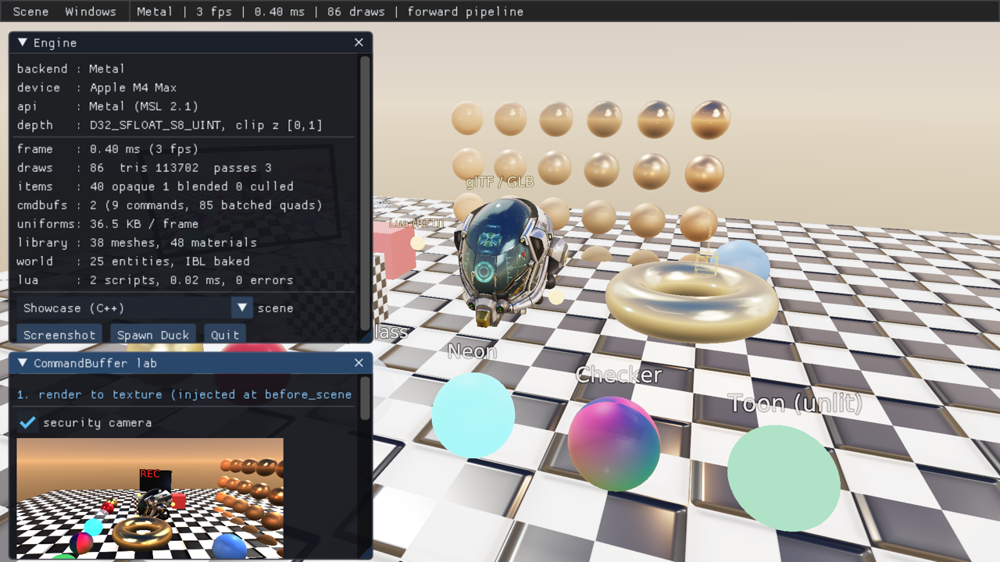 |
| 材质编辑器 | CommandBuffer 实验室（渲染到纹理、后处理、管线控制） |
| 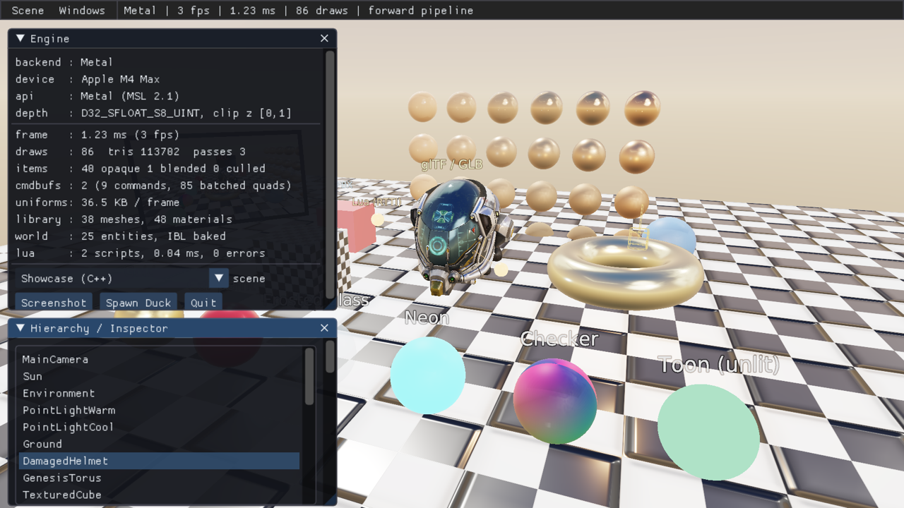 | 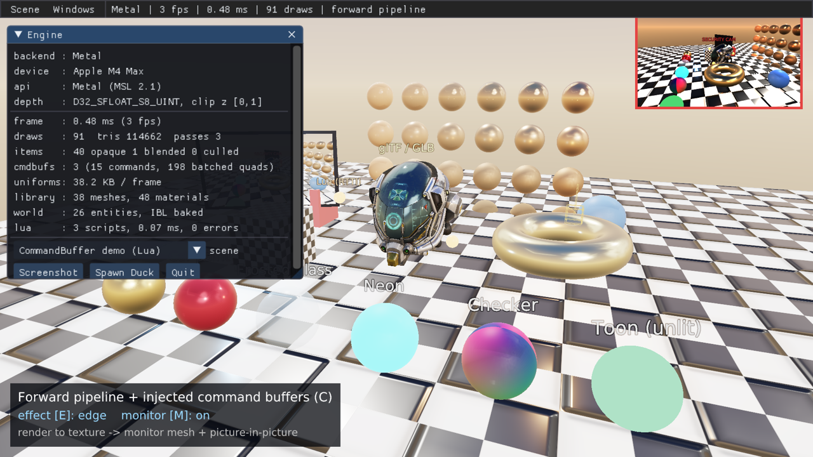 |
| 反射 Inspector | Lua CommandBuffer 示例（RT 显示器 + 画中画 + HUD） |

GL / Vulkan 的同组截图见 [`docs/images/features/`](docs/images/features)，headless 能力图（PBR 网格、色调映射、IBL、模型导入）见 [`docs/images/`](docs/images)。
上面的动图由 demo 自己录制：`genesis_demo --backend metal --tour --record frames/`（固定时间步逐帧截图，见下文参数），再用 ffmpeg 合成。

## v4 新增功能

| Physics lab | Cascade mini-game |
|---|---|
| 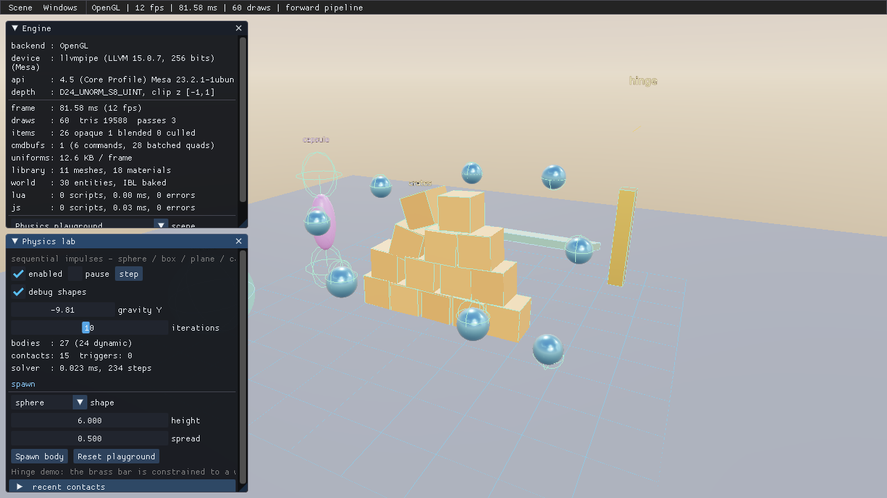 | 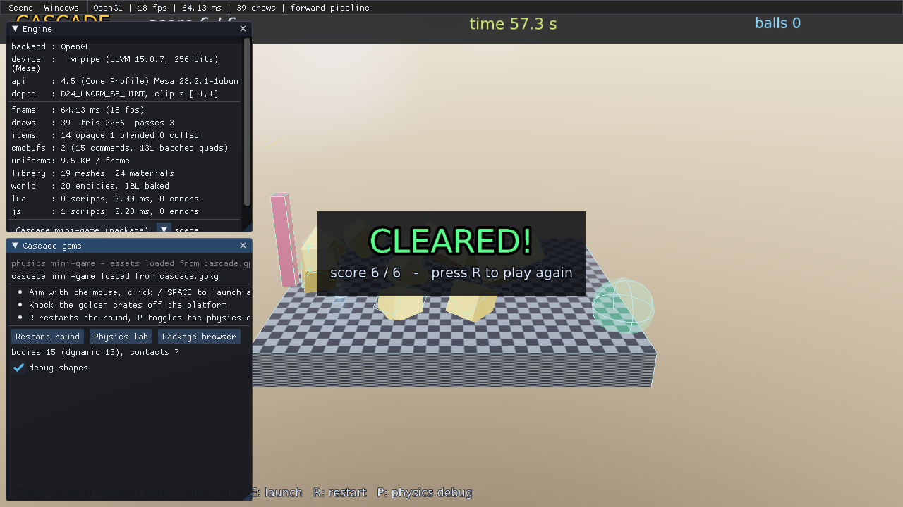 |
| 刚体 / 球盒平面胶囊 / 铰链 / 触发器 + 独立功能页 | `.gpkg` 运行时加载 + JS 玩法脚本 + 物理小游戏 |
| **Asset package browser** | **Gaussian splat lab** |
| 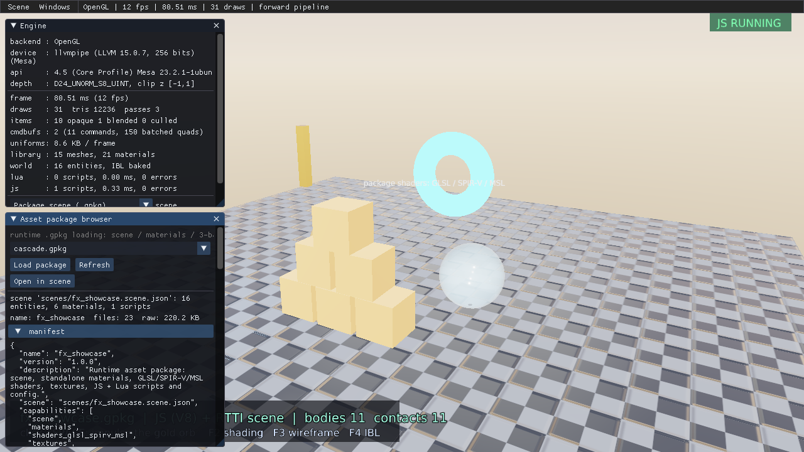 | 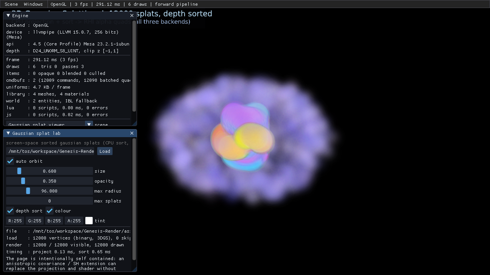 |
| scene / 材质 / 三端 shader / 贴图 / 脚本 / 配置 | 3DGS PLY、深度排序、屏幕空间高斯泼溅 |

## v5 新增功能

| Animation lab | Ray tracing lab |
|---|---|
| 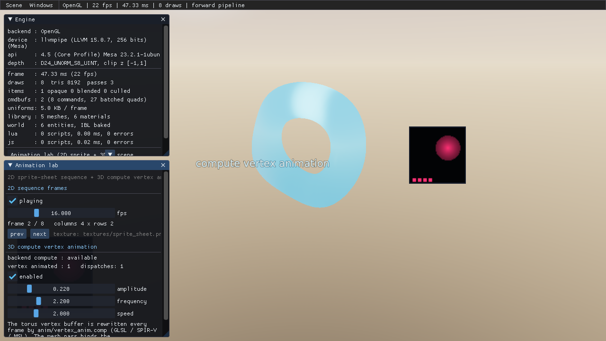 | 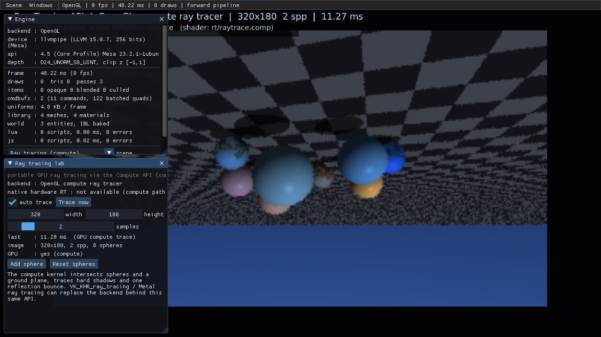 |
| 2D 序列帧 + 3D compute 顶点动画 | 跨后端 GPU compute 光线追踪（阴影 + 反射） |
| **Media player (libavcodec)** | **Encoder / Decoder lab** |
| 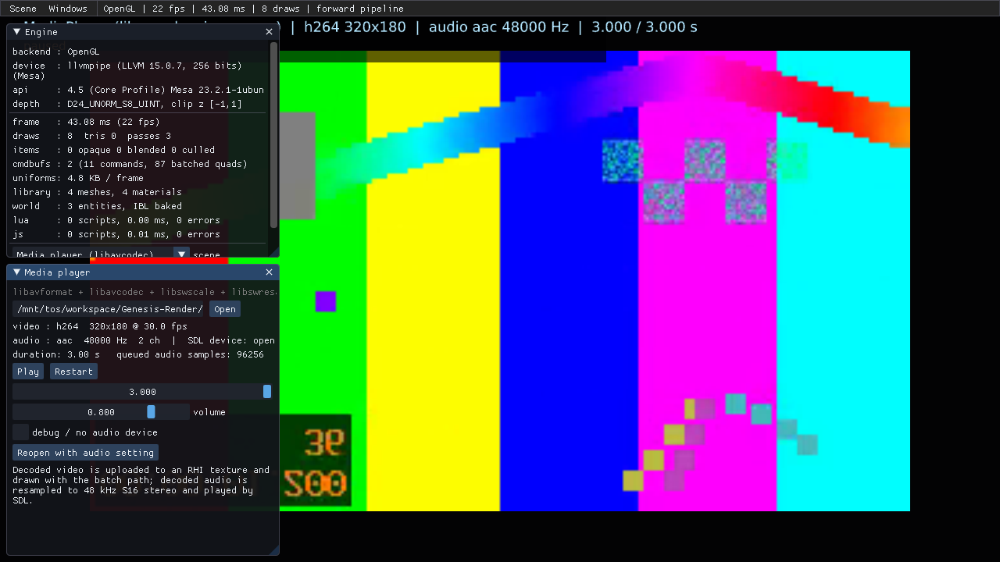 | 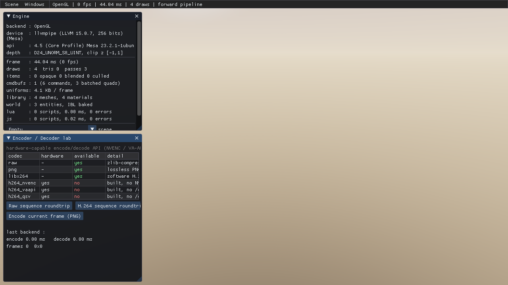 |
| 进程内 H.264/AAC 解码 + SDL 音频播放 | Raw/PNG/H.264（libavcodec）+ 硬件编码器探测 |
| **Engine APIs (4)** | |
| 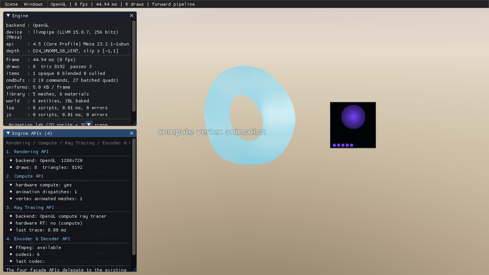 | |
| Rendering / Compute / RayTracing / EncoderDecoder | |

## 快速开始

```bash
# Linux: 可选依赖（容器内无 dev 头文件时）
scripts/fetch_deps.sh            # SDL2 / Vulkan headers + V8 (libnode)，写入 ../deps/prefix
scripts/fetch_lavapipe.sh        # 可选：容器无 Vulkan ICD 时启用软件 Vulkan
./build.sh                       # 自动探测 ../deps/prefix
./build.sh --test                # OpenGL + Vulkan + 跨后端逐像素比对

# macOS
xcode-select --install
brew install cmake sdl2
# 可选：LunarG Vulkan SDK（MoltenVK + validation layers）；重新生成着色器需 glslang + spirv-cross

# Linux (Ubuntu 22.04)
sudo apt-get install -y build-essential cmake libsdl2-dev zlib1g-dev
sudo apt-get install -y libvulkan-dev mesa-vulkan-drivers xvfb   # 可选 Vulkan

./build.sh                     # Release，当前平台可用的全部后端 → build/bin/
./build.sh --test              # 构建 + 全部测试（三后端 + 跨后端像素比对）
./build.sh --test --validation # 同上，打开 Vulkan layer / GL 错误检查 / Metal 校验
./build.sh --demo metal        # 构建并运行 demo（gl | vulkan | metal）
./build.sh --no-js             # 不链接 V8（仅 Lua）
./build.sh --shaders           # 重新生成 17 个 shader 的三端产物（compute 需要 GL 4.3+）
```

## Demo

```bash
./build/bin/genesis_demo --backend metal                       # GLB PBR 查看器（默认）
./build/bin/genesis_demo --backend vulkan --scene showcase     # C++ showcase 场景 + 材质编辑器
./build/bin/genesis_demo --backend metal --scene result --model '/path/to/new model.glb'
./build/bin/genesis_demo --backend metal --scene lua           # 完全由 Lua(RTTI) 搭建的场景
./build/bin/genesis_demo --backend gl --scene commandbuffer    # Lua CommandBuffer / 自定义管线示例
./build/bin/genesis_demo --lab custom                          # 打开 CommandBuffer 实验室并启用自定义管线
./build/bin/genesis_demo --script my_scene.lua                 # 挂载任意 Lua 脚本（start/tick）
```

| 参数 | 说明 |
|---|---|
| `--backend gl\|vulkan\|metal` | 渲染后端（默认 gl；metal 仅 macOS） |
| `--scene result\|showcase\|lua\|commandbuffer\|physics\|game\|gaussian\|package\|animation\|raytracing\|media\|empty` | 初始场景（默认 result；运行时可在菜单 Scene 切换） |
| `--model FILE.glb\|FILE.gltf` | result 场景的初始模型；支持含空格的路径 |
| `--lab model\|material\|commandbuffer\|custom\|text\|inspector\|physics\|gaussian\|package\|game\|animation\|raytracing\|media\|codec\|apis` | 启动时打开的功能面板 |
| `--package FILE.gpkg` | 指定 `--scene package` / `game` 使用的资源包 |
| `--script FILE.lua\|FILE.js` | 额外挂载一个脚本实体（按扩展名选择 Lua / JS） |
| `--screenshot out.png` / `--frames N` | 渲染若干帧后截图退出（含 UI） |
| `--showcase DIR` | headless 生成一组能力证明图 |
| `--validation` | 打开后端校验 |
| `--selftest` | 自动遍历全部场景、面板与交互路径后退出（有错误则非零退出码） |
| `--tour` | 约 16 秒的自动功能演示（材质实时编辑 → 自定义管线 → SDF 文字 → Lua 场景） |
| `--record DIR [--record-fps F]` | 以固定时间步把每帧保存为 `DIR/frame_NNNN.png`（配合 `--tour` 录制演示） |
| `--width/--height`、`--headless`、`--no-ui`、`--no-script`、`--asset-dir` | 常规选项 |

界面入口（菜单 Windows）：**Engine**（后端/设备/统计/截图）、**Render settings**（反射生成）、**Hierarchy / Inspector**（反射编辑任意组件）、**Material editor**（材质库、实时预览、参数、纹理槽、指定给实体）、**CommandBuffer lab**（渲染到纹理的安防摄像头、后处理、自定义管线效果链/画中画/分屏）、**SDF text lab**（2D/3D 文字）、**Physics lab**（暂停/单步/重力/求解迭代、碰撞体调试、生成刚体、接触列表）、**Gaussian splat lab**（PLY 加载、尺寸/透明度/排序/裁剪 + 统计）、**Asset package browser**（运行时加载 `.gpkg`、查看 manifest/文件、载入场景）、**Cascade game**（小游戏入口/重开）、**Animation lab**（2D 序列帧 + 3D compute 顶点动画）、**Ray tracing lab**（GPU compute 光线追踪）、**Media player**（libavcodec 进程内视频 + SDL 音频播放）、**Encoder / Decoder lab**（硬件能力探测 + Raw/PNG/H.264 编解码）、**Engine APIs (4)**（四大 API 能力总览）、**Lua / JS console**（双语言示例片段）、Log、Controls。
快捷键：拖拽左键环绕、滚轮缩放、F1 UI、F2 着色模型、F3 线框、F4 IBL、F5 自定义管线、F6 下一个后处理、ESC 退出。

**GLB PBR 查看器**：保留四个材质参考球，场景中一次展示一个目标模型。
在 **GLB model / Transform** 下拉框分别选择 `result.glb` / `result (1).glb`；
使用 **Browse...**、路径输入或将文件拖入窗口来加载新的 GLB/glTF。
拖拽 Position / Rotation / Scale 数值即可调整整个目标；支持统一缩放、自动取景和复位落地。
加载失败保留当前模型，同一文件再次选择会复用资源并保留 Transform。
操作说明、工程审查和回归结果见 [`docs/GLB_VIEWER.md`](docs/GLB_VIEWER.md)。

## 脚本示例（纯 RTTI）

```lua
function start()
  local cam = world:create("Camera")
  cam:add("Camera").fov = 50
  cam:add("CameraController").distance = 8

  local sun = world:create("Sun"):add("Light")
  sun.type = "directional"; sun.intensity = 3.5
  world:create("Sky"):add("Environment").hdr = asset("textures/sky_equirect.hdr")

  local gold = renderer:createMaterial("gold")
  gold.base_color = color(1.0, 0.76, 0.33); gold.metallic = 1; gold.roughness = 0.2
  local ball = world:create("Ball")
  ball:setMesh(renderer:createMesh("sphere", 1.0), gold)
  local label = ball:add("Text")
  label.text = "gold"; label.offset = vec3(0, 0.8, 0)

  hud = CommandBuffer.new("hud")
  renderer:addCommandBuffer("overlay", hud)
end

function tick(dt)
  hud:clear()
  hud:drawText(string.format("%s  %.0f fps", engine.backend, engine.fps), 20, 20, 24, color(1, 1, 1))
end
```

JavaScript 使用同一套 RTTI（`obj.prop` / `obj.method(...)`）：

```js
function start(id) {
  const m = renderer.createMaterial("js gold");
  m.base_color = color(1.0, 0.76, 0.33, 1.0); m.metallic = 1; m.roughness = 0.2;
  const e = world.create("Ball");
  e.setMesh(renderer.createMesh("sphere", 1.0), m);
  const rb = e.add("RigidBody"); rb.type = "dynamic";
  const col = e.add("Collider"); col.shape = "sphere"; col.radius = 0.5;
}
function tick(dt, id) {
  if (input.keyPressed("space")) physics.applyImpulse(world.find("Ball"), vec3(0, 8, 0), vec3(0, 1, 0));
}
```

更多：`assets/scripts/scene_builder.lua`（完整场景）、`assets/scripts/commandbuffer_demo.lua`（渲染到纹理 + 自定义管线）、
`assets/packages/cascade_src/scripts/cascade.js`（完整小游戏），在 demo 的 Lua / JS console 中还可运行内置示例片段。

## 架构

```
demo / tests
Engine            input → UI → device.beginFrame → world.update → render → endFrame
ECS · Script(Lua 5.4 + JS/V8 + 通用 RTTI 绑定) · Reflection · UI(ImGui on RHI + Inspector) · Text(SDF)
Physics           RigidBody · Collider(sphere/box/plane/capsule) · HingeJoint · 顺序冲量求解器
Scene/Package     JSON scene loader · .gpkg 运行时挂载/解包 · 材质文件 · 三端 shader
Renderer          RenderSystem · FrameExecutor(Forward/Custom) · CommandBuffer · Material
                  RenderTexture · FrameAllocator(动态 UBO 环) · PipelineCache · IBL
Resource          glTF/GLB · FBX · OBJ · stb_image · 程序化网格 · AssetPackage(.gpkg)
Gaussian          PLY(3DGS) 解析 · 深度排序 · 高斯泼溅（独立功能页）
RHI               OpenGL 4.1 core │ Vulkan 1.1 (MoltenVK) │ Metal (Obj-C++/MSL)
Platform          SDL2 窗口/输入/计时        Foundation: math / log / file
```

| 文档 | 内容 |
|---|---|
| [`架构设计文档.md`](架构设计文档.md) | **完整架构**：分层、类关系图、帧时序、三后端约定、材质/CommandBuffer/RTTI/文字/UI 设计、demo 入口、问题根因与修复 |
| [`ARCHITECTURE.md`](ARCHITECTURE.md) | 英文概要 |
| [`docs/BUILD.md`](docs/BUILD.md) | 构建、依赖、着色器生成、校验环境 |
| [`docs/TEST_REPORT.md`](docs/TEST_REPORT.md) | 本机编译运行与测试报告 |
| [`docs/VERIFICATION.md`](docs/VERIFICATION.md) | 每项能力的验证方法与效果图 |
| [`docs/PBR.md`](docs/PBR.md) | PBR / IBL 数学 |
| [`docs/ASSET_PACKAGES.md`](docs/ASSET_PACKAGES.md) | `.gpkg` 格式、离线制作、scene/材质/三端 shader/脚本/配置、运行时挂载 |
| [`docs/JS_SCRIPTING.md`](docs/JS_SCRIPTING.md) | V8 集成、与 Lua 的能力对齐、API、示例、限制 |
| [`docs/PHYSICS.md`](docs/PHYSICS.md) | 刚体/碰撞体/接触求解/铰链/触发器、Physics lab、测试 |
| [`docs/GAUSSIAN_SPLATTING.md`](docs/GAUSSIAN_SPLATTING.md) | 3DGS 实现、限制与后续扩展路线 |
| [`docs/BACKEND_COMPATIBILITY.md`](docs/BACKEND_COMPATIBILITY.md) | 新增能力的三后端兼容矩阵与验证方法 |
| [`docs/ANIMATION.md`](docs/ANIMATION.md) | 2D 序列帧 + 3D compute 顶点动画、组件、三端实现与测试 |
| [`docs/FOUR_APIS.md`](docs/FOUR_APIS.md) | Rendering / Compute / Ray Tracing / Encoder-Decoder 四大 API |
| [`docs/RAY_TRACING.md`](docs/RAY_TRACING.md) | 跨后端 GPU 光线追踪实现与扩展点 |
| [`docs/ENCODER_DECODER.md`](docs/ENCODER_DECODER.md) | 硬件编解码能力探测、软件回退与 API |
| [`docs/CASCADE_GAME.md`](docs/CASCADE_GAME.md) | Cascade 小游戏：包内容、玩法、物理、脚本与验证 |
| [`docs/REQUIREMENT_CHECKLIST.md`](docs/REQUIREMENT_CHECKLIST.md) | v4 / v5 全部子任务 → 实现 / 入口 / 测试 / 文档对照表 |
| [`docs/legacy/`](docs/legacy) | 历史文档（v1、v2.0 架构与 Piccolo 差距分析） |

## 目录

```
CMakeLists.txt / build.sh           构建（后端开关、依赖探测）
scripts/build_shaders.py            单源 GLSL → GLSL410 / SPIR-V / MSL
scripts/fetch_deps.sh               Linux 可选依赖（SDL2/Vulkan 头文件 + V8 + libav*）
scripts/fetch_lavapipe.sh           软件 Vulkan ICD（无驱动的容器）
scripts/fetch_shader_tools.sh       glslangValidator + spirv-cross
scripts/build_demo_packages.sh      重建示例 .gpkg 与 3DGS 样例
tools/genesis_pack.py               .gpkg 构建 / 校验 / 列表 / 解包
tools/gen_gsplat.py                 3DGS PLY 生成
assets/{models,textures,fonts,scripts}
assets/packages/                    cascade.gpkg / fx_showcase.gpkg + *_src 可编辑源
assets/splats/                      genesis_gaussians.ply
assets/media/                       sample.mp4（H.264 + AAC，离线生成）
src/genesis/rhi/{opengl,vulkan,metal}
src/genesis/renderer                渲染系统、CommandBuffer、材质、RT、帧资源、管线缓存、Gaussian splat、shaders/
src/genesis/physics                 刚体、碰撞体、铰链、求解器
src/genesis/scene                   JSON scene 加载
src/genesis/resource                glTF/FBX/OBJ/图片 + asset_package(.gpkg)
src/genesis/reflection              RTTI 核心 + 引擎类型注册
src/genesis/script                  Lua VM、V8 JavaScript、沙箱、通用反射绑定
src/genesis/text                    SDF 字体
src/genesis/ui                      ImGui RHI 渲染器 + 反射 Inspector
src/genesis/api                      Rendering / Compute / RayTracing / EncoderDecoder API
src/genesis/animation                2D 序列帧 + 3D compute 顶点动画系统
src/genesis/{ecs,engine,platform_layer,foundation_layer}
demo/                               main.cpp · demo_app.{hpp,cpp} · demo_ui.cpp
tests/                              CPU + GPU(三后端) + 跨后端比对
docs/images/                        showcase 图、features/ 与 v4/ 功能截图
```

## 许可证

第三方依赖遵循各自许可证（imgui、Lua 5.4、cgltf、stb、VMA：MIT；SDL2、zlib：zlib）。引擎代码沿用仓库原有许可。
