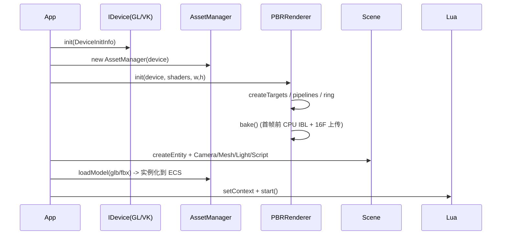
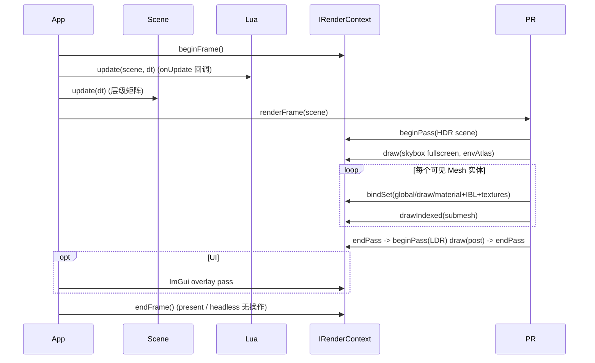

# Genesis Render —— 架构说明与升级文档

> 目标：在原有相机滤镜 Demo（Vulkan/SDL2 单后端）基础上，对齐 **Piccolo 引擎** 的
> PBR/IBL 渲染能力，落地一套**可切换 OpenGL 4.x / Vulkan 双后端、可导入
> glTF/FBX、支持实时 UI 与 Lua 脚本的 ECS 引擎内核**。
>
> 本文覆盖：架构分层、类图、模块说明、关键时序图、多后端抽象、资源管线、
> ECS/脚本、IBL 烘焙与跨后端一致性处理。

---

## 1. 总体分层

```
                ┌──────────────────────────────────────────────┐
                │  应用层 (demo/main.cpp)                      │
                │  - 参数解析 / 场景搭建 / 相机 / 导入按钮       │
                └──────────────────────────────────────────────┘
                                      │
                ┌─────────────────────▼───────────────────────┐
                │  ECS + 脚本 + UI                            │
                │  ecs/(Registry,Scene,Comp) script/(Lua)     │
                │  ui/editor_ui.hpp (ImGui 面板)              │
                └─────────────────────┬───────────────────────┘
                                      │ Scene / Entity / Component
                ┌─────────────────────▼───────────────────────┐
                │  渲染层 render/                             │
                │  PBRRenderer (forward + IBL + post)         │
                │  primitives / cpu_ibl / shaders             │
                └─────────────────────┬───────────────────────┘
                                      │ IDevice / IRenderContext
                ┌─────────────────────▼───────────────────────┐
                │  RHI (rhi/) —— 后端中立抽象                  │
                │  buffer/texture/pipeline/descriptor/fb       │
                └───────┬───────────────────────────────┬─────┘
                        │                               │
            ┌───────────▼─────────┐         ┌───────────▼──────────┐
            │ rhi_opengl.cpp     │         │ rhi_vulkan.cpp       │
            │ GL 4.1 core/EGL    │         │ Vulkan 1.0 / VMA     │
            │ (窗口 GL / 无头)   │         │ (swapchain / 无头)   │
            └─────────────────────┘         └──────────────────────┘
                        │                               │
                ┌───────▼───────────────────────────────▼─────┐
                │  平台 application_layer (SDL2)              │
                │  foundation_layer (log/memory/file/service) │
                │  resource (glTF cgltf + FBX Assimp + 贴图)  │
                └─────────────────────────────────────────────┘
```

与 Piccolo 的对应关系（升级参考）：

| Piccolo 模块 | Genesis 对应 |
|---|---|
| GObject/Component + ObjectID | `ecs/registry.hpp`（稀疏组件池）+ `Entity` + `Scene` |
| RenderSystem / World 数据桥 | `PBRRenderer::renderFrame(Scene&)`（ECS 直接遍历，无反射代码生成） |
| MeshComponent / GpuMesh | `MeshComponent` + `GpuModel/GpuMesh`（`resource/asset_manager.cpp`） |
| PBR material json | `MaterialDesc/MaterialUBO`（程序化 + glTF PBR 因子） |
| offline IBL（cmgen + lut） | `render/cpu_ibl.hpp` **运行时 CPU 卷积**，六面 atlas |
| LuaComponent + sol2 | `script/lua_engine.cpp`（Lua 5.4 C API，无第三方绑定库） |
| Editor UI (ImGui) | `ui/editor_ui.cpp`：层级/检查器/资产/渲染设置 |
| VulkanRHI / RHI 接口 | `rhi/rhi.hpp`（`IDevice/IRenderContext/IBuffer/...`） |

---

## 2. RHI 抽象（多后端核心）

### 2.1 接口对象

`src/genesis/rhi/rhi.hpp`：

```
IDevice                         GLDevice / VKDevice
 ├─ Buffer        IBuffer       (vertex/index/uniform, host ring)
 ├─ Texture       ITexture      (2D/Cube/RT/Depth, RGBA8/16F/32F/D32F)
 ├─ BindingSetLayout
 ├─ BindingSet                  (flat binding table, 见下)
 ├─ ShaderProgram (vs+f/spv)
 ├─ Pipeline      IPipeline
 ├─ FrameBuffer   IFrameBuffer
 └─ RenderContext IRenderContext
       beginPass / endPass / bindPipeline / bindSet /
       bindVertexBuffer / bindIndexBuffer / draw / drawIndexed
```

### 2.2 扁平绑定表（一份 GLSL 同时服务两个后端）

shader 全部写 `layout(set=0, binding=N)`，Vulkan 直接使用；
OpenGL 后端在编译时正则去掉 `set=` 标记并保留 `binding=N`
（`rhi_opengl.cpp::GLDevice::preprocess`），binding 号即纹理单元。

```
binding 0  GlobalBlock  (viewProj/light/camera, dynamic UBO)
binding 1  DrawBlock    (model/normalMatrix/tint,  dynamic UBO)
binding 2  MaterialBlock(PBR 参数, dynamic UBO)
binding 10 EnvAtlas     (天空六面横向 atlas)
binding 11 IrrAtlas     (漫反射 IBL atlas)
binding 12 PrefAtlas    (预滤波镜面 IBL atlas, 带 mip)
binding 13 BRDF LUT
binding 20..24 albedo / normal / metallicRoughness / ao / emissive
binding 30 sceneColor  (后处理)
binding 31 equirect    (烘焙)
```

- Vulkan：descriptor 集合持久化（每个材质一个 set，只写一次，
  动态 UBO 偏移每帧在 `vkCmdBindDescriptorSets` 传入）。
- OpenGL：UBO 用 `glBindBufferRange` + 每帧 shadow buffer
  上传（软件驱动下 persistently-mapped 行为不可靠）。

### 2.3 无头（headless）模式

`DeviceInitInfo::headless=true` 时：
- **Vulkan**：不创建 surface/swapchain，渲染到离屏 RGBA8 texture，
  `readTextureRGBA8` 回读，便于 CI 截图验证。
- **OpenGL**：EGL pbuffer 上下文（`rhi_opengl.cpp` 中 `GENESIS_EGL_HEADLESS`），
  同样离屏渲染。

### 2.4 软件驱动兼容处理（llvmpipe / lavapipe）

在纯软件 GPU 上踩坑并处理：
- **llvmpipe 多个 FBO 挂同一 cubemap 时只有第一个面可写**
  → GL 后端对同一纹理共享一个 FBO，在 `beginPass` 按
  (mip/layer) 重新 `glFramebufferTexture2D/Layer`。
- **lavapipe 对 cubemap RT、sampler 数组、高迭代 GGX shader 会段错误**
  → IBL 改为 **CPU 卷积**（`cpu_ibl.hpp`），结果存 2D atlas。
- **lavapipe 异步管线编译/描述符高负载偶发崩溃** → descriptor set
  持久化 + 只写一次；测试脚本对 VK 做有限重试（GL 为严格判定后端）。
- macOS/GL 4.1 兼容：preprocess 在缺少 `layout(binding)` 时
  有 block/sampler 反射回退路径。

---

## 3. 类图（核心）

```
Scene
 ├─ Registry registry
 │    ├─ unordered_map<Entity, TransformComponent>
 │    ├─ ... MeshComponent / CameraComponent / LightComponent
 │    ├─ ... TagComponent / ScriptComponent
 │    └─ view<A,B...>()  —— 稀疏交集遍历
 ├─ mainCamera, activeLight
 └─ update(dt): Transform 层级 -> world 矩阵

MeshComponent
 ├─ GpuModel* model
 │    ├─ vector<GpuMesh*> draws   {indexOffset,count,node,material*}
 │    ├─ vertex/index IBuffer
 │    └─ bounding
 ├─ Vec3 tint; int node
 └─ visible

PBRRenderer
 ├─ IDevice* dev_ ; ShaderLibrary*
 ├─ sceneColor_(RGBA16F) + sceneFBO_      HDR
 ├─ screenColor_(RGBA8) + screenFBO_      LDR
 ├─ envAtlas_/irrAtlas_/prefAtlas_/brdfLUT_ (CPU IBL 结果)
 ├─ ring_  (2MB UBO ring, 3 arenas)
 ├─ sky/pbr/post pipelines + binding sets
 ├─ bake()         —— CPU IBL 上传
 └─ renderFrame(Scene&, uiCallback)
       HDR scene pass -> tonemap/post -> (UI overlay)

AssetManager
 ├─ loadModel(path) -> GpuModel   (glTF via cgltf / FBX via Assimp)
 ├─ createMeshModel(MeshData)     (程序化图元)
 ├─ loadTexture* / default 贴图
 └─ 路径解析 (相对/绝对, .gltf 内嵌/外链)

LuaEngine
 ├─ lua_State* (Lua 5.4)
 ├─ genesis.* 绑定: log/findEntity/key/input/time
 ├─ 组件 getter/setter: position/euler/scale
 └─ update(Scene, dt)  每实体 onUpdate(path, e, dt)
```

---

## 4. 关键时序

### 4.1 启动



### 4.2 每帧



### 4.3 模型导入

```
.glb/.gltf ──cgltf──┐
                    ├─> MeshData(顶点/索引/材质/节点树)
.fbx/.obj ─Assimp──┘        │  (generateTangents, 法线补全)
                             ▼
                    AssetManager::uploadModel
                             │
            IBuffer(vertex/index) + Material(UBO+贴图)
                             ▼
                    GpuModel { draws[] }  ──> MeshComponent
```

---

## 5. PBR 光照模型

`assets/shaders/pbr.frag` 由 `frame.params.w` 选择：

- **0 = Cook-Torrance（Blinn-Phong H 半程向量）**
  - D：GGX/Trowbridge-Reitz
  - G：Smith-Schlick-GGX（直接光 k=(r+1)²/8）
  - F：Schlick，金属把 F0 混入 albedo
  - 漫反射：`kd*(1-metal)*albedo/PI`
  - 方向光 + 最多 4 个点光源
- **1 = 经典 Blinn-Phong**（fresnel + 金属染色，作为对照模型）
- **间接光 = Split-Sum**
  - `irradiance atlas` 漫反射卷积
  - `prefiltered atlas`（8 mip，粗糙度选择层级）
  - `BRDF LUT`（scale/bias 两通道）

调试开关在 UI「Render」面板：`directOn / iblOn / exposure / iblStrength /
envRotation / lightingModel`，对应 `FrameUBO.misc/params`。
`--scenario {basic,nodirect,noibl,blinn,dark}` 用于无头回归。

### CPU IBL（`render/cpu_ibl.hpp`）

```
equirect(1024x512, 程序化生成)
   ├─ buildEnvFaces     6×128   直接重采样
   ├─ buildIrrFaces     6×32    半球余弦卷积
   ├─ buildPrefilter   6×128, 8 mip, GGX 重要性采样(32spp)
   └─ buildBRDFLUT      128²    G/VdH + Schlick
        │  RGBA32F CPU -> ITexture::uploadRGBA16F(per mip)
        ▼
   envAtlas(768x128) / irrAtlas(192x32) / prefAtlas(768x128,mips) / brdfLUT
```
shader 内 `envDirToFaceUV(dir)->(face,uv)`，atlas 坐标
`vec2((face+uv.x)/6, uv.y)`，两后端同一份数学。

---

## 6. ECS 与脚本

- Registry：每个组件类型一个 `unordered_map<Entity,T>`，
  `view<A,B>` 以第一个池迭代 + 其余 O(1) 查找；无 STL RTTI。
- 层级：父子 Transform 在 `Scene::update` 求 world；
  导入模型时每个节点生成一个实体（`instantiateModel` + TRS 分解）。
- Lua：
  - 沙箱基础库 `base/string/math`；
  - 组件路径式访问（`get/set_float("TransformComponent.m_pos.x")` 兜底）
    + 直接 `e.position/eulerAngle/e.scale`；
  - 输入 `genesis.key(KEYS.W)`、`genesis.input.mouseDX()`、`genesis.time()`；
  - 脚本生命周期 `onStart`（可选）+ `onUpdate(e,dt)`。
  - 示例：`assets/scripts/rotate.lua`。

---

## 7. 构建 / 运行 / 验证

```bash
cmake -S . -B build -DCMAKE_BUILD_TYPE=Release
cmake --build build -j

# 交互窗口
build/GenesisDemo --opengl
build/GenesisDemo --vulkan

# 无头回归（CI）
bash scripts/run_headless_tests.sh
```

CLI：`--backend/--opengl/--vulkan --headless --width --height
--frames --screenshot out.png --scenario S --model path`。

shader 在构建期由 glslangValidator 编成 SPIR-V（Vulkan 用）；
OpenGL 运行时读同名 GLSL 源码（去掉 `set=` 前缀）。
资产同时拷贝到 `build/assets`，可执行文件旁优先查找该目录。

---

## 8. 后续可继续对齐 Piccolo 的方向

1. 反射代码生成（libclang）替代手动组件注册；
2. GBuffer 延迟管线（目前为 forward + HDR/post）；
3. 阴影（方向光 shadow map + PCF）；
4. 动画（glTF skeletal / Assimp morph）；
5. JobSystem 多线程 + 帧数据双缓冲对齐；
6. MoltenVK / Windows D3D12 RHI（RHI 接口已后端中立）。
