# Genesis-Render 统一架构说明文档

> **文档版本**: v2.0（统一架构说明）
> **日期**: 2026-09-06
> **适用代码**: Genesis Render 2.0.0（`CMakeLists.txt` 中 `project(GenesisRender VERSION 2.0.0)`）
> **撰写依据**: 逐文件阅读改造后真实源码（`src/genesis/**`、`demo/`、`tests/`、`scripts/`、`cmake/`）、v1 原始代码（`src/demo1/**`、`src/genesis/application_layer/**`、`docs/legacy/CMakeLists_v1_original.txt`）、v1 原始文档（`docs/legacy/`）以及四份 Piccolo 源码分析报告（`/mnt/tos/workspace/work/docs/analysis/piccolo_*.md`，基于 Piccolo v0.0.9-16-gf505370）。
> 文中所有类名、函数名、文件路径、常量数值均摘自真实源码；引用路径为仓库根目录下的相对路径。

---

## 文档导航

| 部分 | 内容 | 适合读者 |
|---|---|---|
| **第一部分：Genesis-Render v1 现状架构（改造前）** | v1 分层、核心类、帧循环、模块清单、基于源码的问题与局限 | 需要了解改造起点与动机的读者 |
| **第二部分：Piccolo 参考引擎架构** | GAMES104 Piccolo（v0.0.9 快照）的分层/主循环/ECS/反射/渲染/资产/UI/脚本提炼 | 需要理解"对齐目标"的读者 |
| **第三部分：能力对齐差距分析（Gap Analysis）** | Piccolo vs Genesis v1 vs Genesis v2 的逐能力对比表与超越点标注 | 评审、项目管理者 |
| **第四部分：Genesis-Render v2 升级后架构（重点）** | RHI 双后端、着色器单源双方言、图像朝向约定、ECS、资产管线、渲染器、PBR/IBL、UI/脚本、构建、测试、完整帧时序、局限与路线 | 引擎开发者、后续维护者 |

### 版本信息

| 项 | v1（改造前） | v2（改造后，本文档主体） |
|---|---|---|
| CMake 工程名 | `VULKAN_RENDERER VERSION 0.1.0` | `GenesisRender VERSION 2.0.0` |
| 渲染后端 | 仅 Vulkan 1.0（MoltenVK 兼容宏） | OpenGL 4.1 core + Vulkan 1.1 双后端（RHI 抽象） |
| 平台 | 事实仅 macOS（demo1 依赖 OBJCXX/AVFoundation） | Linux / macOS 跨平台（SDL2） |
| 可执行目标 | `DEMO1`（相机滤镜演示） | `genesis_demo`（PBR 场景演示）、`genesis_tests`（45 个测试用例） |
| 场景组织 | 无（ImGui 面板 + 单相机纹理） | sparse-set ECS + RenderScene |
| 光照 | 无（滤镜后处理） | Cook-Torrance/Blinn-Phong PBR 直接光 + 运行时烘焙 split-sum IBL |
| 资产 | 无导入器（相机帧 BGRA 直传） | glTF/GLB（cgltf）、FBX（自研二进制解析 + zlib）、OBJ、png/jpg/tga/bmp/hdr（stb_image） |
| 脚本 | 无 | Lua 5.4 单虚拟机 + 沙箱 env + 43 个 `genesis.*` API |
| 测试 | 无 | 29 CPU + 16 GPU 用例 + 跨后端像素比对 |

### 术语表

| 术语 | 含义 |
|---|---|
| **RHI** | Render Hardware Interface，后端无关的渲染硬件抽象层（`src/genesis/rhi/`） |
| **ECS** | Entity-Component-System；Genesis v2 采用 sparse-set（稀疏集）存储 |
| **sparse set** | 组件存储结构：稀疏数组 EntityId→稠密下标 + 稠密数组存组件本体，O(1) 增删查 |
| **UBO** | Uniform Buffer Object（GLSL）/ Uniform Buffer（Vulkan），std140 布局 |
| **descriptor set** | Vulkan 的资源绑定单元；GL 后端以 uniform block index + texture unit 模拟 |
| **dynamic offset** | `UNIFORM_BUFFER_DYNAMIC` 绑定时在 bind 阶段传入的缓冲内偏移，用于 per-draw 数据环形缓冲 |
| **push constant** | Vulkan 的小容量 per-draw 常量；GL 后端用名为 `PushConstants` 的 std140 UBO（block binding 0）+ 3 槽轮转模拟 |
| **IBL** | Image Based Lighting，基于图像的光照（irradiance / prefiltered specular / BRDF LUT 三张贴图） |
| **split-sum** | UE4 提出的 IBL 近似：把渲染方程拆成"预滤波环境贴图 × BRDF 积分 LUT"两项 |
| **NDF** | Normal Distribution Function（法线分布函数），如 GGX / Blinn-Phong lobe |
| **equirect** | 等距柱状投影全景图（2:1 HDR 环境贴图） |
| **mip chain** | 纹理的逐级半分辨率链，prefilter 按粗糙度选 mip（LOD） |
| **NDC** | Normalized Device Coordinates；GL 深度 [-1,1]、Vulkan 深度 [0,1]，本文约定两后端 NDC y=-1 均对应 render target 第 0 行 |
| **swapchain** | 呈现链；GL 后端将"默认帧缓冲 + SDL_GL_SwapWindow"抽象为 swapchain |
| **present pass** | v2 中把 HDR 场景色调映射并合成 UI 后输出到 swapchain/capture 目标的渲染通道 |
| **tonemap** | 色调映射（None/Reinhard/ACES），配合曝光与 gamma 编码 |
| **sRGB / 线性** | 颜色纹理以 `RGBA8_SRGB` 格式上传（硬件解码为线性），数据纹理（法线/金属度/粗糙度/AO）用 `RGBA8_UNORM` |
| **glTF / GLB** | Khronos 运行时传输格式（JSON / 单文件二进制）；v2 用 cgltf 解析 |
| **FBX** | Autodesk Kaydara FBX；v2 为自研二进制解析器（无 FBX SDK / assimp） |
| **VMA** | VulkanMemoryAllocator（`src/external/vk_mem_alloc.h`），仅 Vulkan 后端内部使用 |
| **SPIR-V** | Vulkan 着色器字节码；由 `scripts/build_shaders.py` 调 glslangValidator 从 GLSL 450 变体生成 |
| **GLSL 410 / 450** | 单源双方言：OpenGL 变体 `#version 410`（macOS 上限），Vulkan 变体 `#version 450` |
| **headless** | 无呈现运行模式（隐藏 SDL 窗口 + offscreen 渲染 + 回读），供测试/CI |
| **Xvfb / llvmpipe / lavapipe** | 无 GPU 的 CI 验证环境：X 虚拟帧缓冲 + Mesa 软件光栅（GL）/ Vulkan 软件实现 |
| **GameObject-Component** | Piccolo 的实体模式：实体持有组件指针数组、逐对象 tick，非数据导向 ECS |
| **`$typeName`/`$context`** | Piccolo 反射序列化的多态 JSON 协议 |

---

# 第一部分：Genesis-Render v1 现状架构（改造前）

## 1.1 项目概述

Genesis Render v1 是一个基于 **Vulkan + SDL2** 的演示型渲染工程，核心功能是 **macOS 相机实时捕获 + 8 种滤镜（GPU 片元着色器实现，另附 CPU 参考实现）+ ImGui 面板显示**（`src/demo1/main.cpp` 打印的横幅为 "Genesis Camera Filter (GPU)"）。它具备一个雏形的基础层（服务单例、内存、日志、文件、动态数组）与一个薄应用层（SDL2 窗口），但**没有引擎层**：没有场景、没有 ECS、没有材质/模型资产管线，图形代码集中在 demo 内部并直接调用 Vulkan C API。

## 1.2 技术栈

| 类别 | 选型 | 证据（文件） |
|---|---|---|
| 图形 API | Vulkan 1.0（`apiVersion = VK_API_VERSION_1_0`），macOS 走 MoltenVK portability 扩展（`VK_KHR_PORTABILITY_ENUMERATION_EXTENSION_NAME`、设备扩展 `"VK_KHR_portability_subset"`） | `src/demo1/graphics/gpu_device.cpp` |
| 窗口/输入 | SDL2（`SDL_Vulkan_GetInstanceExtensions` / `SDL_Vulkan_CreateSurface`） | `src/genesis/application_layer/window.cpp`、`gpu_device.cpp` |
| UI | Dear ImGui（`imgui_impl_sdl` + `imgui_impl_vulkan`） | `docs/legacy/CMakeLists_v1_original.txt` 的 `GenesisExternal` |
| 内存 | 自研 `MemoryService/HeapAllocator`；`tlsf.c` 编入 external；VMA 头文件已 `#define VMA_IMPLEMENTATION` 编入但**无任何调用点** | `gpu_device.cpp:12-13` |
| 相机 | macOS AVFoundation（Objective-C++，`camera_capture.mm`），BGRA8 输出 | `src/demo1/camera/`、`src/demo1/CMakeLists.txt` |
| 着色器 | `filter.vert` / `filter.frag`（GLSL 450）离线编译为 SPIR-V 并以 `*.spv.h` C 数组入库 | `src/demo1/graphics/shaders/` |
| 语言标准 | C++17（`set_property(... CXX_STANDARD 17)`），demo1 另启用 `OBJCXX` | `docs/legacy/CMakeLists_v1_original.txt`、`src/demo1/CMakeLists.txt` |
| 构建 | CMake ≥ 3.24，`find_package(Vulkan REQUIRED)`；SDL2 仅 `if (UNIX)` 下查找 | `docs/legacy/CMakeLists_v1_original.txt` |
| Profiler | Tracy 宏定义（`TRACY_ENABLE/TRACY_ON_DEMAND/TRACY_NO_SYSTEM_TRACING`）已开启编译定义 | 同上 |

## 1.3 目录结构（v1）

```
Genesis-Render/
├── CMakeLists.txt                     # 备份于 docs/legacy/CMakeLists_v1_original.txt
├── src/
│   ├── genesis/
│   │   ├── foundation_layer/          # 基础层（v2 中保留并扩充）
│   │   │   ├── platform.hpp           # 平台宏（GENESIS_DEBUG_BREAK 等）
│   │   │   ├── service.hpp            # Service 基类 + GENESIS_DECLARE_SERVICE / GENESIS_SINGLETON_CLASS
│   │   │   ├── serviceManager.hpp/cpp
│   │   │   ├── memory.hpp/cpp         # MemoryService / Allocator / HeapAllocator / MemoryData
│   │   │   ├── log.hpp/cpp            # LogService + GenesisPrint 宏
│   │   │   ├── file.hpp/cpp           # FileService / FileDirectory / FileReadResult
│   │   │   ├── array.hpp              # Array<T>（Allocator 感知的动态数组）
│   │   │   ├── assert.hpp             # GENESISASSERT / GENESISASSERT_MSG
│   │   │   └── serialization_blob.hpp/cpp
│   │   └── application_layer/
│   │       └── window.hpp/cpp         # Window : Service（SDL2 窗口 + OS 消息回调数组）
│   ├── demo1/                         # 唯一可执行目标 DEMO1
│   │   ├── main.cpp                   # 主循环（相机 → 滤镜 → ImGui → present）
│   │   ├── camera/camera_capture.h/.mm# AVFoundation 捕获（CameraFrame / FrameCallback）
│   │   ├── filter/filter_system.h/cpp # 滤镜枚举/参数 + CPU 实现
│   │   └── graphics/
│   │       ├── gpu_device.hpp/cpp     # Vulkan 设备/交换链/帧循环/ImGui 初始化
│   │       ├── gpu_resources.hpp      # Buffer/Texture/Sampler/ShaderState 句柄与 CreateInfo（未被实现消费）
│   │       ├── gpu_enum.hpp           # TextureType / ResourceUsageType 等枚举
│   │       ├── camera_texture.h/cpp   # 相机帧 → Vulkan 纹理（staging + layout 转换 + descriptor）
│   │       ├── filter_renderer.h/cpp  # 离屏滤镜 pass（裸 vkCmd* 录制）
│   │       ├── genesis_imgui.hpp/cpp  # ImGuiService（SDL 平台后端 + 样式 + log/fps 面板）
│   │       └── shaders/filter.{vert,frag}(+ .spv.h)
│   └── external/                      # imgui、tlsf、vk_mem_alloc.h（v1 仅用到 imgui/tlsf/VMA 头）
```

## 1.4 分层架构图（v1）

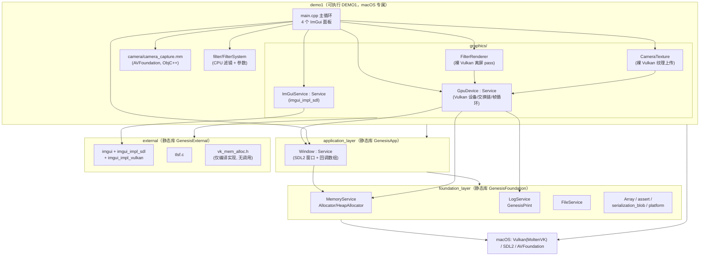

> 注意：v1 的"分层"仅是 CMake 目标划分（`GenesisFoundation`/`GenesisApp`/`GenesisExternal`/`DEMO1`），**图形能力没有独立库层**——`GpuDevice` 等全部位于 demo 目标内部。

## 1.5 核心类图（v1，成员与方法摘自源码）

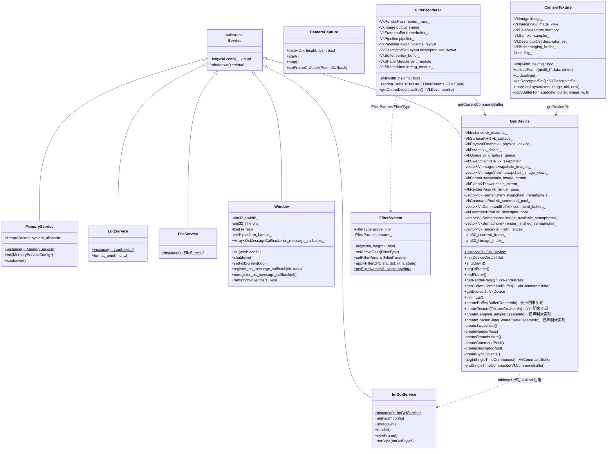

**关键源码事实**（`src/demo1/graphics/gpu_device.hpp:64-76`）：

```cpp
/*resources create & destroy*/
BufferHandle createBuffer(const BufferCreateInfo &desc);
void destroyBuffer(BufferHandle handle);
TextureHandle createTexture(const TextureCreateInfo &desc);
...
ShaderStateHandle createShaderState(const ShaderStateCreateInfo &desc);
```

这四个资源工厂方法**只有声明，整个 `src/demo1/` 中没有任何定义**（已 grep 确认）。`gpu_resources.hpp` 中配套的 `Buffer/Texture/Sampler/ShaderStage` 结构体（含 `VmaAllocation` 成员）与 Builder 风格 `*CreateInfo` 类因此全部是死代码；`gpu_device.cpp` 顶部 `#define VMA_IMPLEMENTATION` 编入了 VMA，但没有任何 `vmaCreate*` 调用点。实际的纹理/管线资源由 `CameraTexture`、`FilterRenderer` 各自用裸 `vkCreateImage/vkAllocateMemory/vkCreateGraphicsPipelines` 实现。

## 1.6 帧渲染时序图（v1）

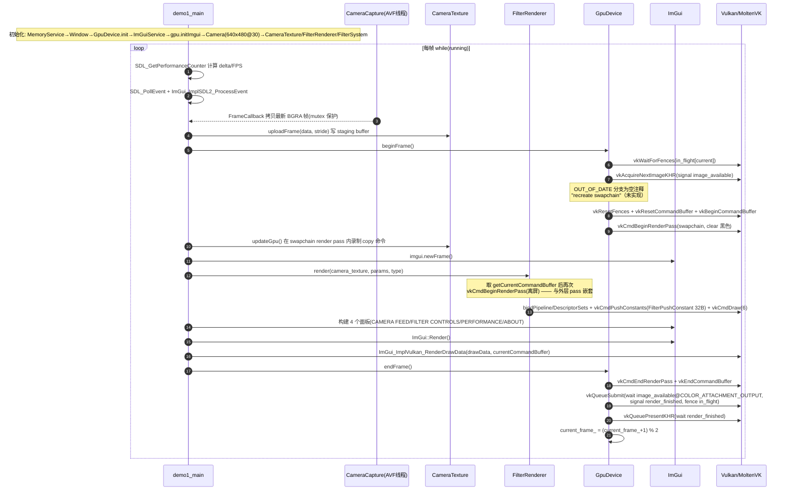

## 1.7 各模块功能说明表（v1）

| 模块 | 文件 | 功能 | 关键实现细节 |
|---|---|---|---|
| 服务框架 | `foundation_layer/service.hpp` | 单例服务模式 | `GENESIS_DECLARE_SERVICE(Type)` 展开为 `static Type* instance();`；`GENESIS_SINGLETON_CLASS` 删除拷贝/移动并私有化构造 |
| 内存 | `foundation_layer/memory.hpp/cpp` | 统一分配入口 | `MemoryService::system_allocator`（`HeapAllocator`）；TLSF 源文件编入 external 但未接入 |
| 日志 | `foundation_layer/log.hpp/cpp` | printf 风格日志 | `GenesisPrint` 宏 → `LogService::format_print`；无级别/无彩色/无回调 |
| 文件 | `foundation_layer/file.hpp/cpp` | 文件读取 | `FileService`、`FileReadResult`；demo 实际未使用 |
| 容器 | `foundation_layer/array.hpp` | `Array<T>` | Allocator 感知动态数组；仅 `Window` 的回调列表使用 |
| 窗口 | `application_layer/window.hpp/cpp` | SDL2 窗口 | `WindowConfig{width,height,title,allocator}`；`register_os_message_callback` 多播数组；`refresh_` 记录刷新率（1/60 默认） |
| GPU 设备 | `demo1/graphics/gpu_device.*` | Vulkan 实例/设备/交换链/帧循环 | `MAX_FRAMES_IN_FLIGHT = 2`；swapchain 格式优先 `B8G8R8A8_UNORM + SRGB_NONLINEAR`，present 模式优先 MAILBOX；物理设备直接取 `physicalDevices[0]`（无评分）；描述符池 11 种类型 ×1000；`initImgui()` 用一次性命令缓冲上传字体后 `vkDeviceWaitIdle` |
| ImGui 服务 | `demo1/graphics/genesis_imgui.*` | SDL 平台后端 + 样式 | `ImGuiStyles{Classic,DarkRed,DarkGold,GreenBlue}`；附 `imgui_log_*` / `imgui_fps_*` 辅助面板函数 |
| 相机捕获 | `demo1/camera/camera_capture.mm` | AVFoundation 视频采集 | `CameraFrame{data(BGRA),width,height,bytesPerRow,timestamp}`；串行 dispatch queue 回调；demo 以 640×480@30 运行 |
| 相机纹理 | `demo1/graphics/camera_texture.*` | CPU 帧 → GPU 纹理 | HOST_VISIBLE staging + 逐行 memcpy（处理 stride）；`transitionLayout` + `copyBufferToImage`；descriptor set 供 ImGui::Image 显示 |
| 滤镜渲染器 | `demo1/graphics/filter_renderer.*` | GPU 后处理 | 独立离屏 render pass/framebuffer/输出纹理；全屏四边形（6 顶点）；`FilterPushConstant{filterType,brightness,contrast,saturation,intensity,sigma,padding[2]}`（32B）经 `vkCmdPushConstants` 传入 `filter.frag` |
| 滤镜系统 | `demo1/filter/filter_system.*` | 滤镜枚举 + CPU 参考实现 | `FilterType{None,Grayscale,GaussianBlur,SobelEdge,Invert,Sepia,Sharpen,Emboss}`；CPU 路径实现 Grayscale/Invert/Sepia/Sharpen/Emoss/BrightnessContrast |
| 主程序 | `demo1/main.cpp` | 装配 + 主循环 | 全局 `g_frame_mutex/g_latest_frame/g_new_frame_available` 传递相机帧；4 个 ImGui 面板；FPS 每秒统计 |

## 1.8 现状问题与局限清单（基于源码的客观陈述）

### A. 平台与后端

| # | 问题 | 源码证据 |
|---|---|---|
| A1 | **仅 Vulkan 单后端**，无 GL/其他抽象；所有图形代码硬编码 `vk*` 调用 | `gpu_device.cpp`、`camera_texture.cpp`、`filter_renderer.cpp` 通篇 Vulkan C API |
| A2 | **事实仅 macOS**：demo1 `enable_language(OBJCXX)`、`camera_capture.mm`、链接 `-framework AVFoundation/Foundation/CoreMedia/CoreVideo`；根 CMake 仅在 `if (UNIX)` 下找 SDL2，无 Linux/Windows 特定处理，也无任何非 macOS 可运行的可执行目标 | `src/demo1/CMakeLists.txt:8,22,55-60`、`docs/legacy/CMakeLists_v1_original.txt:6-8` |
| A3 | 构建系统不跨平台：`find_package(Vulkan REQUIRED)` 硬性依赖、无后端开关、无测试目标、无 headless 模式；shader 以手工生成的 `*.spv.h` 入库但**无生成脚本** | `docs/legacy/CMakeLists_v1_original.txt` |
| A4 | 无窗口 resize 处理：`beginFrame`/`endFrame` 中 `VK_ERROR_OUT_OF_DATE_KHR/VK_SUBOPTIMAL_KHR` 分支只有注释 `// recreate swapchain`，交换链重建从未实现 | `gpu_device.cpp:583-587,655-658` |

### B. 抽象层缺失与实现质量

| # | 问题 | 源码证据 |
|---|---|---|
| B1 | `GpuDevice::createBuffer/createTexture/createSampler/createShaderState`（及对应 destroy）**声明但未实现**；`gpu_resources.hpp` 的句柄/CreateInfo/VMA 字段全部成为死代码，资源抽象名存实亡 | `gpu_device.hpp:64-76`；全仓 grep 无定义 |
| B2 | **demo 绕过抽象直接调 Vulkan**：`CameraTexture`/`FilterRenderer` 各自持有 `VkDevice/VkPhysicalDevice` 裸句柄，自建 image/memory/pipeline/descriptor，重复实现 layout 转换与 staging 上传 | `camera_texture.h:47-49`、`filter_renderer.h:54-56` |
| B3 | 帧内命令录制违反 Vulkan render pass 规则：`beginFrame()` 已 `vkCmdBeginRenderPass`(swapchain)，随后 `camera_texture.updateGpu()` 在同一命令缓冲录制 barrier/copy，`FilterRenderer::render()` 又 `vkCmdBeginRenderPass`(离屏) —— render pass 嵌套与 pass 内 transfer 均为非法用法，依赖驱动宽容度 | `main.cpp:192-251` 调用序 + `filter_renderer.cpp:476-530` |
| B4 | 物理设备选择直接取 `physicalDevices[0]`，无 suitability 检查（队列族仅查 graphics，未验证 present 支持） | `gpu_device.cpp:521-531` |
| B5 | 同步原语粒度粗：每次 `endSingleTimeCommands`/字体上传都 `vkQueueSubmit + vkDeviceWaitIdle` 全设备阻塞 | `gpu_device.cpp:414-427` |
| B6 | swapchain render pass 只有 1 个 color attachment，**无 depth attachment**，无法直接扩展 3D 渲染 | `gpu_device.cpp:239-279` |
| B7 | 校验层仅在定义 `VULKAN_DEBUG_REPORT` 编译宏时启用；`checkInstanceExtensionSupport` 枚举后未做实际比对（结果未使用） | `gpu_device.cpp:47-64,82-97` |

### C. 引擎能力缺失

| # | 缺失能力 | 说明 |
|---|---|---|
| C1 | 无 ECS / 场景图 / 实体层级 | 场景中"物体"只有相机纹理与滤镜四边形 |
| C2 | 无材质系统、无着色器管理（除滤镜外）、无 PBR/光照 | `filter.frag` 是唯一片元着色器 |
| C3 | 无模型导入（glTF/FBX/OBJ 均无）、无纹理文件加载（stb_image 未使用） | 图像输入只有相机 BGRA 帧 |
| C4 | 无脚本系统 | — |
| C5 | 无数学库：foundation_layer 无向量/矩阵/四元数（v1 构建目标不含任何 math 文件） | `docs/legacy/CMakeLists_v1_original.txt:10-25` |
| C6 | 无测试、无 CI、无截图/回读能力 | 仓库 v1 部分无 tests 目录 |
| C7 | 无输入抽象：SDL 事件仅转发给 ImGui | `main.cpp:169-177` |

### D. 文档与代码不一致（v1 原始文档的失实描述）

| 文档声称 | 代码事实 |
|---|---|
| "滤镜使用计算着色器实现，工作组 16x16"（`docs/legacy/ARCHITECTURE_v1_original.md`） | 滤镜是**片元着色器** `filter.frag` + 全屏四边形光栅化（`filter.vert` 仅 11 行），无任何 `vkCmdDispatch`/compute pipeline |
| "vkEnumeratePhysicalDevices + 评分选择" | 直接取 `physicalDevices[0]` |
| "无锁队列：多线程渲染命令提交" | 单线程录制单条命令缓冲，无次级命令缓冲 |
| "VMA 集成……子分配与池管理、内存 defragmentation" | VMA 仅编译了实现（`VMA_IMPLEMENTATION`），无调用点；纹理内存走裸 `vkAllocateMemory` |
| "MAX_FRAMES_IN_FLIGHT = 2 双缓冲 + VK_PIPELINE_STAGE_2_ 新 API" | 帧数正确；同步用的是 `VK_PIPELINE_STAGE_COLOR_ATTACHMENT_OUTPUT_BIT`（非 synchronization2） |

> 上述 D 类差异说明 v1 文档不能作为架构事实来源；本统一文档以源码为准。

---

# 第二部分：Piccolo 参考引擎架构

> 本部分基于四份逐文件源码分析报告（`work/docs/analysis/piccolo_core_ecs.md`、`piccolo_render_rhi.md`、`piccolo_asset_pipeline.md`、`piccolo_ui_script_editor.md`）提炼重组。Piccolo 为 GAMES104 课程引擎，分析快照 `git describe = v0.0.9-16-gf505370`（约 2022 年中）。路径以 Piccolo 仓库根为基准。

## 2.1 分层架构与构建目标

### 2.1.1 五层运行时 + 两个构建期工具层

| 层 | 目录 | 内容 | 依赖方向 |
|---|---|---|---|
| **core** | `engine/source/runtime/core/` | `base/`(macro.h、hash.h)、`math/`(Vector/Matrix/Quaternion/Transform，Ogre 派生风格)、`color/`、`log/`(LogSystem, spdlog 异步)、`meta/`(反射与序列化运行时：json.h=json11 别名、reflection/、serializer/) | 不依赖上层（但存在真实瑕疵：`core/base/macro.h` 反向 include function 层 `global_context.h`，层次倒置） |
| **platform** | `engine/source/runtime/platform/` | `FileSystem::getFiles`（目录枚举）、`Path` 静态路径工具；极薄，建于 `std::filesystem` | 仅依赖 C++17 |
| **resource** | `engine/source/runtime/resource/` | `AssetManager`（JSON↔结构体网关）、`ConfigManager`（ini）、`res_type/`（WorldRes/LevelRes/ObjectInstanceRes + 组件/数据/全局资源反射结构） | core + platform |
| **function** | `engine/source/runtime/function/` | `global/`(RuntimeGlobalContext)、`framework/`(WorldManager/Level/GObject/Component)、`animation/`、`character/`、`controller/`、`input/`、`particle/`、`physics/`(Jolt)、`render/`(Vulkan RHI + Passes)、`ui/`(WindowUI 抽象)；引擎入口 `engine.{h,cpp}` | core/platform/resource |
| **editor** | `engine/source/editor/` | `main.cpp`（唯一可执行入口）、`PiccoloEditor`、`EditorUI : WindowUI`、`EditorSceneManager`、`EditorInputManager`、`EditorFileService` | 全部 runtime |
| 工具层 1 | `engine/source/meta_parser/` | **PiccoloParser**：libclang 12 离线反射代码生成器 + mustache 模板（`engine/template/*.mustache`） | 构建期 |
| 工具层 2 | `engine/source/precompile/` | **PiccoloPreCompile**：每次构建驱动 Parser 全量重扫头文件，产出 `_generated/reflection/*`、`_generated/serializer/*`、`all_reflection.h`、`all_serializer.{h,ipp}` | 构建期 |

### 2.1.2 CMake target

| Target | 类型 | 说明 |
|---|---|---|
| `PiccoloRuntime` | 静态库 | core+platform+resource+function **全部 glob 进单一库**——层次约束仅靠 include 约定，非链接强制（"伪分层"） |
| `PiccoloEditor` | 可执行 | 唯一 `main()`；POST_BUILD 全量 `copy_directory engine/asset → bin/asset` |
| `PiccoloParser` / `PiccoloPreCompile` | 工具/自定义 | 依赖链 `PiccoloRuntime → PiccoloPreCompile → PiccoloParser` |
| `PiccoloShaderCompile` | 自定义 | glslangValidator `-V100` 编译 GLSL→SPIR-V 并嵌入 C++ 头（`shader/generated/cpp/*.h`），运行时不读磁盘 |
| 3rdparty | — | glfw、spdlog、imgui(docking 1.87 WIP)、Jolt、lua_static 5.4.4 + sol2(3.2.3)、tinyobjloader、stb、json11、VulkanSDK + VMA |

### 2.1.3 架构图

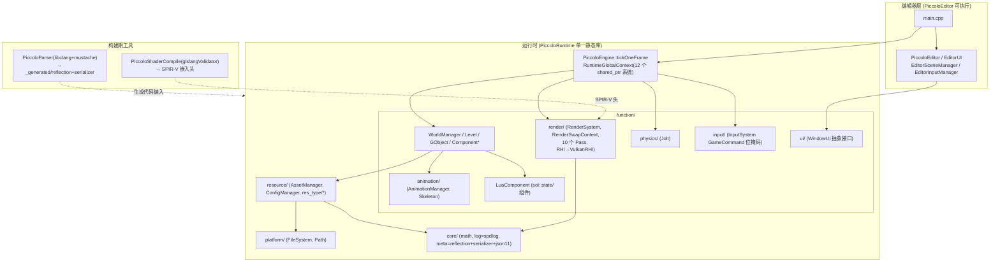

## 2.2 引擎主循环（RuntimeGlobalContext::tickOneFrame 真实顺序）

启动链：`main() → PiccoloEngine::startEngine(config)`（第一行 `Reflection::TypeMetaRegister::metaRegister()` 注册全部生成反射表）→ `g_runtime_global_context.startSystems()` 按 **Config→File→Log→Asset→Physics→World→Window(GLFW)→Input→Particle→Render→DebugDraw→RenderDebugConfig** 顺序创建 12 个系统；`PiccoloEditor::initialize` 置 `g_is_editor_mode=true` 并注入 `EditorUI`。世界延迟到第一次 tick 才加载（`WorldManager::tick` 首帧 `loadWorld`）。

每帧精确顺序（`engine/source/runtime/engine.cpp` + `editor.cpp`）：

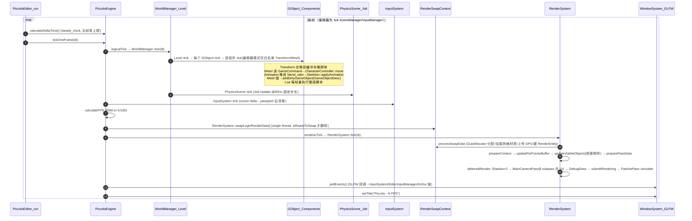

要点：物理步进在所有组件 tick 之后、渲染交换之前；`RenderSwapContext` 双缓冲（`RenderSwapData` 7 个 `std::optional` 字段）当前是**单线程下的数据所有权切换**（源码注释 `// single thread`），为未来拆线程预留；无 vsync/限帧逻辑。

## 2.3 World / Level / GObject / Component —— "ECS" 的真实形态

**准确定性**：Piccolo 的"ECS"实为 **GameObject-Component 对象组合模式**（接近早期 Unity），不是 archetype/sparse-set 的数据导向 ECS：

- 实体 `GObject`（`function/framework/object/object.h`）持有 `std::vector<Reflection::ReflectionPtr<Component>> m_components`——**裸指针 + 运行时类型名字符串**的多态数组；
- 组件查找 `tryGetComponent<T>(const std::string& type_name)` 是 **O(n) 线性扫描 + 字符串比较**（配套宏把类名字符串化）；
- **没有集中式 System 调度器**：逻辑分散在各 `Component::tick(dt)`，由 `GObject::tick` 逐对象逐组件解释执行；全局系统（physics/render/particle）是挂在 `RuntimeGlobalContext` 上的 Manager 单例；
- **GObject 之间没有父子层级**（`Level::m_gobjects` 是扁平 `unordered_map<GObjectID, shared_ptr<GObject>>`），所有 Transform 皆世界空间；引擎唯一的层级结构是动画骨骼 `Node/Bone`；
- ID 由 `ObjectIDAllocator::alloc()`（静态 `std::atomic` 递增）分配，`k_invalid_gobject_id = SIZE_MAX`。

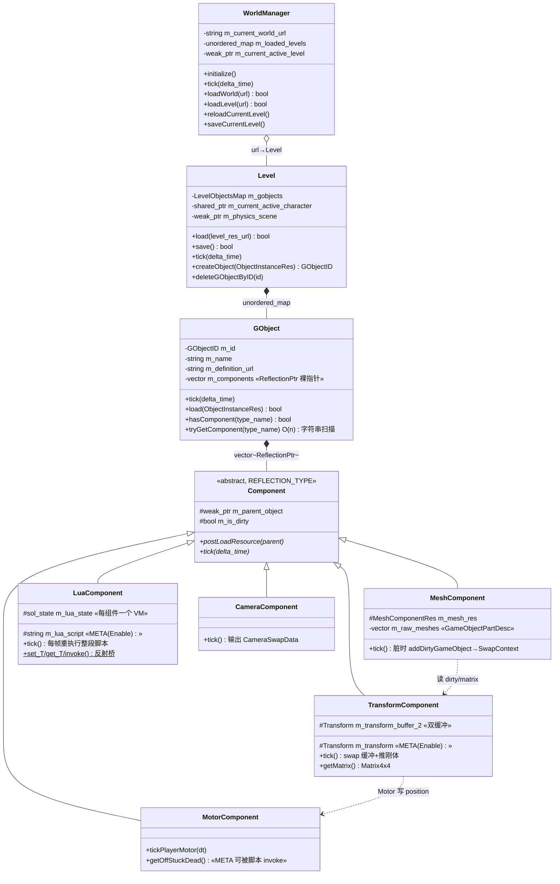

**定义/实例两级组件模型**（轻量 prefab）：`.object.json`（`ObjectDefinitionRes{m_components}`）是组件模板；`.level.json` 里的 `ObjectInstanceRes{m_name, m_definition, m_instanced_components}` 可携带实例级组件，`GObject::load` 中**实例组件按类型名覆盖定义组件**（`hasComponent` 去重）。`TransformComponent` 使用双缓冲（`m_transform_buffer[2]` + tick 时 `std::swap` 索引）+ dirty flag 向 RigidBody/Mesh/Particle 传播，为并行化预留。

## 2.4 反射与序列化（META 宏 + libclang + mustache + 多态 JSON）

Piccolo 最有含金量的架构决策是"**定义一次字段，三处受益**"：一套离线代码生成同时驱动 (a) JSON 资产多态序列化、(b) 编辑器属性面板自动构建、(c) Lua 脚本按字符串路径读写字段/调方法。

- **声明侧宏**（`core/meta/reflection/reflection.h`）：`REFLECTION_TYPE(X)` / `CLASS(X, Fields|WhiteListFields|All...)` / `META(Enable|Disable)` / `REFLECTION_BODY(X)`。`META/CLASS` 仅在 `__REFLECTION_PARSER__` 下展开为 `__attribute__((annotate(...)))`，**运行时零开销**；`REFLECTION_BODY` 展开为 friend 声明，让生成代码访问私有成员。
- **生成侧**：`PiccoloParser` 用 `clang_createTranslationUnitFromSourceFile` 解析聚合头（`parser_header.h`），`buildClassAST` 建模 Class/Field/Method/MetaInfo，`SchemaMoudle` 按源文件分组，`SerializerGenerator/ReflectionGenerator` 以 mustache 模板产出 `_generated/serializer/*.serializer.gen.{h,ipp}` 与 `_generated/reflection/*.reflection.gen.h`，汇总为 `all_serializer.ipp` / `all_reflection.h`。**每次构建全量重扫，无增量**。字段 JSON key 由 `Utils::getNameWithoutFirstM` 去掉 `m_` 前缀（蛇形）。
- **运行时侧**：`TypeMetaRegister::metaRegister()` 把每个类型注册进四张全局表（`m_class_map/m_field_map/m_method_map/m_array_map`，元素为 `std::function` tuple）；查询外观 `TypeMeta/FieldAccessor(void* 类型擦除读写)/MethodAccessor/ArrayAccessor`；`ReflectionPtr<T>{type_name, T*}` 是非拥有智能指针，承载多态组件数组。
- **序列化协议**（`core/meta/serializer/serializer.h` + json11）：多态指针写为 `{"$typeName": "<运行时类型名>", "$context": {...}}`；读取时 `TypeMeta::newFromNameAndJson(type_name, context)` **由 JSON 中的类型名字符串驱动工厂构造**——这是 level/object JSON 中组件多态数组的机制核心。`AssetManager::loadAsset<T>(url,out)` = 读文件→`Json::parse`→`Serializer::read`，仅 3 个成员函数，无注册表/无引用计数/全同步。

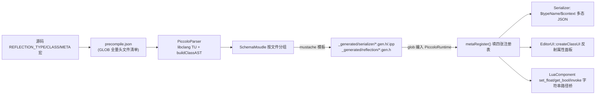

## 2.5 渲染系统：RHI 边界、Pass 体系、GBuffer、双管线

### 2.5.1 RHI 抽象边界（rhi.h + 唯一实现 VulkanRHI）

- `RHI` 纯虚基类（`function/render/interface/rhi.h`，178 行）+ `rhi_struct.h`（1133 行结构体镜像）+ `render_type.h`（1835 行，**枚举数值与 Vulkan 完全相同**，实现里 C 风格强转）。这是"**Vulkan 形状的薄抽象（1:1 镜像）**"而非语义化高级 RHI。
- `grep -rln "public RHI"` 验证：**全仓库只有 `VulkanRHI` 一个实现，没有 OpenGL 后端**。GLFW 仅用于窗口与 `VkSurfaceKHR`。
- 句柄体系：`RHIBuffer/RHIImage/...` 等 24 个空类，Vulkan 侧 `VulkanBuffer : RHIBuffer` 等以 `setResource/getResource` 透传 `VkBuffer`（指针透传模式）。
- **抽象泄漏点**：`rhi.h` 直接 include `<GLFW/glfw3.h>` 与 `<vk_mem_alloc.h>`，接口签名出现 `VmaAllocator/VmaAllocationCreateInfo`（`createBufferVMA` 等，GL 后端无法自然实现）；Pass 层头文件 include `vulkan/vulkan.h`；`RenderResource` 多处 `static_cast<VulkanRHI*>` 访问 `m_assets_allocator/m_viewport`；`RHI_SUCCESS` 宏 == `true`（与 `VK_SUCCESS==0` 语义相反）。
- 帧生命周期五段式约定（无 beginFrame/endFrame 命名）：`prepareContext() → waitForFences() → resetCommandPool() → prepareBeforePass()`（`vkAcquireNextImageKHR` + begin cmd，swapchain 重建收敛为回调）`→ …passes… → submitRendering()`（end + submit + `vkQueuePresentKHR`）。`k_max_frames_in_flight = 3`。

### 2.5.2 Pass 体系与 MainCameraPass

`RenderPassBase`（仅 `m_rhi/m_render_resource` 两成员）→ `RenderPass`（Framebuffer/Descriptor/Pipeline 容器 + `static VisiableNodes m_visiable_nodes` 全局可见节点表）→ 具体 Pass。`RenderPipelineBase` 持有 **10 个 pass 槽位**：`DirectionalLightShadowPass、PointLightShadowPass、MainCameraPass、ToneMappingPass、ColorGradingPass、FXAAPass、UIPass、CombineUIPass、PickPass、ParticlePass`。`RENDER_PIPELINE_TYPE` 二值：`FORWARD_PIPELINE / DEFERRED_PIPELINE`（默认 DEFERRED），两条路径**共享同一 render pass 与 subpass 结构**（forward 连续两次 `cmdNextSubpassPFN` 跳过 GBuffer/光照 subpass）。

`MainCameraPass` 是 **9 attachment × 8 subpass** 的巨型 render pass：

| attachment | 内容/格式 | | subpass | 内容 |
|---|---|---|---|---|
| 0 gbuffer_a | 世界法线 ×0.5+0.5，`R8G8B8A8_UNORM` | | 0 basepass | `drawMeshGbuffer`（写 GBuffer） |
| 1 gbuffer_b | metallic/specular(恒0.5)/roughness/shadingModelID，UNORM | | 1 deferred_lighting | 全屏三角形读 4 个 input attachment；skybox 走 `SHADINGMODELID_UNLIT` 分支 |
| 2 gbuffer_c | baseColor，`R8G8B8A8_SRGB`（提暗部精度） | | 2 forward_lighting | forward 主管线 / deferred 粒子 billboard |
| 3/4 backup odd/even | 场景 HDR `R16G16B16A16_SFLOAT` 乒乓 | | 3/4/5 | tone mapping(Uncharted2, 曝光 4.5 硬编码) → color grading(当前直通) → FXAA(采样型) |
| 5/6 post-process odd/even | HDR 中转（SAMPLED） | | 6 ui | ImGui（`UIPass::draw`）+ 编辑器 gizmo 轴 |
| 7 depth | 共享深度 D32_SFLOAT 优先 | | 7 combine_ui | 场景+UI 两个 `subpassInput` 合成 → swapchain |
| 8 swapchain image | B8G8R8A8_UNORM，PRESENT_SRC | | | |

**GBuffer 编解码**在 `shader/include/gbuffer.h`（`PGBufferData{worldNormal, baseColor, metallic, specular, roughness, shadingModelID}`，`EncodeGBufferData/DecodeGBufferData`）；延迟光照在 `deferred_lighting.frag` 中用 `inverse(proj_view_matrix) * ndc` 重建世界坐标。绘制采用**材质→mesh 两级分桶 + 每 drawcall ≤64 实例的 SSBO 手工实例化**；所有 per-frame/per-drawcall 数据经 **128MB 持久映射全局 ring buffer + dynamic offset**（`roundUp` 到 `min_storage_buffer_offset_alignment`，每帧 `resetRingBufferOffset`）上传——这是 Piccolo 最核心的 CPU→GPU 模式。阴影：方向光单张 4096² `R32_SFLOAT`（无级联，采样端常数 bias 0.000075，硬阴影）；点光 dual-paraboloid 2048²×30 层 + geometry shader（macOS/MoltenVK 下与方向光阴影一起被 `isPointLightShadowEnabled()` 关闭）。`PickPass` 在鼠标回调里同步重绘整场景到 `R32_UINT` 并整屏回读（类名自注 "inefficient"）。粒子为 GPU compute（kickoff→emit→simulate，indirect dispatch，CPU 回读 alive count）。

## 2.6 PBR 与 IBL（mesh_lighting.h / mesh_lighting.inl）

直接光 Cook-Torrance 三件套（`shader/include/mesh_lighting.h`）：

```glsl
highp float D_GGX(highp float dotNH, highp float roughness) {
    highp float alpha  = roughness * roughness;      // Disney 重映射 α = r²
    highp float alpha2 = alpha * alpha;
    highp float denom  = dotNH * dotNH * (alpha2 - 1.0) + 1.0;
    return (alpha2) / (PI * denom * denom);
}
highp float G_SchlicksmithGGX(dotNL, dotNV, roughness) {
    highp float k = ((roughness + 1.0)²) / 8.0;      // Schlick 近似 k
    return GL(dotNL) * GV(dotNV);                    // Smith 联合形式
}
highp vec3 F_Schlick(cosTheta, F0) { return F0 + (1-F0) * Pow5(1-cosTheta); }
```

组合（`BRDF()`）：`roughness` 钳制下限 0.05；`spec = D*F*G / (4·NoL·NoV + 0.001)`；`kD = (1-F)(1-metallic)`；漫反射 Lambert `basecolor/π`；`F0 = mix(vec3(0.04), basecolor, metallic)`（金属工作流）。`F_SchlickR(cosTheta,F0,roughness)` 为 IBL 提供粗糙度修正的 Fresnel。

间接光 split-sum（`mesh_lighting.inl`，forward 的 `mesh.frag` 与 deferred 的 `deferred_lighting.frag` **语句级 include 同一份实现**）：

```glsl
irradiance = texture(irradiance_sampler, N).rgb;      // 辐照度图
F          = F_SchlickR(clamp(dot(N,V),0,1), F0, roughness);
brdfLUT    = texture(brdfLUT_sampler, vec2(NoV, roughness)).rg;
lod        = roughness * MAX_REFLECTION_LOD;          // 8 级
reflection = textureLod(specular_sampler, R, lod).rgb;
specular   = reflection * (F * brdfLUT.x + brdfLUT.y);
Libl       = (1-F)(1-metallic) * (irradiance*basecolor) + specular;
result     = Lo(直接光: 15 点光循环 + 方向光阴影) + La(basecolor*ambient) + Libl;
```

**三张 IBL 贴图全部是离线预烘焙的 `.hdr` 资产**（`asset/texture/sky/skybox_{irradiance,specular}_{X,Y,Z}{±}.hdr` 12 张面片 + `brdf_schilk.hdr`），仓库内**没有任何烘焙工具**；运行时唯一"预计算"是 specular cubemap 的 mip 链（`vkCmdBlitImage` 逐级生成，非 GGX 卷积）。cubemap 面序重排为 `{+X,-X,+Z,-Z,+Y,-Y}` 并在 shader 中做 `vec3(x,z,y)` 轴交换（引擎 Z-up → cubemap Y-up）。已知未接通项：occlusion 贴图绑定但光照未使用、emissive 在延迟路径丢失、gbuffer specular 通道恒 0.5。

## 2.7 资产管线：无离线转换器，运行时解析

本快照的真实形态是"**美术源文件即运行时资产**"：

| 环节 | Piccolo v0.0.9 做法 |
|---|---|
| 静态网格 | **运行时 tinyobjloader 解析 `.obj`**：仅三角面、缺法线用面叉积、缺 UV 填 (0.5,0.5)、切线现场解、顶点全展开（de-index，uint16 索引上限 65535，源码注释自认 "for testing purposes only"） |
| 蒙皮网格 | `.mesh_bind.json`（player 的达 **20MB 文本 JSON**，55500 顶点），启动全量解析——后期版本引入二进制 `.mesh` 的直接动因 |
| 贴图 | `.tga/.png/.jpg/.hdr` 源文件运行时 `stb_image` 解码（LDR 强制 4 通道；HDR 仅 2/4 通道）；**仅 base_color 用 sRGB 格式**；mipmap 运行时 `VulkanUtil::genMipmappedImage` blit 链生成 |
| FBX/glTF | **不支持**（全仓 grep 无 fbx/gltf/assimp）；骨骼资产是课程工具在仓库外生成后 check-in 的私有 JSON |
| 材质 | `*.material.json` 仅 5 个贴图路径（base_colour/metallic_roughness/normal/occlusion/emissive，glTF 通道约定 G=roughness B=metallic）；PBR 标量 UBO（`MeshPerMaterialUniformBufferObject`）已备好但序列化未接通，运行时恒默认值 |
| 场景 | 三级 JSON：`*.world.json → *.level.json → *.object.json`（双扩展名命名约定），组件多态数组靠 `$typeName/$context` |
| 缓存/去重 | 渲染侧 `GuidAllocator<T>` 三枚（instance/mesh/material，`allocGuid` 幂等：相同源文件只上传一次 GPU）+ 包围盒缓存 + `AnimationManager` 五张 URL 缓存 map；**无资产注册表、无引用计数、无异步加载** |
| IBL | 12 张 HDR 面 + BRDF LUT 离线预烘焙直接入库；换关卡经 `m_level_resource_desc` 重新 `uploadGlobalRenderResource` |
| 部署 | POST_BUILD 全量 `copy_directory engine/asset → bin/asset`，无 cook/打包/版本化 |

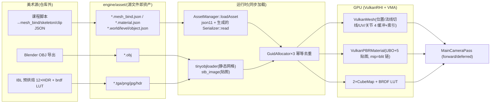

## 2.8 UI / 输入 / 脚本 / 编辑器

- **UI 能力边界**：runtime 侧 `function/ui/window_ui.h` 仅一个纯虚接口 `WindowUI{initialize(WindowUIInitInfo); preRender();}`（cpp 为空实现）；唯一实现是编辑器 `EditorUI`。**没有游戏内 UI 框架**（HUD/菜单均无），面板管理完全交给 ImGui Docking（`ImGuiConfigFlags_DockingEnable` + DockBuilder 程序化初始布局：Menu/World Objects/Game Engine(透明视口)/File Content/Components Details 五面板）。
- **ImGui 对接**：`UIPass::initializeUIRenderBackend` → `ImGui_ImplGlfw_InitForVulkan(window, true)` + `ImGui_ImplVulkan_Init`，**ImGui 不拥有自己的 VkRenderPass，而是作为 MainCameraPass 的 subpass 6 的客人**（`init_info.Subpass = _main_camera_subpass_ui`），descriptor pool 复用引擎全局池（注释明示为 imgui 追加配额）；每帧 `UIPass::draw()` 在命令录制中途同步执行整个 immediate-mode 帧。合成 `combine_ui.frag` 用两个 `subpassInput`，逻辑是"**UI 像素非黑即完全覆盖场景**"（无 alpha blend）+ 手动 gamma。
- **输入**：GLFW → `WindowSystem` 的 `std::vector<std::function>` **多播回调中心**（11 类注册接口）→ {ImGui 链式回调(PrevUserCallback)、`InputSystem`(游戏 `GameCommand` 位掩码：forward/backward/.../free_carema/invalid)、`EditorInputManager`(编辑器 `EditorCommand`)}。事件泵在 `tickOneFrame` 末尾（回调数据供下一帧消费，一拍延迟）；**不使用 `io.WantCaptureMouse`**，互斥靠 `g_is_editor_mode` 开关 + 视口矩形测试（悬浮 ImGui 窗口下的点击会穿透到拾取）。无 action mapping，键位硬编码 switch。
- **脚本**：`LuaComponent` —— **每组件一个 `sol::state`**（只开 `sol::lib::base`），脚本是内嵌于 object.json 的 `m_lua_script` 字符串，`tick()` **每帧把整段脚本当 chunk 重新执行**（无 start/tick 约定、delta_time 不传入、local 状态每帧重置）。暴露给 Lua 的全部 API 只有 **3 个反射桥函数**：`set_float(GameObject,"Comp.field[.sub]",v)`、`get_bool(...)`、`invoke(GameObject,"Comp.method")`（无参无返回），底层是 `find_component_field()` 按 `"."` 分段走 `TypeMeta/FieldAccessor/MethodAccessor` 字符串路径。全仓库唯一示例脚本是 player.object.json 里控制跳跃高度的一段 if。无热重载（等效路径是 Reload Current Level 重建 VM）。
- **编辑器复用 runtime**：进程级复用（editor 链接 PiccoloRuntime 直接跑 `tickOneFrame`）；`g_is_editor_mode` 一个布尔控制组件 tick 白名单与输入分流；Inspector 是反射驱动的 `类型名→widget creator` 注册表（`m_editor_ui_creator`：Transform/Vector3/Quaternion/bool/int/float/std::string...）递归生成；拾取 = `PickPass::pick` 同步重绘回读；"游戏画面嵌在编辑器窗口" = 透明 ImGui 窗口 `MenuBarRect()` → `RenderSystem::updateEngineContentViewport` 改 `VulkanRHI::m_viewport` + 相机 aspect。

### Piccolo 侧对 Genesis 的关键结论

1. Pass 层与后端解耦可行（3600 行 Vulkan 细节被隔离在一个实现文件），但 Piccolo 的"与 Vk 同值枚举镜像 + VMA 进接口"使 GL 后端**无法自然实现**——Genesis v2 因此选择语义化窄接口（见第四部分 4.2）。
2. `subpassInput`/input attachment 是纯 Vulkan 特性，双后端方案必须降解为采样。
3. 最值得继承的模式：帧生命周期五段式、持久映射 ring buffer + dynamic offset、GuidAllocator 幂等去重、shader 以字节数组头文件嵌入、光照数学独立于 API（`.h/.inl` 共享）。
4. 必须规避的坑：每组件一个 Lua VM、每帧重执行 chunk、无 WantCaptureMouse 过滤、同步拾取、`clear()` 空实现导致 GPU 资源只增不减、字符串驱动组件查找。

---

# 第三部分：能力对齐差距分析（Gap Analysis）

## 3.1 逐能力对比总表

> 列说明：**Piccolo 做法**以 v0.0.9-16 快照源码为准；**Genesis v1 现状**以 `src/demo1/**` 与 v1 CMake 为准；**Genesis v2 实现方式**以改造后源码为准（路径见第四部分）。

| 能力项 | Piccolo 做法 | Genesis v1 现状 | Genesis v2 实现方式 | 是否超越参考实现 |
|---|---|---|---|---|
| **ECS** | GameObject-Component 模式：`GObject` 持 `vector<ReflectionPtr<Component>>`，`tryGetComponent` O(n) 字符串比较，无 System 调度器，逐对象逐组件 tick，无实体层级 | 无 | 真 sparse-set ECS（`src/genesis/ecs/ecs.hpp`）：`Entity{id,generation}` 代际句柄、`ComponentPool<T>` O(1) 增删查、World 内建 parent/children 层级 + `depth()`、`SystemScheduler` 按 `order()` 稳定排序（Script 50→CameraController 90→Transform 100→Render 200）、`each<T>()`/`view<A,B>()`/`view<A,B,C>()` 类型安全迭代、8 个内建 POD 组件 | **超越**：数据导向存储 + 显式调度器 + 实体层级，Piccolo 三者皆无 |
| **模型导入 (fbx/gltf)** | 不支持 FBX/glTF（grep 确认）；静态网格运行时 tinyobjloader 解析 obj（顶点全展开、uint16 上限）；蒙皮网格是仓库外工具生成的 20MB `.mesh_bind.json` | 无任何模型导入 | glTF2.0/GLB：**cgltf** 运行时直载（`resource/gltf_importer.cpp`，POSITION/NORMAL/TANGENT/TEXCOORD_0/1/JOINTS_0/WEIGHTS_0、u8/u16/u32 索引、内嵌图片、完整节点层级、PBR 金属粗糙度材质五贴图槽）；FBX：**自研 Kaydara 二进制解析器 + zlib**（`resource/fbx_importer.cpp`，2539 行，含 6.x/7.x 双记录宽度、PolygonVertexIndex 负值终结扇形三角化、LayerElement 四种映射模式、UpAxis/UnitScaleFactor 基变换 `L'=A·L·A⁻¹`、材质/纹理/Video 链接、防御性上限防炸）；另有 OBJ 与程序化网格（`procedural_mesh.*`）；索引按顶点数自动选 u16/u32 | **超越**：Piccolo 完全没有的两条导入路径（FBX 蒙皮求值除外，见 4.13 局限） |
| **实时 UI** | ImGui 1.87 docking，焊死在 Vulkan subpass（input attachment 合成，"非黑即覆盖"无 alpha blend）；无 GL 路径；无 WantCaptureMouse 过滤 | ImGui + imgui_impl_vulkan（仅编辑器面板；显示相机纹理） | `ui/ui_system.*`：**双后端对接**（GL: `imgui_impl_opengl3` + `"#version 410"`；VK: `imgui_impl_vulkan` + swapchain render pass + 专属 descriptor pool），UI 画在 present pass 内部（`RenderSystem::setPostPresentCallback`），标准 alpha blend；每帧把 `io.WantCaptureMouse/Keyboard` 写回 `InputSystem::ui_wants_mouse/ui_wants_keyboard`，相机控制器据此让位 | **部分超越**：双后端 + WantCapture 过滤 + 真混合；不及 Piccolo 处：无 docking 编辑器面板体系（v2 是运行时调试 UI，非编辑器） |
| **脚本系统** | LuaComponent：每组件一个 `sol::state`（仅 base 库），每帧重执行整段内嵌 chunk，**仅 3 个桥函数**（set_float/get_bool/invoke，靠字符串反射路径），无 dt 传参、无热重载 | 无 | `script/script_system.*`：Lua 5.4 vendored，**单共享虚拟机**；每脚本编译一次装入沙箱 env（新表 + `__index`→全局表，`lua_setupvalue` 替换 chunk 的 `_ENV` upvalue），registry ref 持有；约定入口 `start(entity_id)` / `tick(dt, entity_id)`；全局 `genesis` 表暴露 **43 个 C API + version/lua_version**（日志/时间/实体/变换/层级/灯光/输入/渲染设置/统计/调试绘制/IBL 烘焙/模型加载），错误经 `reportError` 环形缓存并可在 UI 面板显示；`ScriptSystem` 是 order=50 的标准 ECS System | **超越**：单 VM + 沙箱 + 入口约定 + 43 API vs 每对象 VM + 整段重执行 + 3 API |
| **多后端渲染 (gl & vulkan)** | **只有 Vulkan 后端**（`grep "public RHI"` 仅 VulkanRHI）；RHI 是 Vk 枚举同值镜像 + VMA 类型进接口签名，GL 无法自然实现 | 仅 Vulkan（且 demo 绕过抽象直接调 vk） | `src/genesis/rhi/`：语义化窄接口（`RHIDevice/RHICommandBuffer` + 纯数据 desc 结构，native 句柄仅经 `nativeHandle()` 为 ImGui 集成放行）；**OpenGL 4.1 后端**（`opengl/gl_backend.*` + `gl_command_buffer.cpp`，descriptor set→uniform block/texture unit 公式映射，push constant→UBO 模拟，立即执行语义）与 **Vulkan 1.1 后端**（`vulkan/vk_backend.*` + VMA）并存，`RHIDevice::create(DeviceDesc)` 工厂 + `GENESIS_RHI_OPENGL/VULKAN` 编译开关；两后端渲染同一场景通过像素级比对测试 | **超越**：Piccolo 单后端，v2 双后端且有一致性测试兜底 |
| **PBR 直接光** | Cook-Torrance：D_GGX(α=r²)、G_SchlicksmithGGX(k=(r+1)²/8)、F_Schlick、`spec=D*F*G/(4·NoL·NoV+0.001)`、kD=(1-F)(1-metallic)、F0=mix(0.04,albedo,metallic)；roughness 钳 0.05；点光衰减 `1/(d²+1)·(1-d²/r²)`；方向光/点光阴影（单张 4096²、dual-paraboloid） | 无光照（滤镜后处理） | `shaders/common/pbr.h` + `scene/pbr_mesh.frag`：与 Piccolo 同族的 Cook-Torrance（公式见 4.8，逐项对照表），**另加可切换的归一化 Blinn-Phong NDF**（`n=2/α²-2`，`(n+2)/2π` 归一）用于对比教学；三种光源（方向/点/聚光）+ Unreal 风格平滑窗口衰减 `(1-(d/r)⁴)²/d²` + 聚光锥平滑过渡；法线贴图 TBN（重正交化）；alpha mask/blend/double-sided 四条管线变体；**无阴影**（如实列入局限） | **基本对齐、局部超越**（双 NDF、聚光灯、能量守恒 kD）；阴影未对齐（Piccolo 有，v2 无） |
| **PBR 间接光 (IBL)** | split-sum 运行时合成；但 irradiance/prefiltered/BRDF LUT **三张贴图全靠仓库外离线预烘焙的 .hdr 资产**，仓库内无烘焙器；运行时仅 blit 生成 specular cubemap mip 链（非 GGX 卷积） | 无 | **运行时 GPU 烘焙整条 IBL 管线**（`renderer/render_system_ibl.cpp`）：equirect HDR→cubemap（6 面 raster draw）→mip 链→irradiance 余弦卷积（π/N 黎曼和）→prefiltered GGX 重要性采样（Hammersley + Karis mip bias，逐 mip roughness 斜坡）→BRDF 积分 LUT（RG16F，(1-Fc)/Fc 拆分）；全部用 **raster pass 而非 compute**（GL 4.1 无 compute，`info_.supports_compute=false`），两后端同一套代码；无 HDR 资产时程序化天空兜底（CPU 生成 512×256 equirect）；`EnvironmentComponent.ibl_dirty` 驱动重烘焙 | **各有取舍**：v2 免离线资产、可任意换环境图、可测试（LUT 与 CPU 参考积分比对）；Piccolo 零运行时开销。烘焙质量参数（256/64/256/256、256/512 采样）偏向验证而非影视级 |
| **跨平台构建** | Linux(强制 clang + Ninja/Makefiles)/macOS(Xcode)/Windows 脚本，但依赖 libclang12、硬编码 `/usr/include/c++/9/`、editor CMakeLists 存在中文弯引号 bug；shader 每次构建需 glslangValidator | 事实仅 macOS（OBJCXX/AVFoundation 硬链接；SDL2 仅 UNIX 分支；Vulkan REQUIRED） | 单一 `CMakeLists.txt`（≥3.16，C++17）跑 Linux/macOS：SDL2 三级探测（CMake 包→pkg-config→手工）、Vulkan **可选**（找不到自动降级 GL-only）、`GENESIS_BACKEND_OPENGL/VULKAN` 开关、`GENESIS_LEGACY_DEMO1` 保留 v1 demo（仅 APPLE）、shader 生成产物**入库**（无 Python/Vulkan SDK 也能构建，`GENESIS_REBUILD_SHADERS=AUTO|ON|OFF`）、CTest 注册 `genesis_tests --no-window`、macOS 框架/Linux libGL 分支处理 | **超越**：依赖更轻（不需要 libclang/课程工具链）、可降级构建、生成物入库策略比"每次构建全量重扫"更健壮 |
| **测试验证** | **无任何自动化测试**（无 tests 目录；precompile 链路的弯引号 bug 即缺乏测试的直接后果） | 无 | `tests/`：**29 个 CPU 用例**（math/ecs/procedural/gltf/fbx/resource/image/shaders/script/render_ubo 十组）+ **16 个 GPU 用例**（rhi/render/pbr/ibl 四组，headless 隐藏窗口 + `renderAndCapture` 像素断言）+ **跨后端像素比对**（同一参考场景 GL vs VK：均值差 <6.0/255 且 >4 偏差像素 <25% 判 MATCH，产物写 `/tmp/genesis_cross_backend_{gl,vk}.png`）；自研轻量框架（`TEST/TEST_GPU` 宏 + `CHECK/CHECK_NEAR/CHECK_EQ` + 自动注册 Registry） | **超越**：从 0 到 45+ 用例与跨后端一致性验证 |

## 3.2 补充能力对比（次要项）

| 能力项 | Piccolo | Genesis v1 | Genesis v2 | 结论 |
|---|---|---|---|---|
| 数学库 | Ogre 派生 Vector/Matrix/Quaternion/Transform/AxisAlignedBox，可反射，无 SIMD | **缺失** | `foundation_layer/math/math.hpp`（806 行）：Vec2/3/4、Quat（lookRotation/fromEulerYXZ/slerp）、列主 Mat4（compose/inversed/normalMatrix/perspective(zero_to_one)/ortho/lookAt）、Transform、Color、AABB（transformed/merge）、Frustum（fromViewProjection 平面提取 + intersectsAABB）、Ray | 从 0 到完整；Piccolo 无可视锥剔除数学之外的优势 |
| 反射/序列化 | META 宏 + libclang codegen + `$typeName` 多态 JSON（三消费者） | 无 | **未实现**（有意取舍：v2 无编辑器需求，场景用代码/Lua 构建；序列化仅 `serialization_blob` 遗留） | 未对齐——列入后续路线 |
| 逻辑/渲染解耦 | RenderSwapContext 双缓冲（单线程） | 无 | RenderSystem 作为 order=200 的 ECS System，`syncFromWorld` 拉取相机/环境/网格，GPU 镜像（RenderScene）与 ECS 严格分离（组件不触 RHI） | 等价目标、更简单机制（单线程拉模型） |
| 资源去重 | GuidAllocator×3（源文件→id 幂等） | 无 | `TextureCache`（按解析后 key 去重 + 默认白/黑/法线/灰兜底）；模型按 uploadModel 显式管理 | 对齐思想，粒度较粗（无 mesh 级 GUID） |
| 阴影 | 方向光单张 4096²（无 CSM）+ 点光 dual-paraboloid | 无 | 无（组件已预留 `cast_shadow/receive_shadow` 字段） | 未对齐——列入路线 |
| 拾取 | PickPass 同步重绘整场景 + 整屏回读 | 无 | `MeshComponent::pick_id` + `CameraState::screenRay` CPU 射线（未做完整 picking UI） | 部分对齐（数据已备好） |
| 调试绘制 | DebugDrawManager 六管线 + 字体 | 无 | `RenderSystem::drawLine/drawBox/drawSphere`（push-constant 管线，即时线框，demo 用于灯光 gizmo） | 轻量对齐 |
| 物理/动画/粒子 | Jolt 物理、骨骼动画（GPU 蒙皮）、30 万粒子 compute | 无 | 无（顶点布局已预留 joints/weights 槽位） | 未对齐——超出本次升级范围 |
| 编辑器 | 完整 ImGui docking 编辑器（5 面板 + gizmo + Inspector） | 无 | 无（demo 内 6 个运行时调试面板） | 未对齐——列入路线 |

## 3.3 四个特别标注

1. **多后端**：Piccolo **只有 Vulkan 后端**（其 RHI 是"预留了形式上多后端能力的宽接口"，实际 VMA/GLFW/subpass 概念泄漏使其无法落地 GL）。Genesis v2 实现了 **GL 4.1 + Vulkan 1.1 双后端**并通过跨后端像素比对测试证明语义一致——**超越参考实现**。
2. **测试**：Piccolo **无自动化测试**。Genesis v2 有 **45+ 测试用例**（29 CPU + 16 GPU）+ 跨后端一致性比对 + CTest 集成——**超越参考实现**。
3. **脚本**：Piccolo 仅 **3 个反射桥函数**（且每帧重执行整段 chunk、每对象一个 VM）。Genesis v2 单 VM + 沙箱 + start/tick 约定，暴露 **43 个类型化 API**（40+）——**超越参考实现**。
4. **IBL**：Piccolo 靠**离线预烘焙资产**（仓库无烘焙器，运行时零烘焙开销但资产不可换、不可测）。Genesis v2 **运行时 GPU 烘焙**（免资产、任意环境图、烘焙结果可被测试断言，代价是首次烘焙的一次性 GPU 时间）——**各有取舍**，不是单向超越。

---

# 第四部分：Genesis-Render v2 升级后架构（重点）

## 4.1 总体分层架构与目录结构

### 4.1.1 分层架构图

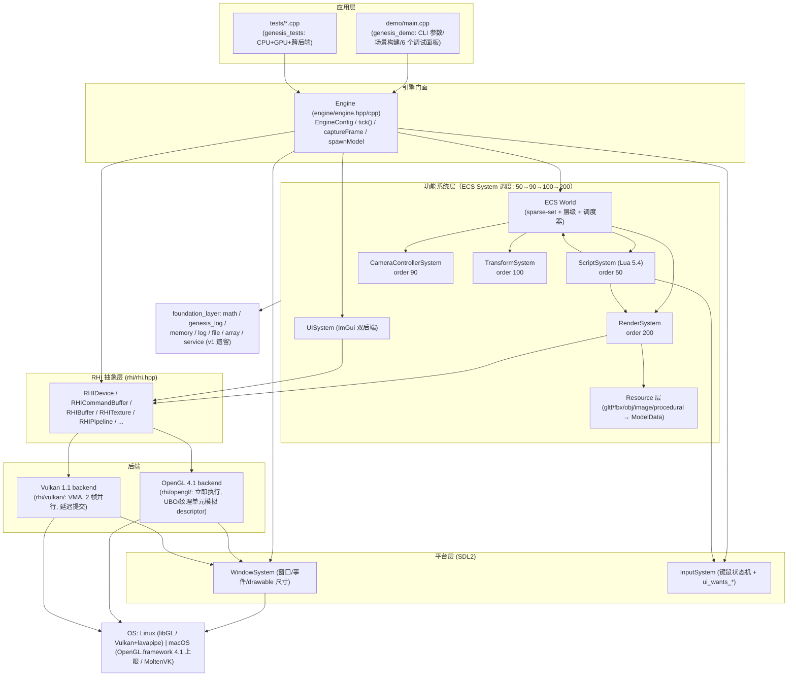

分层原则（与 Piccolo 的教训对应）：

- **ECS 组件是纯数据**，永不调用 RHI/渲染器（`ecs/components.hpp` 头注释明文约定）；GPU 对象集中在 `RenderScene`，模拟层与渲染层以"RenderSystem 每帧同步"为唯一边界——对齐 Piccolo 的 SwapContext 目标但用更简单的单线程拉模型。
- **native 句柄不进入渲染器代码**：`rhi.hpp` 设计目标第 3 条——原生句柄仅经 `nativeHandle()` 在极少数集成点（ImGui Vulkan 后端）跨界。
- **foundation 不依赖任何上层**；v1 遗留的 service/memory/log/file 与新的 `math/`、`genesis_log.hpp` 并存（新旧日志双轨：`GenesisPrint` 供 legacy demo1，`GEN_LOG_*` 供新引擎）。

### 4.1.2 目录结构与模块职责表

| 目录/文件 | 职责 | 关键内容 |
|---|---|---|
| `src/genesis/foundation_layer/` | 基础设施 | `math/math.hpp`（Vec/Quat/Mat4/Transform/Color/AABB/Frustum/Ray，列主存储）、`genesis_log.hpp`（Logger 单例：级别/彩色/history 环形缓冲供 UI/回调供测试/errorCount，`GEN_LOG_TRACE..FATAL` 宏）、v1 遗留 `service/memory/log/file/array/assert/serialization_blob/platform` |
| `src/genesis/rhi/` | 后端无关渲染硬件接口 | `rhi.hpp`（抽象类）、`rhi_enums.hpp`（后端无关枚举 + GL 绑定映射公式）、`rhi_desc.hpp`（纯数据 desc）、`rhi_factory.cpp`（`RHIDevice::create`）、`rhi_enums.cpp`（格式工具函数） |
| `src/genesis/rhi/opengl/` | GL 4.1 后端 | `gl_backend.hpp/cpp`（GLDevice + 资源类）、`gl_command_buffer.cpp`（立即执行命令缓冲）、`gl_convert.hpp`（格式/枚举转换表）、`gl_loader.hpp`（直接链接系统 GL，无 GLAD/GLEW） |
| `src/genesis/rhi/vulkan/` | Vulkan 1.1 后端 | `vk_backend.hpp/cpp`（VkDeviceRHI：instance/设备评分/VMA/swapchain/2 帧并行）、`vk_command_buffer.cpp`（录制式命令缓冲 + barrier/blit/mip 链/回读）、`vk_convert.hpp` |
| `src/genesis/ecs/` | 实体组件系统 | `ecs.hpp`（Entity/ComponentPool/World/SystemScheduler）、`components.hpp`（Transform/Mesh/Camera/Light/Environment/Script/Tag/CameraController 8 组件）、`systems.hpp/cpp`（TransformSystem/CameraControllerSystem） |
| `src/genesis/resource/` | 资产导入（CPU 侧） | `resource_types.hpp/cpp`（Vertex 88B/ImageData/TextureRef/MaterialData/MeshData/NodeData/ModelData + ResourceIO 入口）、`resource_io.cpp`（文件/路径/stb_image/PNG-TGA 写出/格式分发/OBJ）、`gltf_importer.cpp`（cgltf）、`fbx_importer.cpp`（自研 FBX）、`procedural_mesh.hpp/cpp`（plane/box/sphere/torus/material grid）、`third_party_impl.cpp`（stb/cgltf 实现宏落点） |
| `src/genesis/renderer/` | 渲染器 | `render_ubo.hpp`（7 个 GPU UBO 结构 + static_assert 尺寸锁）、`render_scene.hpp/cpp`（CameraState/GpuMesh/GpuMaterial/TextureCache/RenderScene）、`render_system.hpp`（RenderSystem 声明 + RenderSettings/RenderStats/RenderTarget）、`render_system.cpp`（布局/管线/目标）、`render_system_frame.cpp`（同步 + 帧执行）、`render_system_ibl.cpp`（IBL 烘焙）、`render_internal.hpp`（shader 装配/顶点布局/全屏四边形工具） |
| `src/genesis/renderer/shaders/` | 单源双方言 GLSL | `common/genesis_shader.h`（方言宏 + binding 预算 + equirect/cubemap 工具）、`common/ubo_layout.h`（5 个共享 UBO 块）、`common/pbr.h`（PBR 库）、`common/fullscreen.vert`、`scene/`（pbr_mesh/unlit_mesh/skybox/debug_line）、`ibl/`（equirect_to_cube/irradiance/prefilter/brdf_lut）、`post/tonemap.frag`、`generated/`（入库的生成产物 .h/.cpp） |
| `src/genesis/platform_layer/` | SDL2 平台层 | `window_system.hpp/cpp`（WindowDesc/WindowSystem/Timer；按后端设 `SDL_WINDOW_OPENGL|VULKAN`，hidden 供 headless，drawable 尺寸经 `SDL_Vulkan_GetDrawableSize`/`SDL_GL_GetDrawableSize`）、`input_system.hpp/cpp`（双缓冲键态/边沿检测/鼠标增量/滚轮/文本 + `ui_wants_mouse/keyboard`） |
| `src/genesis/ui/` | 实时 UI | `ui_system.hpp/cpp`（ImGui 双后端；post-present 合成；日志环形缓冲；Genesis 深色主题） |
| `src/genesis/script/` | Lua 脚本 | `script_system.hpp/cpp`（单 VM + 沙箱 + 43 API + start/tick） |
| `src/genesis/engine/` | 引擎门面 | `engine.hpp/cpp`（EngineConfig/Engine::initialize/tick/run/captureFrame/saveScreenshot/spawnModel） |
| `src/genesis/application_layer/` | v1 遗留 | `window.hpp/cpp`（legacy `Genesis::Window`，仅 demo1 使用） |
| `src/demo1/` | v1 遗留 demo | 保留原样，仅 `GENESIS_LEGACY_DEMO1=ON`（macOS）时构建 |
| `src/external/` | vendored 三方 | imgui(1.86 系 + sdl/opengl3/vulkan 后端)、lua 5.4、cgltf、stb_image、zlib 接口、vk_mem_alloc.h、cglm/meshoptimizer/enkiTS/json.hpp/tracy 等（后四类 v2 暂未使用，属仓库既有内容） |
| `demo/main.cpp` | 演示程序 | CLI（`--backend gl|vulkan --headless --frames N --screenshot --width/--height --validation --no-ui --no-script --asset-dir`）；场景：相机 + 太阳方向光 + 2 个动画点光 + 环境 IBL（`assets/textures/sky_equirect.hdr`）+ 贴图地面 + 5 个 glTF/GLB 模型 + 2 个 FBX 模型 + 6×4 程序化材质球阵 + Lua 动画实体 + 灯光 gizmo 调试线；6 个 ImGui 面板（统计/Render-PBR/ECS 层级/Lua/日志/操作说明） |
| `tests/` | 验证套件 | `test_framework.hpp`、`test_main.cpp`（runner + 跨后端比对）、`test_cpu.cpp`（29 例）、`test_gpu.cpp`（16 例） |
| `scripts/` | 工具 | `build_shaders.py`（单源→双方言→入库头）、`gen_assets.py`（纯标准库生成全部测试资产：7 张 png + 2 张 hdr + 4 组 gltf/glb）、`gen_fbx_test_asset.py`（生成二进制 FBX 测试资产） |
| `CMakeLists.txt` + `cmake/GenesisShaders.cmake` | 跨平台构建 | 见 4.10 |
| `assets/` | 入库资产 | `models/`（DamagedHelmet.glb、Duck.glb、genesis_{sphere,torus,cube_textured,test_scene}.gltf/.glb/.bin、genesis_test_{cube,sphere}.fbx）、`textures/`（checker/panel/tile/grid/uv_gradient png + sky_equirect.hdr 2048×1024 + small_equirect.hdr 256×128） |

## 4.2 RHI 抽象层

### 4.2.1 设计目标（摘自 `src/genesis/rhi/rhi.hpp` 头注释）

1. **一份渲染器实现跑在两个差异极大的原生 API 上**（OpenGL 4.1+ core 与 Vulkan 1.1+）；
2. **显式资源 + 显式帧**（按 Vulkan 的模型设计接口），因为 Vulkan 是更难模拟的一方；**GL 后端吸收阻抗失配**（立即执行、无 image layout、uniform block 代替 descriptor set）；
3. **native 句柄不泄漏进渲染器代码**——仅 `nativeHandle()` 一个受控出口（ImGui Vulkan 集成等罕见场景）；
4. 线程模型：渲染线程单线程录制与提交。

这是对 Piccolo RHI 反面教材的直接回应：不镜像 Vk 枚举数值、不把 VMA 类型放进接口、`TextureLayout` barrier 等 Vulkan 概念以"GL 端可空操作"的语义保留。

### 4.2.2 资源与设备类图（真实虚函数签名）

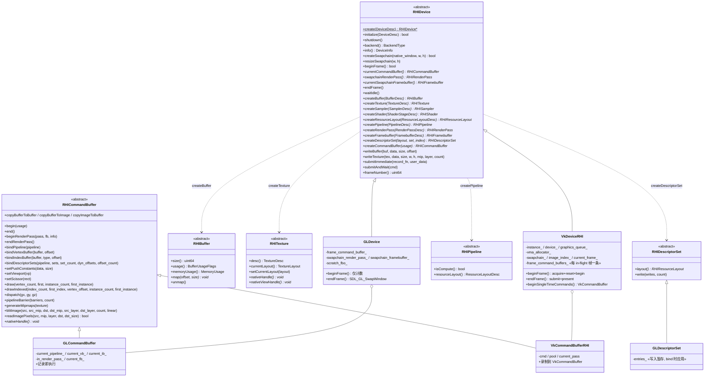

描述结构（`rhi_desc.hpp`）全部为纯数据 POD：`BufferDesc{size,usage,memory_usage,initial_data,name}`、`TextureDesc{type,format,w,h,depth,array_layers,mip_levels,usage,generate_mipmaps}`（`layerCount()` 对 TexCube 返回 `6*array_layers`）、`SamplerDesc`（含 compare/anisotropy/border）、`ShaderStageDesc{stage,code_type(GlslSource|Spirv),code,code_size}`、`ResourceBinding{set,binding,type,stages,count,name}`（**name 是 GL 后端必需的 uniform block/采样器名，Vulkan 端忽略**）、`PipelineDesc`（内联 `resource_layout` + `color_formats[8]/depth_format` 的 render-pass 兼容性）、`RenderPassDesc{attachments[9]}`（最多 8 色 + 1 深度，**无 subpass 概念**——这是能在 GL 落地的关键简化）、`FramebufferDesc`（按值匹配 pass，后端缓存 pass 对象）、`DeviceDesc{backend,native_window,w,h,enable_validation,headless,vsync,srgb_backbuffer}`、`DeviceInfo`（限额与能力：`min_uniform_buffer_offset_alignment=256` 缺省、`supports_compute` GL 端为 false 等）。

### 4.2.3 descriptor set / uniform block 的 GL ↔ Vulkan 映射规则

GL 4.1 没有 descriptor set，v2 用**确定性公式**把 `(set, binding)` 映射到 GL 的两种绑定点（`rhi/rhi_enums.hpp:304-319`）：

```cpp
static constexpr uint32_t GL_PUSH_CONSTANT_BLOCK_BINDING = 0;
static constexpr uint32_t GL_UNIFORM_BLOCK_BASE = 1;
static constexpr uint32_t GL_BINDING_STRIDE = 8; // blocks/units per set

inline uint32_t glUniformBlockIndex(uint32_t set, uint32_t binding)
{   return GL_UNIFORM_BLOCK_BASE + set * GL_BINDING_STRIDE + binding; }
inline uint32_t glTextureUnit(uint32_t set, uint32_t binding)
{   return set * GL_BINDING_STRIDE + binding; }
```

| 概念 | Vulkan 端 | OpenGL 端 |
|---|---|---|
| UBO (set,binding) | `VkDescriptorSetLayoutBinding` + `vkCmdBindDescriptorSets` | 管线链接时 `glUniformBlockBinding(program, idx, glUniformBlockIndex(set,binding))`；bind 时 `glBindBufferRange(GL_UNIFORM_BUFFER, block_index, id, offset(+dynamic_offset), range)`（`gl_command_buffer.cpp:253-259`） |
| 采样纹理 (set,binding) | `COMBINED_IMAGE_SAMPLER` 描述符 | 管线构建时按 binding 的 `name` 查 `glGetUniformLocation` 并 `glUniform1i(loc, glTextureUnit(set,binding))`；bind 时 `glActiveTexture(GL_TEXTURE0+unit) + glBindTexture + glBindSampler`（`gl_backend.cpp:216`、`gl_command_buffer.cpp:265-267`） |
| dynamic offset | `UNIFORM_BUFFER_DYNAMIC` + `pDynamicOffsets` | 直接加进 `glBindBufferRange` 的 offset —— per-draw ring 机制两端同构 |
| push constant | `VkPushConstantRange`（vertex+fragment） | **UBO 模拟**：shader 侧声明名为 `PushConstants` 的 std140 块绑定到 block index 0；GL 端为每个管线维护 `kPushConstantSlots = 3` 个小 UBO 轮转（避免覆盖仍在飞行中的旧值），`setPushConstants` 时 `glBufferData` 孤儿化 + `glBindBufferRange`（`gl_backend.cpp:226-243`） |
| descriptor set 本体 | `VkDescriptorSet`（写即生效） | `GLDescriptorSet` 只**暂存 Entry 列表**（buffer/offset/range 或 texture/sampler），在 `bindDescriptorSets` 时统一应用——把 Vulkan 的"预写后绑"语义翻译成 GL 的"绑定时生效" |
| 绑定预算 | set 0..2，每 set ≤6 binding | 公式值域：UBO block 1..25、纹理单元 0..21，处于 GL 4.1 最低保证（`GL_MAX_UNIFORM_BUFFER_BINDINGS ≥ 36`、`GL_MAX_TEXTURE_IMAGE_UNITS ≥ 16` 的实际余量）之内；block 0 恒留给 push constant |

### 4.2.4 两个后端的语义差异（文档化、有意为之）

摘自 `rhi/opengl/gl_backend.hpp` 头注释与实现：

| 语义 | OpenGL 4.1 后端 | Vulkan 后端 |
|---|---|---|
| 命令执行 | **记录即执行**：`GLCommandBuffer` 的每个方法直接发 GL 调用；`end()`/提交是空操作（单线程渲染线程下顺序保证与 Vulkan 等价） | **延迟提交**：录制进 `VkCommandBuffer`，`endFrame()` 时 `vkQueueSubmit` |
| 帧循环 | `beginFrame()` 仅 `++frame_number_`；`endFrame()` = `SDL_GL_SwapWindow`（headless 跳过）；`currentFrameIndex()` 恒 0 | `beginFrame()` = waitFence → `vkAcquireNextImageKHR`（OUT_OF_DATE/resize → `resizeSwapchain` 后递归重试）→ reset+begin 帧命令缓冲；`endFrame()` = submit（wait `image_available`@COLOR_ATTACHMENT_OUTPUT，signal `render_finished`，fence）→ `vkQueuePresentKHR`（SUBOPTIMAL/OUT_OF_DATE → 重建）→ `current_frame_=(current_frame_+1)%2`；`VK_MAX_FRAMES_IN_FLIGHT = 2` |
| layout barrier | `pipelineBarrier` **为空操作**，仅更新 `GLTexture::setCurrentLayout` 记账（供 mip 生成/回读时机判断）——GL 驱动内部自行同步 | 真实 `VkImageMemoryBarrier` + layout 转换（`vk_command_buffer.cpp:298`） |
| swapchain | 默认帧缓冲包装为 `GLFramebuffer(is_default=true)` + 按值缓存的 `GLRenderPass` | 真 `VkSwapchainKHR`（格式优先 sRGB/UNORM 按 `DeviceDesc::srgb_backbuffer`，present 模式 FIFO，`vsync=false` 时尝试 MAILBOX；image 数 = minImageCount+1） |
| 内存 | `glBufferData/glBufferSubData`；CPU 可见缓冲保留 `shadow_` CPU 副本（GL 4.1 无法 map GPU-only 缓冲） | **VMA**（`vmaCreateBuffer/vmaCreateImage`，`MemoryUsage` 映射 `VMA_MEMORY_USAGE_GPU_ONLY/CPU_TO_GPU/GPU_TO_CPU`）；CpuToGpu 持久映射 |
| mip 生成 / blit / 回读 | `glGenerateMipmap`；scratch FBO + `glBlitFramebuffer`；`glGetTexImage`（隐式同步） | `vkCmdBlitImage` mip 链（逐级 layout 转换）；`vkCmdBlitImage`；staging buffer 拷贝 + fence 等待回读 |
| compute | `supports_compute = false`（4.1 core 无 compute）——**引擎所有 GPU 工作（含 IBL 烘焙）因此只用 raster pass** | 支持，但渲染器为保持两端同构不使用 |
| 设备选择 | 上下文即设备（SDL_GL 4.1 core profile，双缓冲，24/8 深度模板） | 评分选卡：DISCRETE +1000 / INTEGRATED +500 / CPU +10，`maxImageDimension2D/1024` 加分，`samplerAnisotropy` +20（`vk_backend.cpp:448-497`）；macOS 走 portability 枚举 + `VK_KHR_portability_subset` |
| 一次性提交 | `submitImmediate` 直接执行回调 | single-time command buffer + submit + waitIdle |

### 4.2.5 帧生命周期时序图（RHI 视角，双后端并列）

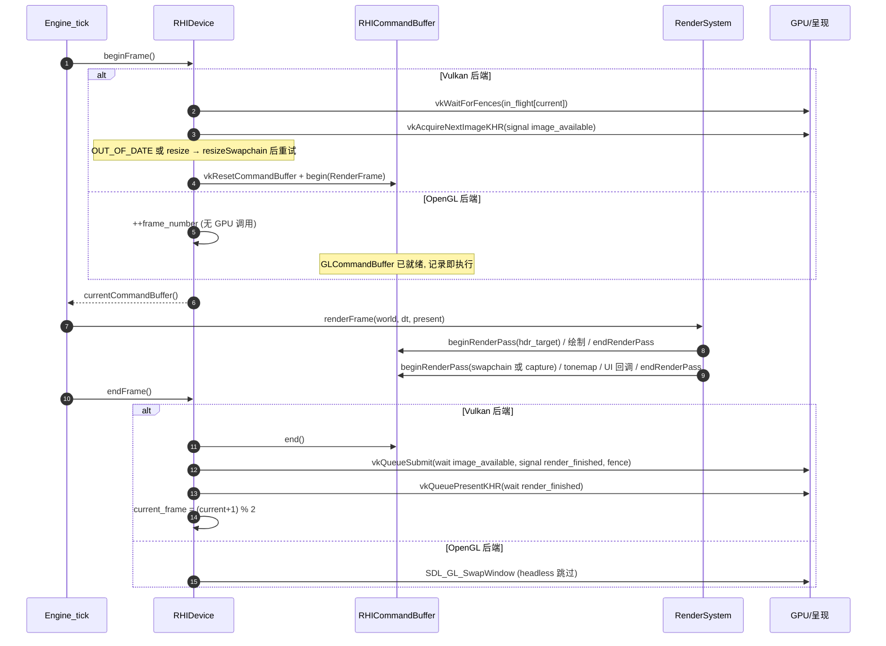

## 4.3 着色器单源双方言方案

### 4.3.1 方言与构建流程

一份 GLSL 源，两个变体（`shaders/common/genesis_shader.h` 头注释 + `scripts/build_shaders.py`）：

- **Vulkan 变体**：`#version 450` + `#define GENESIS_VK 1`，显式 `layout(set=,binding=)`、`layout(push_constant)`；
- **OpenGL 变体**：`#version 410`（**macOS 上限**）+ `#define GENESIS_GLSL 1`，无 binding 限定符——GL RHI 在管线构建期按**名字**把 uniform block 绑到 `glUniformBlockIndex(set,binding)`、把采样器 uniform 指到 `glTextureUnit(set,binding)`；push constant 变成名为 `PushConstants` 的 std140 块（binding 0）。

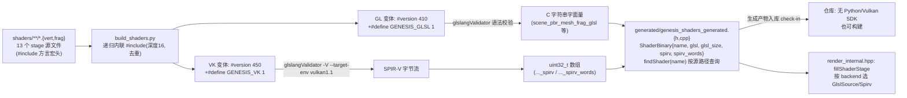

产物**入库策略**（`cmake/GenesisShaders.cmake`）：生成文件提交进仓库，`GENESIS_REBUILD_SHADERS=AUTO`（默认）只在 configure 期检测到 Python3 + glslangValidator/glslc 时重跑；`ON` 强制重建（并额外提供 `GenesisShaders` 构建目标）；`OFF` 用入库头。缺 glslang 时脚本降级为 GLSL-only（`spirv=nullptr`，Vulkan 端 `fillShaderStage` 报错拒载）。运行时 `Shaders::findShader("scene/pbr_mesh.vert")` 以**源相对路径**为 key 取回两种载荷——shader 无磁盘 IO、无路径问题（继承 Piccolo 的"字节数组嵌入"经验，但一份注册表同时服务两个后端）。

### 4.3.2 binding 预算表（为什么是 set0/1/2 + 这些 binding）

摘自 `genesis_shader.h` 头注释（与 `render_system.cpp:138-217` 的布局创建一一对应）：

| set | 语义/绑定频率 | binding | 资源 | GLSL 名 | GL 映射 |
|---|---|---|---|---|---|
| 0 | **scene**（每帧写一次） | 0 | UBO PerFrame(384B) | `PerFrame` | block 1 |
| 0 | | 1 | UBO Lights(544B, 8 灯) | `Lights` | block 2 |
| 0 | | 2 | UBO Environment(64B) | `Environment` | block 3 |
| 0 | | 3 | cube 辐照度图 | `u_irradiance_map` | unit 3 |
| 0 | | 4 | cube 预滤波图 | `u_prefilter_map` | unit 4 |
| 0 | | 5 | 2D BRDF LUT | `u_brdf_lut` | unit 5 |
| 1 | **material**（每材质一组） | 0 | UBO Material(96B) | `Material` | block 9 |
| 1 | | 1..5 | 2D base_color / metallic_roughness / normal / occlusion / emissive | `u_base_color` 等 | unit 9..13 |
| 2 | **per-draw**（dynamic offset） | 0 | UBO PerDraw(144B, dynamic) | `PerDraw` | block 17 |
| — | skybox 专用 set1 | 0/1 | cube/2D 天空贴图 | `u_sky_equirect`/`u_sky_cube` | unit 8/9 |
| — | post 专用 set0 | 0/1 | UBO PostParams(32B) + HDR 场景色 | `PostParams`/`u_scene_color` | block 1 / unit 1 |
| — | IBL 烘焙 set0 | 0/1/2 | UBO IBLParams(32B) + 源 equirect + 源 cube | `IBLParams`/`u_src_equirect`/`u_src_cube` | block 1 / unit 1/2 |
| 0 | push constant（debug line 80B = mat4+vec4；unlit 16B = vec4） | — | — | `PushConstants` | block 0（3 槽轮转） |

设计动因：三个 set 恰好对应三种**变更频率**（帧/材质/绘制），与 Piccolo 的 `_mesh_global/_per_mesh/_mesh_per_material` 三 set 结构同构，但把 Piccolo 的 SSBO(dynamic) 方案换成标准 UBO(dynamic)（GL 4.1 的 SSBO 属 4.3+，不可用）；数值预算确保 GL 端 block ≤ 1+2*8+5=22 < 36、纹理单元 ≤ 2*8+5=21，处于 4.1 最低限额安全区。

### 4.3.3 方言宏与"参数名必须避开关键字"的原因

```c
#ifdef GENESIS_VK
#define GS_UBO(gs_set, gs_binding, gs_block) layout(set = gs_set, binding = gs_binding, std140) uniform gs_block
#define GS_TEX2D(gs_set, gs_binding, gs_name) layout(set = gs_set, binding = gs_binding) uniform sampler2D gs_name
#define GS_PUSH(gs_block) layout(push_constant) uniform gs_block
#else
#define GS_UBO(gs_set, gs_binding, gs_block) layout(std140) uniform gs_block
#define GS_TEX2D(gs_set, gs_binding, gs_name) uniform sampler2D gs_name
#define GS_PUSH(gs_block) layout(std140) uniform gs_block
#endif
#define GS_IN(gs_loc, gs_type, gs_name) layout(location = gs_loc) in gs_type gs_name
```

宏族：`GS_UBO / GS_TEX2D / GS_TEXCUBE / GS_TEX2D_ARRAY / GS_PUSH / GS_IN / GS_OUT`——把"Vulkan 需要、GL 4.1 不允许/不需要"的限定符全部收进 7 个宏，shader 正文对两端完全一致。**关键陷阱**（源码 NOTE 注释原文）：宏参数名**不得**取 `set`、`binding`、`location`——预处理器是无词法意识的纯文本替换，若参数名叫 `binding`，则 `layout(binding = binding)` 中的**限定符关键字本身**也会被实参替换，产出 `layout(0 = 0)` 这类非法代码。因此所有宏参数带 `gs_` 前缀（`gs_set/gs_binding/gs_loc/gs_name`）。

## 4.4 图像朝向约定（orientation contract）

这是双后端离屏渲染正确性的核心约定，`render_scene.cpp:46-66`（CameraState::update 内注释）与 `render_system_frame.cpp:379-402` 是唯一权威：

**决策 1：投影矩阵不做 Y 翻转。** 常见 Vulkan 教程做法是在投影矩阵左乘 `diag(1,-1,1)` 翻转 clip Y（Piccolo 的 `RenderCamera::getPersProjMatrix` 即如此）。v2 明确拒绝，原因是：**翻转 clip Y 会同时反转三角形的屏幕空间绕序**，背面剔除（`FrontFace::CounterClockwise` + `CullMode::Back`）随之翻转；要维持正确剔除就必须为"翻转/不翻转"两类目标各建一套管线变体（或动态改 frontFace），复杂度外溢到每个 pass。v2 选择接受两个后端各自的自然朝向，把修正收敛到唯一一个采样点。

**决策 2：两后端 NDC y=-1 都对应 render target 第 0 行。** GL 窗口坐标原点在左下，NDC y=-1 即第 0 行；Vulkan 帧缓冲坐标 `y_fb = (ndc.y+1)/2 * h`，ndc y=-1 同样落在第 0 行。于是使用 GL 风格（y-up）投影时，**视图的"底部"落在第 0 行**——所有离屏图像统一是"row 0 = 画面底部"，多 pass 链（scene → tonemap → capture）在两个后端上自洽，pass 之间无需任何翻转。全屏四边形的 UV 约定与此对齐：`render_internal.hpp:90-109` 中 uv(0,0) 配对 NDC(-1,-1)，即"uv 原点是 row 0"。

**决策 3：只在 present/tonemap pass 用 flip uv 修正一次。** `post/tonemap.frag` 的 `u_post_a.w > 0.5` 分支执行 `uv.y = 1.0 - uv.y`。`RenderSystem::renderFrame` 的取值规则：

| 输出目标 | flip_uv | 原因 |
|---|---|---|
| **GL 默认帧缓冲**（present） | `false` | 窗口 row 0 = 底部，与离屏图"row 0 = 底部"一致，直接采样即正立 |
| **Vulkan swapchain**（present） | `true` | swapchain image row 0 = 窗口顶部，须翻转 |
| **capture 目标**（`renderAndCapture`，恒 `true`) | `true` | 公共契约：**capture 输出统一为 "row 0 = top"**（测试与截图消费方按普通图像语义读取） |

配套细节：深度范围差异（GL [-1,1] / Vulkan [0,1]）由 `Math::Mat4::perspective(..., zero_to_one_depth)` 在 CPU 端解决（`CameraState::update` 按 `backend` 选择），shader 不需要分支；`PerFrameUBO.backend_params` 仍向 shader 通报 `(flip_uv, zero_to_one, flip_clip_y, 0)` 供特殊路径（如 skybox 用 `inv_view_projection` 重建视线，天然兼容两种 clip 约定）；深度比较两端统一 `CompareOp::LessOrEqual`（GL 端 `glDepthFunc(GL_LEQUAL)` 为初始化默认）。这套约定被 GPU 测试直接验证：`test_gpu.cpp` 全部断言建立在 "row 0 == top" 的 capture 语义上，跨后端比对若朝向错误会产生数量级更大的差异（`test_main.cpp:181-183` 注释原文）。

## 4.5 ECS（sparse-set 实体组件系统）

### 4.5.1 设计定位（`ecs/ecs.hpp` 头注释原文要义）

经典 **sparse-set** ECS——既不是 Piccolo 的 GameObject/Component 树，也不是完整的 archetype 引擎：每组件类型一个 `ComponentPool<T>` 稠密存储（缓存友好迭代）+ 稀疏数组 EntityId→稠密下标（O(1) add/get/remove）；删除 O(1)（末尾元素换入空洞）；实体是 (id, generation) 句柄，可检测悬垂；**层级（parent/children）放在 World 而非 Transform 组件里**，使 TransformSystem 能一次自顶向下遍历；System 是带稳定整数 `order()` 的普通对象，调度器排序一次。

### 4.5.2 sparse-set 存储结构图解

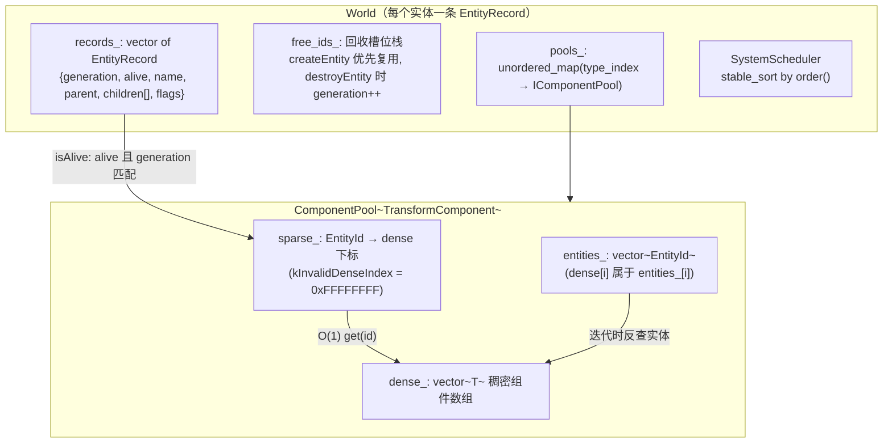

删除流程（`ComponentPool::removeEntity`）：`dense_[index] = move(dense_[last])`、同步搬 `entities_` 并回写其 sparse 项、双 pop、`sparse_[id] = kInvalidDenseIndex`——O(1) 且稠密数组始终无洞。实体销毁（`World::destroyEntity`）：深度优先递归销毁 children → 从父的 children 摘除 → **遍历所有池** `removeEntity(id)` → `alive=false; ++generation; free_ids_.push_back(id)`。

### 4.5.3 类图

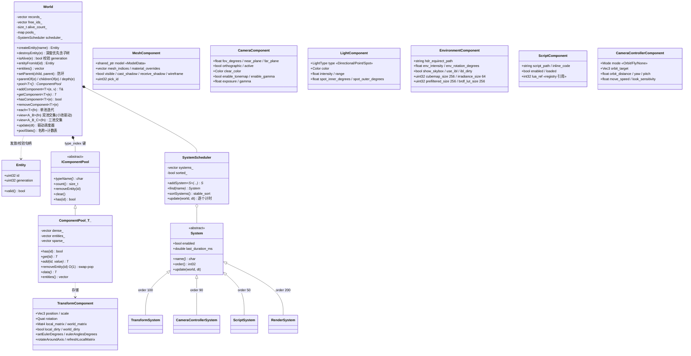

每个组件声明 `static constexpr const char *kComponentName`（如 `"Transform"`），供诊断与 Lua 按名查询。组件是纯数据，**行为全部在 System**。

### 4.5.4 System 调度顺序与一帧时序

| order | System | 职责 |
|---|---|---|
| 50 | `ScriptSystem` | Lua 可能移动实体/改渲染设置，最先跑 |
| 90 | `CameraControllerSystem` | 由 InputSystem 驱动 orbit/fly 相机；`ui_wants_mouse` 为真时不响应拖拽/滚轮（拖滑条不转视角） |
| 100 | `TransformSystem` | `refreshLocalMatrix()` 后按 `world.depth(e)` **稳定排序自顶向下**合成 `world_matrix = parent.world_matrix * local_matrix` |
| 200 | `RenderSystem`（`update()` 只做 `syncFromWorld`：相机/环境/IBL 请求） | 实际绘制由 `Engine::tick` 在 `world.update` 之后显式调 `renderFrame`（保持"先全部模拟、后一次性录制"的清晰边界） |

调度器 `SystemScheduler::update` 对每个启用系统用 `steady_clock` 计时写入 `last_duration_ms`（UI 面板可显示）。一帧内 ECS 数据流：

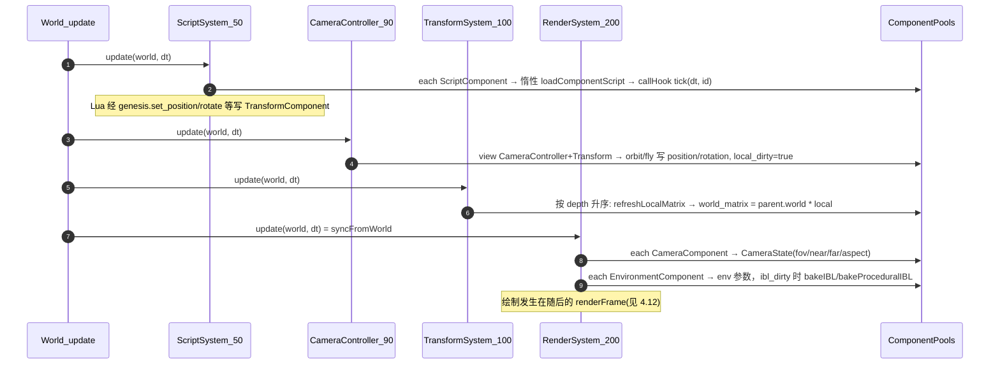

## 4.6 资产管线（resource 层）

### 4.6.1 核心数据结构（`resource/resource_types.hpp`）

**Vertex —— 88 字节单一交错布局**（全 float 属性，保证 GL/Vulkan 完全同构，无整型顶点格式差异）：

| location | 属性 | 类型 | 偏移 | 说明 |
|---|---|---|---|---|
| 0 | position | vec3 | 0 | |
| 1 | normal | vec3 | 12 | 缺失时 `computeNormals()` 平面着色生成 |
| 2 | tangent | vec4 | 24 | xyz 切线 + w 手性；缺失时 `computeTangents()` 由 uv0 解出 |
| 3 | uv0 | vec2 | 40 | |
| 4 | uv1 | vec2 | 48 | lightmap/第二套 UV |
| 5 | joints | vec4 | 56 | 蒙皮关节索引（**以 float 存储**，`kMaxJointInfluences=4`） |
| 6 | weights | vec4 | 72 | 蒙皮权重 |
| — | **stride** | — | **88** | `static_assert(sizeof(Vertex) == kVertexStride)` 锁死 |

（对照：Piccolo 是 44B `MeshVertexDataDefinition` + 独立关节流，GPU 侧拆 3+1 个 binding、uint16 索引上限；v2 单流 7 属性 + u32/u16 自适应索引，两端同一 `VertexLayout`——`render_internal.hpp::meshVertexLayout()`。）

其余结构：

| 结构 | 关键字段 | 说明 |
|---|---|---|
| `ImageData` | `width/height/channels/is_hdr/is_cube`、`pixels(u8)`、`hdr(float RGBA)`、`asRGBA8()`（1/2/3/4 通道统一扩到 RGBA8）、`sampleNearest(u,v)` | CPU 侧图像 IR；`is_cube` 标记 equirect 供 IBL |
| `TextureRef` | `path` 或 `embedded(shared_ptr<ImageData>)`、`srgb`、`valid` | 磁盘路径与容器内嵌图二选一 |
| `MaterialData` | 因子（base_color/emissive/metallic/roughness/normal_scale/occlusion_strength/alpha_cutoff）、`AlphaMode{Opaque,Mask,Blend}`、`double_sided`、五张贴图 `TextureRef`（metallic_roughness 遵循 glTF G=roughness B=metallic） | 金属粗糙度工作流，与 glTF 一一对应 |
| `MeshData` | `vertices/indices(u32)/material_index/bounds/has_normals/has_tangents/has_uv1/has_skin` + `computeNormals/computeTangents/computeBounds` | |
| `NodeData` | `name/local_transform(Mat4)/children[]/meshes[]` | 保留 glTF/FBX 节点层级 |
| `ModelData` | `meshes/materials/images/nodes/root_nodes/bounds/importer("gltf"|"glb"|"fbx"|"obj"|"procedural")` + `flattenNodes()`（层级坍缩为世界空间 `PlacedMesh{mesh_index, transform}` 列表）+ `computeBounds()` | 一次导入的完整产物 |

### 4.6.2 格式分发与两条导入路径

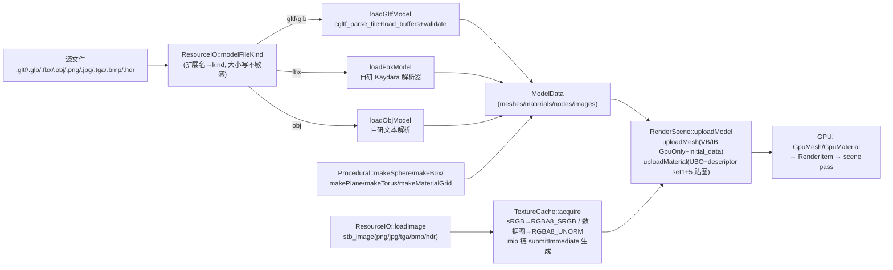

**glTF 路径**（`resource/gltf_importer.cpp`，cgltf）：glTF 本身即 +Y up/右手/-Z forward，与引擎约定一致，**无坐标转换**；逐 primitive 生成 `MeshData`（多 primitive 网格命名 `mesh_p{i}`）；`JOINTS_0` 兼容 u8/u16 存储读成 float；无索引时生成恒等索引；内嵌图片经 buffer view `loadImageFromMemory` 解码后**存入 `model.images` 以在 `cgltf_free` 后存活**；外部 URI 相对 `pathDirectory(path)` 解析；贴图 sRGB 策略：base_color/emissive = true，metallic_roughness/normal/occlusion = false；根节点取活动 scene（否则 scene 0，再否则"非任何节点之子"）；KHR_materials_unlit/transmission 优雅忽略；**尚不支持** morph target、sparse accessor、Draco/Meshopt（文件头注释如实声明）。

**FBX 路径**（`resource/fbx_importer.cpp`，2539 行，无 FBX SDK/assimp，仅标准库 + zlib）：

- 二进制格式：23 字节 magic `"Kaydara FBX Binary  \0"+0x1A 0x00` + u32 版本；节点记录 **<7500 用 u32 三元组、≥7500 用 u64**；NULL 记录终结子表；属性类型 `Y/C/I/L/F/D/S/R` + 数组 `f/d/l/i/b`（Encoding 1 = zlib deflate，`uncompress` 解压）；FBX 6.x 的"标量重复属性伪数组"有回退拼接逻辑；另有基础 ASCII 解析分支。
- 几何：`Vertices`（double 平坦数组）+ `PolygonVertexIndex`（**每多边形最后一角按位取反**，任意 n 边形扇形三角化）+ `LayerElementNormal/UV/Tangent/Color/Material`（四种 Mapping：AllSame/ByPolygon/ByVertex/ByPolygonVertex × Direct/IndexToDirect）。
- 坐标系/单位：读 `GlobalSettings` 的 `UpAxis/UpAxisSign/UnitScaleFactor`，构造单一基变换 `A = axisFixRotation * scale(USF)` **烘进顶点**（位置旋转缩放、法线/切线旋转），节点局部变换做共轭 `L' = A·L·A⁻¹`，保持全层级数学一致（`world'*v' = A*(world*v)`）；欧拉 RotationOrder eEulerXYZ 合成 `R = Rz*Ry*Rx`（对照 assimp FBXConverter 验证）。
- 材质/贴图：`Material` 的 Properties70（DiffuseColor 等）→ `MaterialData`；`Texture→Video` 链接取 `FileName/RelativeFilename` 并按 FBX 目录解析。
- **健壮性**：全部循环受硬上限约束（嵌套深度 64、单数组 16M 元素、文件 512MB、顶点 8M、角点 64M、解压比 256 防 zip bomb），损坏/恶意文件不会挂死或耗尽内存（GPU 测试 `fbx.rejects_garbage_safely` 验证）。
- **蒙皮**：检测到 `Deformer(Skin/Cluster)` 但**不求值**——网格按 bind pose 导入、`has_skin=false`（源码注释 "skinning deliberately not applied"），如实列入 4.13 局限。

**图像路径**（`resource/resource_io.cpp`）：`loadImage`（stb_image，LDR 可强制 RGBA，HDR `stbi_loadf` 存 float）；`loadImageFromMemory` 供容器内嵌图；**写出**：`writeImagePNG`（zlib 自实现编码器）与 `writeImageTGA`——供截图与测试黄金图产物。GPU 侧 `TextureCache::createFromImage` 按 `srgb` 选 `RGBA8_SRGB / RGBA8_UNORM` 格式，mip 链经 `submitImmediate(recordMipGeneration)`（barrier→`generateMipmaps`）生成；采样器按 (mipmap, address) 缓存；内建默认纹理 white/black/flatNormal/grey 惰性创建，材质缺贴图时按槽位语义兜底（base_color→white、metallic_roughness→grey、normal→flatNormal、occlusion→white、emissive→black，`render_scene.cpp:476-480`）。

## 4.7 渲染器（renderer 层）

### 4.7.1 RenderScene：GPU 侧场景镜像

| 类型 | 内容 |
|---|---|
| `CameraState` | position/rotation/forward/up + fov/near/far/aspect/ortho；五矩阵（view/projection/view_projection/inv_view_projection/inv_view）；`update()`（朝向约定见 4.4）、`updateFromTransform(world_matrix)`、`screenRay(pixel, viewport)`（拾取射线，near 平面 z 按后端取 0/-1） |
| `GpuMesh` | VB/IB（`MemoryUsage::GpuOnly` + `initial_data` 一次上传）、index_type（顶点 ≤65535 用 u16，否则 u32——修正 Piccolo 的 uint16 硬上限）、material_index、AABB |
| `GpuMaterial` | `MaterialUBO` + 专属 UBO buffer + **set1 descriptor set**（从 mesh 组合布局分配）+ 五个 `GpuTexture` + transparent/alpha_mask/double_sided 标志 |
| `TextureCache` | key→`GpuTexture` 去重（路径或内嵌指针）；`acquire(ref, srgb, fallback_key)` 失败永不返回空（兜底默认纹理），材质永远有可绑对象 |
| `RenderScene` | `uploadModel/uploadMesh/uploadMaterial/defaultMaterial/updateShadingMode/releaseAll`；持有全部 `unique_ptr<GpuMesh/GpuMaterial>` |

### 4.7.2 Pass 结构与描述符布局

v2 的帧只有**两个 render pass 实例**（对照 Piccolo 的 8-subpass 巨型 pass + 2 阴影 pass + 粒子 pass）：

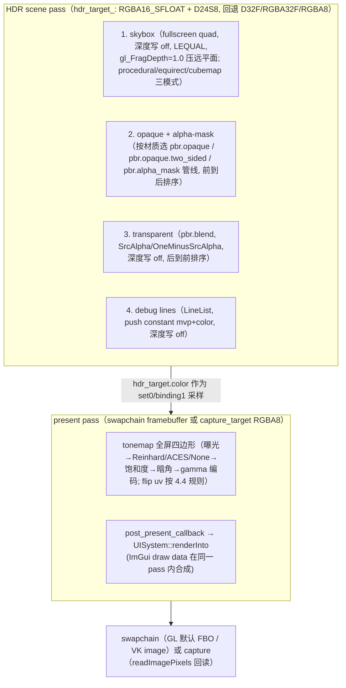

描述符集规划（`render_system.cpp:4-11` 头注释 + `createPersistentResources`）：

| 管线族 | set 0 | set 1 | set 2 |
|---|---|---|---|
| mesh（pbr ×4 变体 + unlit） | scene：PerFrame/Lights/Environment UBO + irradiance/prefilter/brdf 三贴图（**一个组合布局 `mesh-combined` 覆盖 set0..2**，scene/material/per_draw layout 指针全部别名到它） | material：Material UBO + 5 贴图（每材质一个 set） | per-draw：PerDraw UBO（**UniformBufferDynamic**，全引擎共享一个 set，dynamic offset 区分） |
| skybox | scene（同上） | `u_sky_equirect` + `u_sky_cube` | — |
| tonemap/present | PostParams UBO + `u_scene_color` | — | — |
| IBL 烘焙 ×4 | IBLParams UBO + `u_src_equirect` + `u_src_cube` | — | — |
| debug line | —（push constant 80B：mat4 mvp + vec4 color） | — | — |

管线变体：`pbr.opaque`（Back cull）、`pbr.opaque.two_sided`（cull None）、`pbr.alpha_mask`、`pbr.blend`（cull None + alpha blend + 深度写 off）、`unlit`（验证用，push constant 16B 颜色）、`skybox`、`debug-line`、IBL 四条（懒创建）、present/tonemap **按颜色格式缓存**（`presentPipeline(format)`：Vulkan 管线必须与 render pass 兼容，swapchain BGRA8 与 capture RGBA8 各需一条）。调试开关 `GENESIS_DBG_NOCULL=1` 环境变量可对全部 mesh 管线关剔除关深度（区分"没画"与"画了被拒"）。

### 4.7.3 per-draw UBO ring + dynamic offset 机制

继承 Piccolo 的 ring buffer 思想、以 UBO(dynamic) 形态落地（GL 4.1 兼容）：

- 环大小 = `per_draw_stride_ * kPerDrawSlots`，`per_draw_stride_ = alignUp(sizeof(PerDrawUBO)=144, min_uniform_buffer_offset_alignment)`（典型 256B），`kPerDrawSlots = 4096` → 1MB；
- **双帧半区**：`per_draw_frame_base_ = (frame_index % 2) * stride * 2048`——奇偶帧各占半环，GL 立即执行/VK 2 帧 in-flight 下前一帧数据不会被本帧覆写；`allocatePerDrawSlot()` 顺序推进，越过本帧半区则**复用最后一槽**（宁可画错一个也不踩另一帧数据）；
- 每帧 `renderScenePass` 先把全部 RenderItem 的 `PerDrawUBO{model, normal_matrix, object_params(pick_id, wireframe, uv offset)}` 写进 CPU 暂存数组，**一次 `writeBuffer` 批量上传**到 `per_draw_frame_base_`（避免逐 draw 的 map/flush）；
- 绑定时 `bindDescriptorSets(pipeline, {scene_set, material_set, per_draw_set}, 3, &dynamic_offset, 1)`——per_draw_set 全帧只写一次（range=stride），数据切换全靠 dynamic offset；GL 端翻译为 `glBindBufferRange(..., offset+dynamic, stride)`，VK 端为原生 `pDynamicOffsets`。

### 4.7.4 收集、剔除与排序（`gatherRenderItems`）

每帧对 `world.each<MeshComponent>`：不可见/无模型跳过 → 取 Transform 的 `world_matrix` → 经 `bindings_`（`EntityMeshBinding{entity, mesh_indices, material_overrides}`）找 GPU 网格 → 材质覆盖解析 → 构造 `RenderItem{mesh, material, model, normal_matrix=model.normalMatrix(), world_bounds=gpu.bounds.transformed(model), depth=|cam_pos-bounds.center|, pick_id, entity}` → `settings_.frustum_culling` 开启时用 `Math::Frustum::fromViewProjection(camera_.view_projection)` 做 AABB 相交测试（剔除计入 `stats_.culled_items`，GPU 测试 `frustum_culling_removes_draw_calls` 验证）→ 按材质透明标志分入 `opaque_items_`（**depth 升序，前到后**，利用 early-z）与 `transparent_items_`（**depth 降序，后到前**，正确混合）。灯光收集在 `updateLightsUBO`：`each<LightComponent>` 前 8 盏（`kMaxLights`）写入 `GpuLight{position_range, direction_cone(-Z 轴), color_intensity, type_params(type, cos inner, cos outer, enabled)}` + 环境光。

## 4.8 PBR 光照（必须掌握的数学与代码对应）

着色实现集中在 `shaders/common/pbr.h`（BRDF 库）、`scene/pbr_mesh.frag`（材质采集 + 光源循环 + IBL 合成）、`ibl/*.frag`（烘焙）。C++ 侧镜像常量在 `renderer/render_ubo.hpp`。

### 4.8.1 表面描述与工作流

`PbrSurface{N, V, albedo, metallic, roughness, ao, F0, emissive, shading_mode}` 由 `gsMakeSurface()` 构造：roughness 钳制下限 `GS_MIN_ROUGHNESS = 0.045`（保证 D/G 有限，Piccolo 钳 0.05），**metallic 工作流**：

```glsl
s.F0 = mix(vec3(0.04), albedo, s.metallic);   // pbr.h:64
```

材质采集（`pbr_mesh.frag:53-99`）：base_color = 因子 × sRGB 贴图（硬件已线性化）；metallic/roughness = 因子 × 贴图 **B/G 通道**（glTF 约定）；occlusion 按 `occlusion_strength` 与 1.0 插值；emissive = 因子(rgb×a 强度) × 可选贴图；法线贴图经**重正交化 TBN**（`T = normalize(T - N*dot(N,T))`，`B = cross(N,T)*tangent.w` 手性）；`alpha_mode==GS_ALPHA_MASK && alpha<cutoff` 时 `discard`；双面材质把背向视线的 N 翻转。

### 4.8.2 直接光：两种 NDF + Smith-Schlick-GGX + Schlick Fresnel

**法线分布函数 D（两种，运行时按材质 UBO 的 shading_mode 切换）**：

GGX / Trowbridge-Reitz（`gsDistributionGGX`，α = roughness²，Disney 重映射）：

```
D_GGX(NoH, r) = α² / (π · d²),  α = r²,  d = NoH²(α² − 1) + 1
```

```glsl
float a = roughness * roughness;  float a2 = a * a;
float d = (NoH * a2 - NoH) * NoH + 1.0;
return a2 / max(GS_PI * d * d, 1e-7);            // pbr.h:71-77
```

归一化 Blinn-Phong lobe（`gsDistributionBlinnPhong`，教学对比用；shininess 由感知粗糙度导出，半球积分为 1）：

```
n = max(2/α² − 2, 1),  α = max(r², 1e-4)
D_BP(NoH, r) = (n + 2)/(2π) · NoH^n
```

**几何项 G（Smith 联合 + Schlick-GGX 近似，直接光 k 取 (r+1)²/8）**：

```
k = (r + 1)² / 8
G_SchlickGGX(NoX) = NoX / (NoX(1 − k) + k)
G_Smith(NoV, NoL) = G_SchlickGGX(NoV) · G_SchlickGGX(NoL)     // pbr.h:99-109
```

**Fresnel F（Schlick）**：

```
F_Schlick(cosθ, F0) = F0 + (1 − F0)·(1 − cosθ)⁵               // pbr.h:114-118
F_SchlickRough(cosθ, F0, r) = F0 + (max(1−r, F0) − F0)·(1 − cosθ)⁵   // IBL 用
```

**组合（`gsEvaluateDirectLight`，pbr.h:148-174）**——注意直接光的 F 用 **VoH**（Piccolo 用 NoV，二者在 L·H≈V·H 下近似等价）：

```
specular = (D · G · F) / max(4 · NoV · NoL, 1e-4)
kS = F;  kD = (1 − kS) · (1 − metallic)          // 能量守恒: 金属无漫反射
diffuse = kD · albedo / π
Lo = (diffuse + specular) · radiance · NoL        // radiance 已含衰减, 调用方乘 NoL
```

**光源循环与衰减（`pbr_mesh.frag:109-141` + `pbr.h:208-224`）**：≤8 盏灯（`GS_MAX_LIGHTS`）；方向光 `L = -normalize(direction)`，radiance = color×intensity；点/聚光 `L = Δ/|Δ|`，衰减为 **Unreal 风格平滑窗口逆平方**：

```
atten(d, r) = (1 − (d/r)⁴)² / d²        // gsDistanceAttenuation
spot: × saturate((cosθ − cos_outer)/(cos_inner − cos_outer))   // gsSpotAttenuation
```

最后加平坦环境项 `ambient_color × albedo × ao` 与自发光。

### 4.8.3 间接光：split-sum 近似

**合成公式（`gsEvaluateIBL`，pbr.h:185-196）**：

```
F  = F_SchlickRough(NoV, F0, roughness)
kD = (1 − F)(1 − metallic)
Li = [ kD · irradiance(N) · albedo  +  prefiltered(R, lod) · (F · brdf.x + brdf.y) ] · ao
lod = roughness · (mipCount − 1)        // mipCount 来自 EnvironmentUBO.ibl_params.y
```

调用侧（`pbr_mesh.frag:151-178`）：`u_ibl_params.x > 0.5` 启用间接光；`u_ibl_params.z > 1.5`（SkyMode::Cubemap，即已烘焙）采样三张实贴图，否则退回**解析程序化天空**（`gsProceduralSky`：地平线渐变 + 太阳盘）+ Karis 解析环境 BRDF 近似 `gsEnvBRDFApprox`（保证资产加载期画面不纯黑，同时是 LUT 的测试交叉参考）。最终乘 `env_intensity`。

**(1) irradiance 卷积**（`ibl/irradiance.frag`）——余弦加权半球积分：

```
E(N) = (1/π) ∮_Ω L(ω)(N·ω) dω,  dω = sinθ dθ dφ
```

离散化为 (φ,θ) 均匀网格黎曼和（φ 120 步 × θ 60 步）：`sum += L(ω) · cosθ · sinθ`，输出 `E = π · sum / N`。**π/N 归一化的来历**：`dω = sinθ dθ dφ` 中的 sinθ 已作为权重进入求和项，而均匀角度网格的采样密度正比于 1/(ΔφΔθ) = N/(2π · π/2) = 2N/π²，两项合并后常数化简为 π/N（shader 头注释原文："The 1/pi normalisation and the sin(theta) term cancel against the sample density, giving the classic `sum * PI / sample_count` form"）。

**(2) prefiltered specular**（`ibl/prefilter.frag`）——GGX 重要性采样 + Karis 加权平均：

```
L(R, r) ≈ Σ_i L(H_i)·(N·L_i) / Σ_i (N·L_i)                    // Karis 形式
采样: ξ = Hammersley(i, N)(radical inverse Vdc 位反转)
     cosθ = sqrt((1−ξ₂)/(1 + (α²−1)ξ₂)),  α = r²              // GGX NDF 重要性采样
     L = 2(V·H)H − V
方差缩减: 对源 cubemap 用粗糙度相关 LOD 采样
     pdf = D(NoH)·NoH/(4·VoH);  sa_texel = 4π/(6·256·256)
     sa_sample = 1/(N·pdf);  mip_bias = 0.5·log2(sa_sample/sa_texel)
     L_i = textureLod(u_src_cube, L, mip_bias)
```

roughness→mip 的映射由 CPU 驱动：**逐 mip 一遍烘焙**，`roughness = mip/(prefilter_mips−1)`（`render_system_ibl.cpp:430-443`），运行时反向用 `lod = roughness·(mipCount−1)` 采样——两端公式互逆。

**(3) BRDF 积分 LUT**（`ibl/brdf_lut.frag`）——Karis《Real Shading in Unreal Engine 4》/ LearnOpenGL 积分：

```
对 (NoV, roughness) 网格:  V = (sqrt(1−NoV²), 0, NoV), N = (0,0,1)
GGX 重要性采样 H → L = 2(V·H)H − V
G 用 IBL 重映射 k_IBL = r²/2（注意与直接光 k=(r+1)²/8 不同, Karis/LearnOpenGL 约定）
G_Vis = (G · VoH) / (NoH · NoV)        // 重要性采样已消去 D 与 1/(4·NoV·NoL)
Fc = (1 − VoH)⁵
A += (1 − Fc)·G_Vis;  B += Fc·G_Vis    // 即 F = F0·A + B 的 (scale, bias) 拆分
输出 rg = (A, B)/N 到 RG16F 纹理
```

### 4.8.4 IBL 运行时烘焙管线（时序图）

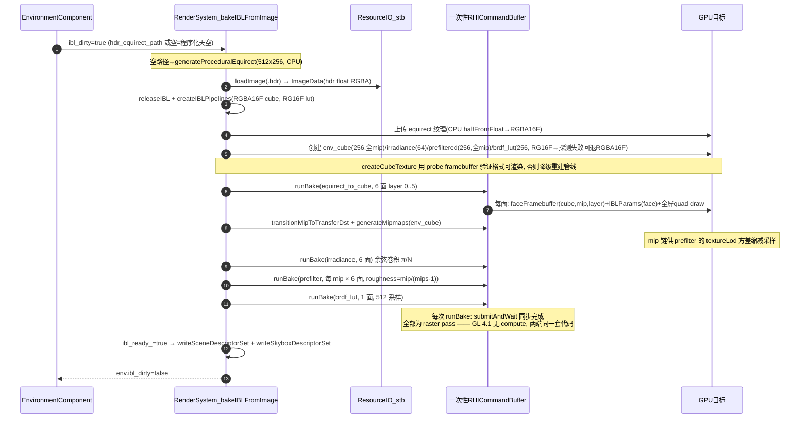

**为什么用 raster pass 而不是 compute**：目标 GL profile 是 4.1 core（macOS 上限），**无 compute shader**（`GLDevice::initialize` 中 `info_.supports_compute = false`，`render_system_ibl.cpp` 头注释："all raster based, so it runs identically on the OpenGL 4.1 and Vulkan backends - no compute shaders required"）。每个烘焙步骤都是"绑定 face/mip 级 framebuffer（`faceFramebuffer` 按 texture+mip+layer+format 哈希缓存）→ 全屏四边形 draw"。另一个 GL 4.1 约束是**颜色格式选 RGBA16F 而非 RGBA32F**：16F 在 4.1 core 可过滤可渲染，32F 不可过滤（`halfFromFloat` CPU 转换注释原文）。默认烘焙参数：cubemap 256（mip 链 9 级）、irradiance 64、prefiltered 256（9 级）、BRDF LUT 256、prefilter 256 采样、BRDF 512 采样（`IblBakeSettings`）。

### 4.8.5 与 Piccolo 公式对照表

| 项 | Piccolo（mesh_lighting.h/.inl） | Genesis v2（pbr.h/pbr_mesh.frag） | 差异说明 |
|---|---|---|---|
| D | GGX，α=r²，`α²/(π·denom²)` | 同式（`gsDistributionGGX`）**+ 归一化 Blinn-Phong 可切换** | v2 多一种教学用 NDF |
| G | `G_SchlicksmithGGX`，k=(r+1)²/8 | 同式（`gsGeometrySmith`） | 一致 |
| F（直接光） | `F_Schlick(dotNV, F0)`（用 NoV） | `gsFresnelSchlick(VoH, F0)`（用 VoH） | 近似等价；VoH 是更常见写法 |
| specular 分母 | `4·NoL·NoV + 0.001` | `max(4·NoV·NoL, 1e-4)` | 同为防除零 |
| kD | `(1−F)(1−metallic)` | 同 | 一致 |
| F0 | `mix(0.04, basecolor, metallic)` | 同 | 一致 |
| roughness 钳制 | `max(0.05, r)` | `max(0.045, r)` | 数值接近 |
| IBL Fresnel | `F_SchlickR(NoV,F0,r)` | `gsFresnelSchlickRough` 同式 | 一致 |
| BRDF LUT | 离线预烘焙 `brdf_schilk.hdr` | 运行时 `ibl/brdf_lut.frag` 积分（k=r²/2，(1−Fc)/Fc 拆分） | v2 免资产 |
| prefilter lod | `roughness * MAX_REFLECTION_LOD(8.0)`（资产 mip） | `roughness * (prefilter_mip_levels−1)`（烘焙 mip 数） | 同族公式 |
| 合成 | `kD·irradiance·basecolor + prefiltered·(F·x+y)` | 同式再 `× ao × env_intensity` | v2 接通了 AO（Piccolo occlusion 绑定但未使用） |
| 点光衰减 | `1/(d²+1) · (1−d²/r²)` | Unreal 窗口 `(1−(d/r)⁴)²/d²` | v2 远处衰减更平滑 |
| 环境项 | `basecolor × ambient_light` 常数 | `ambient_color × albedo × ao` 常数 +（可选）完整 IBL | 结构一致 |
| 阴影 | 方向光 4096² 单张 + 点光 dual-paraboloid | **无**（局限，见 4.13） | 未对齐 |
| emissive | 延迟路径丢失 | 完整参与合成 | v2 修正 |

## 4.9 UI 与脚本

### 4.9.1 ImGui 双后端对接（`ui/ui_system.*`）

| 环节 | OpenGL 路径 | Vulkan 路径 |
|---|---|---|
| 平台后端 | `ImGui_ImplSDL2_InitForOpenGL(window, SDL_GL_GetCurrentContext())` | `ImGui_ImplSDL2_InitForVulkan(window)` |
| 渲染后端 | `ImGui_ImplOpenGL3_Init("#version 410")`（bundled mini loader `imgui_impl_opengl3_loader.h`，GLSL 410 保持在 macOS 4.1 core 内） | `ImGui_ImplVulkan_Init(init_info, vk->vkSwapchainRenderPass())`：专属 descriptor pool（11 类型 ×1000，`FREE_DESCRIPTOR_SET_BIT`）、`Subpass=0`、`MinImageCount=2`、`ImageCount=max(2, swapchainImageCount)`；字体经 `beginSingleTimeCommands → ImGui_ImplVulkan_CreateFontsTexture → endSingleTimeCommands` 上传 |
| 帧内绘制 | `ImGui_ImplOpenGL3_RenderDrawData`（立即执行；随后恢复 viewport/scissor，因 GL 命令缓冲是记录即执行语义） | `ImGui_ImplVulkan_RenderDrawData(draw_data, cmd->nativeHandle())`——**全引擎唯一一处 native 句柄跨界**，且被限制在第三方集成代码内（`ui_system.hpp` 头注释明示） |
| NewFrame | `ImGui_ImplOpenGL3_NewFrame` | `ImGui_ImplVulkan_NewFrame` |

**为什么 UI 画在 present pass 内部（post-present callback）而不是新开一个 pass**：`RenderSystem::setPostPresentCallback(cb, user)` 注册 `uiPostPresentHook`（`engine.cpp:15-19`），在 `renderPresentPass` 的 tonemap draw 之后、`endRenderPass` 之前回调（`render_system_frame.cpp:538-539`）。收益（`ui_system.hpp` 头注释原文）：**两个后端每帧都只有一个 present pass 实例**——若 UI 独立成 pass，Vulkan 端需要第二个 render pass（LoadOp::Load 保住 tonemap 结果）+ 每个 swapchain image 复制一套 framebuffer，GL 端也要多一次 FBO 切换；而在同一 pass 内追加 ImGui 绘制天然满足 Vulkan 的 render pass 兼容性（ImGui 管线就用 swapchain render pass 创建），UI 也自动位于色彩管线末端、可被 capture 路径复用（headless capture 不注册回调即得纯场景图）。这与 Piccolo 把 UI 塞进 MainCameraPass subpass 6 是同一动机，但 v2 不需要 input attachment 这种纯 Vulkan 特性。

**输入事件流与 ui_wants_mouse**：

```
SDL_PollEvent → WindowSystem::pollEvents(event_filter)
   ├─ event_filter: ui_.processEvent(e)   → ImGui_ImplSDL2_ProcessEvent (先喂 UI)
   └─ 引擎处理:      input_.processEvent(e) → 键鼠状态机 (current_/previous_ 双缓冲)
帧内: ui_.beginFrame(input, dt)
   └─ io.WantCaptureMouse/Keyboard → input->ui_wants_mouse / ui_wants_keyboard
消费方: CameraControllerSystem (order 90): ui_wants_mouse 为真 → 忽略拖拽/滚轮;
        Engine::tick: Escape 仅在 !ui_wants_keyboard 时触发退出;
        Lua: genesis.input_key 等照常查询 (脚本可自行判断)
```

这是对 Piccolo"无 WantCaptureMouse 过滤、点击穿透"问题的直接修正（`input_system.hpp` 头注释点名 "the same pattern Piccolo uses with its EditorInputManager"，但 v2 用的是 ImGui 官方捕获标志而非矩形测试）。

### 4.9.2 Lua 脚本系统（`script/script_system.*`）

**架构**（头注释明文对照 Piccolo）：Lua 5.4 vendored（`src/external/lua/*.c` 全量编入 GenesisEngine）；**一个共享 `lua_State`**；引擎上下文（`LuaContext{self, world, render, input}`）以 light userdata 存 registry（key `"genesis.engine_context"`），全部 C 闭包经它访问引擎。

**沙箱机制（每脚本独立 env）**：`loadComponentScript` 为每个 ScriptComponent：

1. `lua_newtable` 建 env 表 + metatable（`__index` → 全局表，读穿透、写隔离——脚本间全局变量互不污染）；
2. Lua 5.4 的 `lua_load` 不再接受 env 参数（`setfenv` 已移除），因此**先 `lua_load` 编译 chunk，再用 `lua_setupvalue(chunk, 1, env)` 替换其第一个 upvalue `_ENV`**（源码注释原文："Lua 5.4 dropped the `env` argument of lua_load: load the chunk first, then replace its _ENV upvalue with our sandbox table"）；
3. `lua_pcall` 执行 chunk 体（定义 start/tick 等函数进 env）；env 存入 registry，引用号记入 `ScriptComponent::lua_ref`；
4. 立即查找并调用 `env.start(entity_id)`（存在才调，栈平衡每条路径都保证）。

**tick 约定**：`ScriptSystem::update`（order 50）先 `each<ScriptComponent>` 惰性加载未编译脚本（`enabled && !loaded`），再对每个已加载脚本 `callHook("tick", ...)` → `env.tick(delta_time × time_scale, entity_id)`；错误统一 `reportError`（计数 + 最近 100 条环形缓存 + `GEN_LOG_ERROR`），单个脚本异常不影响其余脚本与引擎。脚本来源：`script_path`（.lua 文件，chunk 名 `@path`）优先，否则 `inline_code`（demo 的 LuaAnimator 即内联脚本：每帧 `genesis.rotate(GenesisTorus, 0, 40°·dt, 12°·dt)`）。

**API 清单（全局 `genesis` 表，43 个函数 + 2 个版本常量）**：

| 分组 | API | 语义 |
|---|---|---|
| 日志 | `log_info / log_warn / log_error` | 转发 `GEN_LOG_*`，前缀 `[lua]` |
| 时间 | `elapsed() / frame() / set_time_scale(s)` | 脚本时钟（受 time_scale 缩放）/帧号/时间缩放 |
| 实体 | `entity_create(name) / entity_destroy(id) / entity_find(name) / entity_count() / entity_name(id)` | World 实体生命周期与查询（id 经 `entityFromId` 重建代际句柄，防悬垂） |
| 变换 | `get_position / set_position / translate / get_rotation(欧拉度) / set_rotation / rotate(增量度) / get_scale / set_scale / set_parent(child, parent)` | 直接读写 TransformComponent（写后置 local_dirty，TransformSystem 同帧生效）；层级挂接 |
| 灯光 | `light_set(id, type, r,g,b, intensity, ...)` | 写 LightComponent |
| 输入 | `input_key("w") / input_key_pressed("space") / input_mouse(button) / input_mouse_pos() / input_mouse_delta() / input_wheel()` | 键名→SDL scancode 映射表（a-z、0-9、f1-f8、space/shift/ctrl/alt/escape/tab/enter/方向键等） |
| 渲染设置 | `render_set_exposure / render_set_gamma / render_set_tonemap / render_set_shading / render_set_wireframe / render_set_skybox / render_set_env_intensity / render_set_env_rotation / render_set_ambient / render_set_ibl` | 直写 `RenderSettings`（tonemap: none/reinhard/aces；shading: cook-torrance/blinn-phong） |
| 统计/调试 | `render_stats()`（draw_calls/triangles/opaque/transparent/culled/lights/meshes/materials/scene_ms/present_ms/frame/ibl_ready/backend 全表返回）/ `render_draw_line / render_draw_box`（即时调试线）/ `render_bake_ibl(path)`（触发运行时 IBL 重烘焙） | UI 面板与测试共用 |
| 资产 | `load_model(path, x,y,z, scale)`（导入 + spawn 实体 + 绑定 GPU 网格，等价 `Engine::spawnModel`）/ `model_info(entity_id)`（name/importer/meshes/materials/triangles/vertices） | 脚本内动态加载 glTF/FBX/OBJ |
| 常量 | `genesis.version`（`GENESIS_ENGINE_VERSION`="2.0.0"）/ `genesis.lua_version`（LUA_RELEASE） | 脚本特性探测 |

测试保障：`test_cpu.cpp` 的 `script.api_surface_is_complete` 逐个断言 43 个 API 存在且类型为 function；`script.lua_vm_and_entity_api`、`script.component_lifecycle_hooks` 验证沙箱、start/tick、代际句柄。

## 4.10 跨平台构建

### 4.10.1 CMake 结构

```
CMakeLists.txt (project GenesisRender VERSION 2.0.0, C++17, PIC)
├── 选项: GENESIS_BACKEND_OPENGL(ON) / GENESIS_BACKEND_VULKAN(ON) /
│         GENESIS_BUILD_DEMO(ON) / GENESIS_BUILD_TESTS(ON) /
│         GENESIS_LEGACY_DEMO1(OFF, 仅 APPLE 生效) /
│         GENESIS_VULKAN_VALIDATION(OFF) / GENESIS_REBUILD_SHADERS(AUTO|ON|OFF)
│         （两后端同时 OFF → FATAL_ERROR）
├── 平台探测: GENESIS_PLATFORM_MACOS / _LINUX（其余平台仅警告）
├── 依赖: Threads(必需) + ZLIB(必需, FBX 解压/PNG 写出) +
│         SDL2(必需; CMake 包→pkg-config→手工 find 三级探测; 无 SDL2::SDL2 目标时自建 INTERFACE GenesisSDL2) +
│         Vulkan(可选! 找不到→警告并自动 GENESIS_BACKEND_VULKAN=OFF, 构建降级为 GL-only)
├── include(GenesisShaders) → genesis_configure_shaders()   # 见 4.3.1 入库策略
├── add_library(GenesisEngine STATIC ...)
│     源 = glob src/genesis/**（按路径切分: /rhi/opengl/ 与 /rhi/vulkan/ 分别受
│          GENESIS_BACKEND_OPENGL/VULKAN 开关控制, 其余恒编入）
│        + imgui 源（imgui_impl_opengl3 仅 GL 开关、imgui_impl_vulkan 仅 VK 开关）
│        + glob src/external/lua/*.c
│     PUBLIC 定义: GENESIS_RHI_OPENGL / GENESIS_RHI_VULKAN / GENESIS_PLATFORM_* /
│                  GENESIS_ENGINE_VERSION="2.0.0"
│     PRIVATE: LUA_USE_LINUX|LUA_USE_MACOSX; vendored 源 -w 静音
│     链接: SDL2 + Threads + ZLIB::ZLIB + GenesisShaderHeaders
│           macOS: -framework OpenGL/Cocoa/QuartzCore/IOKit/CoreVideo/CoreFoundation
│           Linux: ${CMAKE_DL_LIBS} + find_library(GL)
├── GenesisDemo (demo/*.cpp → 输出名 genesis_demo; 定义 GENESIS_ASSET_DIR 绝对路径)
├── GenesisTests (tests/*.cpp → genesis_tests; enable_testing +
│                 add_test(genesis_unit_tests COMMAND genesis_tests --no-window))
└── GENESIS_LEGACY_DEMO1 → add_subdirectory(src/demo1)   # v1 相机 demo, 仅 macOS
```

### 4.10.2 macOS GL 4.1 上限如何影响设计（决策清单）

Apple 在 macOS 上冻结于 OpenGL 4.1 core，这一事实上限塑造了 v2 的多个核心决策：

| 约束 | 受影响设计 |
|---|---|
| 无 compute shader（4.3+） | IBL 烘焙全部 raster pass（4.8.4）；`DeviceInfo::supports_compute=false` |
| 无 SSBO（4.3+） | per-draw 数据用 **UBO dynamic offset** 而非 Piccolo 的 SSBO dynamic（4.7.3） |
| GLSL 上限 4.10 | shader GL 方言 `#version 410`；ImGui GL 后端显式 `"#version 410"`；Vulkan 方言 450 不受影响 |
| RGBA32F 不可过滤 | HDR 目标/IBL cubemap 用 **RGBA16F**（可过滤可渲染），CPU 侧 `halfFromFloat` 转换；并配 probe-framebuffer 格式降级链（RGBA16F→RGBA32F→RGBA8） |
| 无 `glDrawElementsInstancedBaseVertex` | GL 命令缓冲对 baseVertex+instancing 组合做软件回退（`gl_command_buffer.cpp:325` 注释） |
| push constant 不存在 | `PushConstants` std140 UBO block 0 + 3 槽轮转模拟（4.2.3） |
| 系统 GL 符号齐全 | **不用 GLAD/GLEW**，直接链接（Linux `GL_GLEXT_PROTOTYPES`+libGL，macOS `OpenGL/gl3.h`+framework），`gl_loader.hpp` 只补少量枚举常量 |
| MoltenVK 特性子集 | Vulkan 后端在 Apple 上启用 portability 枚举 + `VK_KHR_portability_subset` 设备扩展 |

## 4.11 测试与验证体系

### 4.11.1 结构

```
tests/
├── test_framework.hpp   # TEST(group,name) / TEST_GPU(group,name) 宏 + AutoRegister
│                        # CHECK / CHECK_MSG / CHECK_NEAR / CHECK_EQ
│                        # Registry 单例: 分组列表/失败计数/checks 计数/verbose
├── test_main.cpp        # runner: --filter/--verbose/--no-gpu(--no-window)/
│                        #   --backend gl|vulkan/--all-backends/--single-backend
│                        # CPU 组恒跑; GPU 组按可用后端各跑一遍;
│                        # 双后端可用且无 filter 时追加跨后端像素比对;
│                        # 退出码 = (failures==0 && failed_tests==0 && cross_ok)
├── test_cpu.cpp         # 29 个 TEST
└── test_gpu.cpp         # 16 个 TEST_GPU + TestEngine headless 封装 + Image 断言工具
```

### 4.11.2 CPU 测试组（29 例）

| 组 | 用例 | 验证内容 |
|---|---|---|
| math (7) | vec3_basics / mat4_identity_and_multiply / mat4_inverse / quat_rotation / look_rotation_and_euler_roundtrip / projection_and_frustum / ray_intersection | 矩阵求逆精度、四元数-欧拉往返（含万向锁分支）、透视投影与视锥平面、射线求交 |
| ecs (4) | entity_lifecycle_and_generation / components_sparse_set_integrity / view_intersection_and_hierarchy / system_order_and_scheduling | 代际失效检测、swap-pop 后稀疏表一致性、双池交集与 parent/depth、调度器按 order 排序执行 |
| procedural (2) | plane_box_sphere_torus / material_grid | 程序化网格的顶点数/法线/切线/UV/包围盒不变量 |
| gltf (4) | sphere_json_and_glb_match / damaged_helmet_full_pbr_material / multi_node_scene_hierarchy / textured_cube_external_images | .gltf 与 .glb 同几何、五贴图槽与因子、节点层级 flatten、外部图片 URI 解析 |
| fbx (3) | binary_cube_geometry_and_material / binary_sphere_mixed_polygons / rejects_garbage_safely | 二进制 FBX 几何/材质、混合多边形扇形三角化、**垃圾输入安全拒绝**（防御上限） |
| resource (1) | format_dispatch | `modelFileKind/loadModel` 扩展名分发 |
| image (3) | png_loading_known_pixels / hdr_equirect_loading / png_and_tga_roundtrip | stb 解码已知像素、Radiance HDR、PNG/TGA 写出再读回 |
| shaders (1) | registry_has_both_variants | **13 个 shader 全部同时具备 GLSL 与 SPIR-V 载荷** |
| script (3) | lua_vm_and_entity_api / component_lifecycle_hooks / api_surface_is_complete | 沙箱 env、start/tick 钩子、43 API 齐全 |
| render_ubo (1) | struct_sizes_match_glsl | C++ UBO 结构尺寸（384/544/64/96/144/32/32B）与 std140 GLSL 布局一致（配合头文件 static_assert 双保险） |

### 4.11.3 GPU 测试组（16 例）与跨后端像素比对方法论

GPU 测试经 `TestEngine`（headless：隐藏 SDL 窗口 + `RenderSystem::renderAndCapture` → RGBA8、row 0 = top）做**像素级断言**（亮度/通道均值、覆盖计数、`maxAbsDifference/meanAbsDifference`）：

| 组 | 用例 | 断言思想 |
|---|---|---|
| rhi (2) | device_creation_and_limits / clear_colour_readback_is_exact | 设备限额合理性；clear 颜色回读逐位精确 |
| render (6) | unlit_geometry_has_expected_coverage / imported_model_renders_non_black / fbx_model_renders / frustum_culling_removes_draw_calls / tonemap_and_gamma_change_the_output / skybox_fills_the_background (+screenshot_file_roundtrip) | 覆盖率几何断言、真实资产非黑、剔除减少 draw call、tonemap/gamma 改变输出、天空盒铺满背景、截图文件往返 |
| pbr (4) | directional_light_creates_shading_gradient / metallic_differs_from_dielectric / roughness_blurs_the_highlight / blinn_phong_and_cook_torrance_both_work_and_differ / point_and_spot_lights_attenuate | 光照梯度、金属/介质响应差、粗糙度模糊高光、双 NDF 均可用且互异、点/聚光衰减 |
| ibl (2) | brdf_lut_matches_cpu_reference / irradiance_of_uniform_environment_is_constant | **GPU 烘焙 LUT 与 CPU 独立蒙特卡洛积分交叉验证**；均匀环境辐照度为常数（物理不变量） |

**跨后端比对**（`test_main.cpp::compareBackends`，非注册 TEST——需同进程跑两个后端）：构造确定性参考场景（160×160，三球：粗糙介质/光滑介质/金属，固定太阳方向光、关 skybox/IBL、ACES、exposure 1.1），GL 与 VK 各 `captureFrame` 一次；判定：

```
mean  = Σ|gl[i] − vk[i]| / N        要求 mean < 6.0 / 255
ratio = count(|Δ| > 4) / N          要求 ratio < 25%
```

（源码注释：不同驱动/光栅器舍入不同故留容差；**朝向错误或几何缺失会产生数量级更大的差异**——这正是 4.4 朝向约定的回归防线。）产物写 `/tmp/genesis_cross_backend_{gl,vk}.png` 供人工复核。

### 4.11.4 headless 验证环境（Xvfb + lavapipe/llvmpipe）

引擎的 headless 语义 = `SDL_WINDOW_HIDDEN` + `DeviceDesc.headless`（GL 端跳过 SwapWindow，VK 端不建 swapchain 呈现）+ `renderAndCapture` 离屏回读，因此**不需要真实显示器**。在无 GPU 的 Linux 容器/CI 中，本项目按如下环境完成全部 GPU 测试与双后端比对：

- **Xvfb** 提供虚拟 X 显示（SDL 窗口系统依赖）；
- OpenGL 走 Mesa **llvmpipe** 软件光栅（4.1+ core 兼容）；
- Vulkan 走 Mesa **lavapipe** 软件实现（`pickPhysicalDevice` 的评分对 `VK_PHYSICAL_DEVICE_TYPE_CPU` +10，天然可选中）；
- CTest 注册的 `genesis_tests --no-window` 只跑 CPU 组（最快回归）；完整验证用 `--all-backends` 追加跨后端比对。

软件光栅的确定性（同一机器上逐位可复现）反过来使像素断言阈值可以收得很紧。

## 4.12 完整一帧时序图（Engine::tick → present，含 UI 与 Lua）

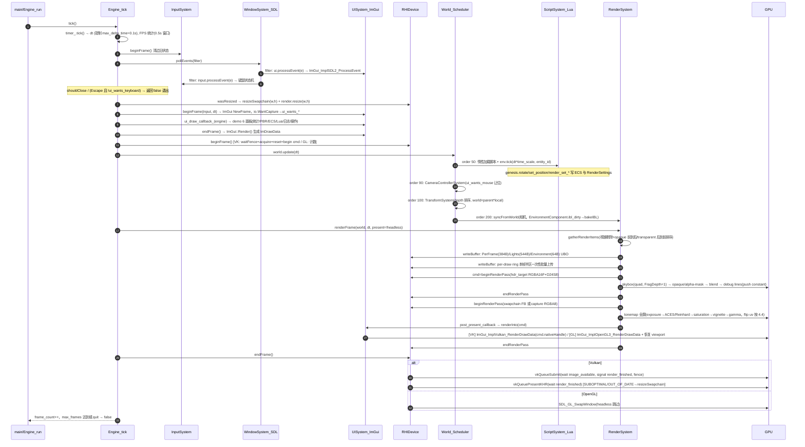

## 4.13 当前局限与后续路线（如实列出）

### 4.13.1 已知局限（全部有源码依据）

| # | 局限 | 现状细节 |
|---|---|---|
| L1 | **FBX 蒙皮未实现** | `fbx_importer.cpp` 检测 `Deformer(Skin/Cluster)` 但不求值："Skinned meshes import in bind pose"，`has_skin=false`；无骨骼动画播放（Vertex 的 joints/weights 槽位已预留，无 skinning shader 路径；glTF 的 JOINTS_0/WEIGHTS_0 会导入数据但同样无 GPU 蒙皮） |
| L2 | **无阴影** | 无 shadow map pass；`MeshComponent.cast_shadow/receive_shadow`、`LightComponent.cast_shadow` 字段已预留未消费（Piccolo 有方向光/点光阴影，此项未对齐） |
| L3 | **单线程渲染** | RHI 明文 "single-threaded on the render thread"；无命令并行录制、无异步上传/IO 线程、资产加载同步阻塞（`loadModel` 在主线程） |
| L4 | 无 MSAA / 无 TAA/FXAA / 无 SSAO/SSR/Bloom | 后处理仅 tonemap+曝光+gamma+饱和度+暗角（Piccolo 至少有 FXAA 与色彩分级槽位） |
| L5 | 无反射/序列化、无场景文件格式、无编辑器 | 场景由 C++/Lua 代码构建；`serialization_blob` 为 v1 遗留；未采用 Piccolo 的 META/codegen 体系（4.13.2 路线项） |
| L6 | TextureCache 无淘汰、RenderScene 资源只增不减 | `releaseAll()` 手动全量释放；无引用计数（Piccolo 同病，但 v2 至少提供确定性释放路径） |
| L7 | per-draw ring 每帧 2048 槽（半环）上限 | 超限复用最后一槽（不越界踩另一帧，但超限物体矩阵错误）；无 GPU-driven/instancing 合批（每 RenderItem 一个 draw call） |
| L8 | glTF 子集 | 无 morph target、sparse accessor、Draco/Meshopt、KTX2；多 scene/多相机/动画通道未导入 |
| L9 | FBX 子集 | pivot 偏移不支持（头注释 "pivot offsets are not supported"）；ASCII 分支仅基础子集；无动画栈（AnimStack 仅解析不消费） |
| L10 | 灯光上限 8 盏、无 tile/cluster | 全量前向循环；无光探针/反射探针 |
| L11 | Lua 无热重载、无协程/沙箱指令配额 | 修改脚本需重启（沙箱只隔离全局表，不限制死循环） |
| L12 | UI 为运行时调试面板 | 无 docking 编辑器工作区、无 gizmo、拾取仅有 `pick_id`+`screenRay` 数据基础未接交互 |
| L13 | swapchain 色彩管理 | `srgb_backbuffer` 默认 false：gamma 编码在 tonemap shader 内做（Piccolo 注释同样承认应改用 sRGB surface）；VK 端 `B8G8R8A8_SRGB` 分支已预留 |
| L14 | Vulkan 后端无 triple buffering | `VK_MAX_FRAMES_IN_FLIGHT=2`（Piccolo 为 3）；无 VkPipelineCache |

### 4.13.2 后续路线（按依赖排序）

1. **阴影**：方向光 CSM（2-4 级）+ 点光 cubemap 阴影 + PCF；compare sampler 抽象（RHI `SamplerDesc.compare_enable/compare_op` 字段已就位）。
2. **蒙皮与动画**：glTF/FBX 动画通道求值 → 关节矩阵 → per-draw UBO 扩容或 UBO 数组 → vertex shader 蒙皮（88B 顶点布局的 joints/weights 已就位）。
3. **场景序列化**：借鉴 Piccolo `$typeName/$context` 多态 JSON 协议，但用轻量宏注册替代 libclang codegen（分析报告 §8.2 的结论）；`.scene.json` + 反射式 Inspector。
4. **异步资产**：IO 线程解码 + 渲染线程上传队列（保留 RenderSystem 同步点语义）。
5. **后处理链**：FXAA/TAA、Bloom、SSAO；HDR 目标已支持 mip 链可扩展。
6. **合批与 GPU-driven**：材质排序合批、instancing、indirect draw（Vulkan 端先行，GL 4.1 降级路径）。
7. **编辑器壳**：ImGui docking 工作区 + gizmo（`TransformComponent`/`screenRay`/`pick_id` 数据基础已备好）。
8. **纹理压缩**：KTX2/BasisU 导入与离线 mip 生成。

---

## 附录：本文档引用的关键源码索引

| 领域 | 文件 |
|---|---|
| v1 | `docs/legacy/CMakeLists_v1_original.txt`、`src/demo1/**`（main.cpp、graphics/gpu_device.*、camera_texture.*、filter_renderer.*、genesis_imgui.*、gpu_resources.hpp、camera/camera_capture.*、filter/filter_system.*）、`src/genesis/application_layer/window.*`、`src/genesis/foundation_layer/{service,memory,log,file,array,assert,platform,serialization_blob}.*` |
| v2 RHI | `src/genesis/rhi/{rhi.hpp,rhi_desc.hpp,rhi_enums.hpp/cpp,rhi_factory.cpp}`、`rhi/opengl/{gl_backend.hpp/cpp,gl_command_buffer.cpp,gl_convert.hpp,gl_loader.hpp}`、`rhi/vulkan/{vk_backend.hpp/cpp,vk_command_buffer.cpp,vk_convert.hpp}` |
| v2 ECS | `src/genesis/ecs/{ecs.hpp,components.hpp,systems.hpp/cpp}` |
| v2 资源 | `src/genesis/resource/{resource_types.hpp/cpp,resource_io.cpp,gltf_importer.cpp,fbx_importer.cpp,procedural_mesh.hpp/cpp,third_party_impl.cpp}` |
| v2 渲染 | `src/genesis/renderer/{render_ubo.hpp,render_scene.hpp/cpp,render_system.hpp/cpp,render_system_frame.cpp,render_system_ibl.cpp,render_internal.hpp}`、`shaders/common/{genesis_shader.h,ubo_layout.h,pbr.h,fullscreen.vert}`、`shaders/scene/{pbr_mesh.vert/frag,skybox.frag,unlit_mesh.*,debug_line.*}`、`shaders/ibl/{equirect_to_cube,irradiance,prefilter,brdf_lut}.frag`、`shaders/post/tonemap.frag`、`shaders/generated/*` |
| v2 平台/UI/脚本/引擎 | `src/genesis/platform_layer/{window_system,input_system}.*`、`src/genesis/ui/ui_system.*`、`src/genesis/script/script_system.*`、`src/genesis/engine/engine.*` |
| 构建/工具/测试 | `CMakeLists.txt`、`cmake/GenesisShaders.cmake`、`scripts/{build_shaders.py,gen_assets.py,gen_fbx_test_asset.py}`、`tests/{test_framework.hpp,test_main.cpp,test_cpu.cpp,test_gpu.cpp}`、`demo/main.cpp`、`assets/**` |
| Piccolo | 四份分析报告 `work/docs/analysis/piccolo_{core_ecs,render_rhi,asset_pipeline,ui_script_editor}.md` 及其附录中的 Piccolo 源码索引 |

*（完）*
