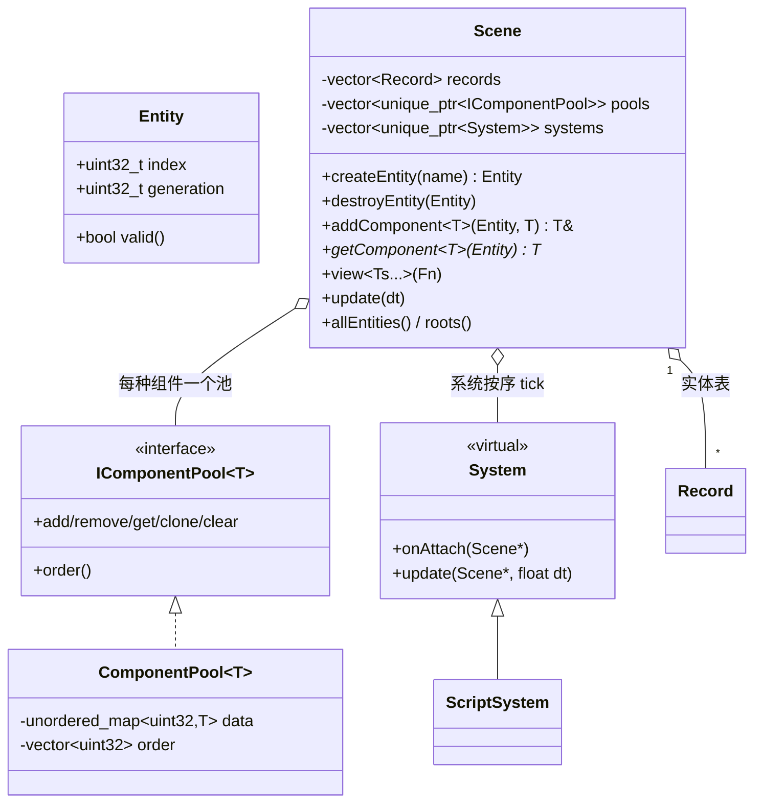
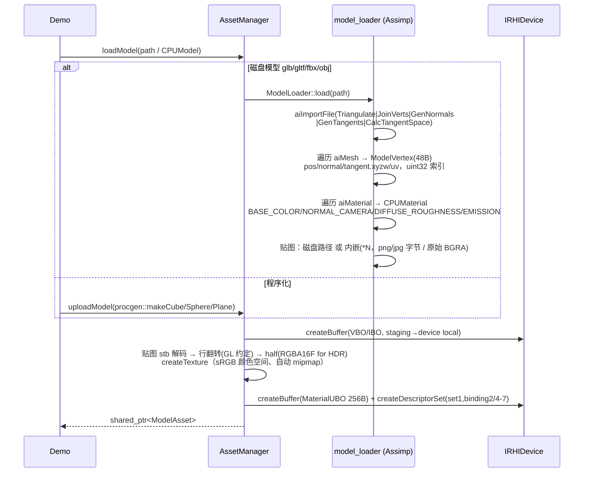
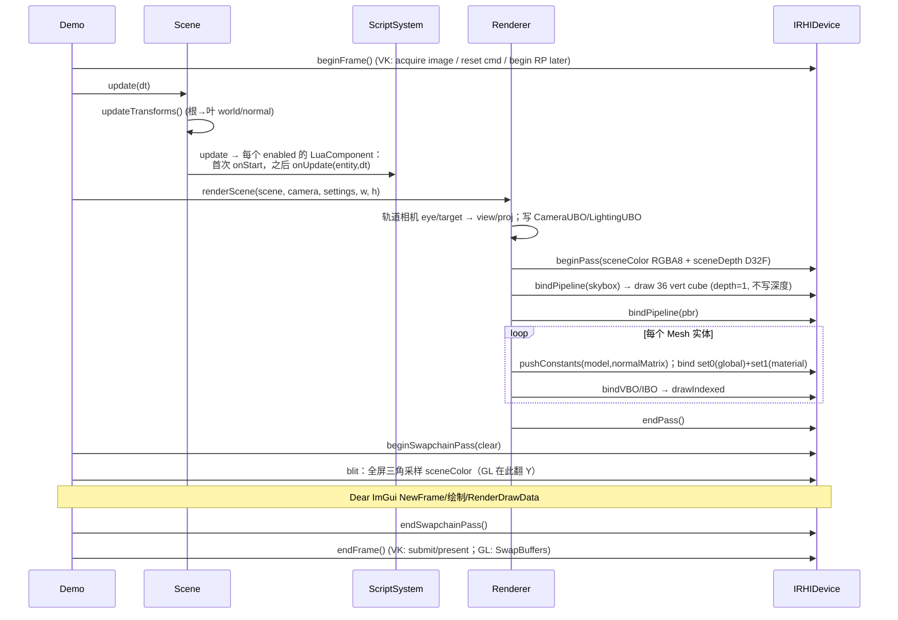
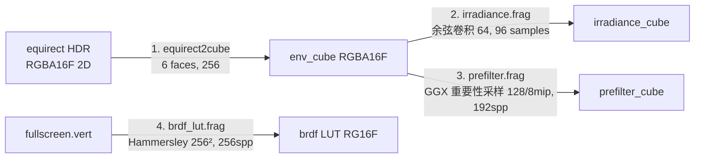
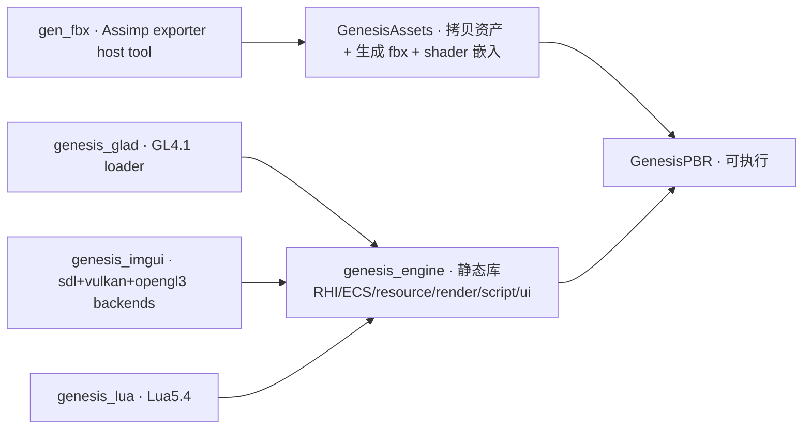

# Genesis Render —— 引擎架构说明文档（升级版）

> 本文档描述重构后的 Genesis-Render 引擎。引擎从原来的 Vulkan 相机滤镜 Demo，升级为
> **双图形后端（OpenGL 4.1 core + Vulkan）**、组件式 ECS、PBR/IBL 渲染管线、
> Assimp 多模型导入、Lua 脚本系统、Dear ImGui 实时编辑界面的小型 3D 引擎。

---

## 1. 分层架构总览

```mermaid
flowchart TB
    subgraph App[Application / Demo]
        DEMO[src/demo/pbr_demo/main.cpp<br/>场景搭建 · 参数解析 · 自测截图]
    end

    subgraph UI[ui —— 实时交互界面]
        EDITOR[ui_service / drawEditor<br/>Hierarchy · Inspector · Rendering]
        IMGUI[Dear ImGui]
    end

    subgraph SCRIPT[script —— Lua 脚本系统]
        LUA[ScriptSystem · sol2]
    end

    subgraph RENDER[render —— 前向 PBR 渲染器]
        RDR[Renderer<br/>帧 UBO · 天空盒 · 网格遍历]
        BAKER[IBL Baker<br/>equirect→cubemap · irradiance · prefilter · BRDF LUT]
    end

    subgraph ECS[ecs —— 实体组件系统]
        SCENE[Scene · Entity · ComponentPool]
        SYS[System 接口]
        COMP[Transform/Camera/Light/Mesh/Env/Lua]
    end

    subgraph RES[resource —— 资源系统]
        ASSET[AssetManager · 路径缓存 · 默认贴图]
        ASSIMP[model_loader (Assimp)<br/>glTF/glb · FBX · OBJ ...]
        IMG[image (stb_image) · procgen]
    end

    subgraph RHI[rhi —— 硬件抽象层（双后端）]
        API[IRHIDevice 抽象接口]
        GL[OpenGL 4.1 backend<br/>gl_rhi.cpp · glad]
        VK[Vulkan backend<br/>vk_rhi.cpp]
        PRE[glsl_preprocess<br/>Vulkan SPIR-V ↔ OpenGL GLSL]
    end

    subgraph FOUND[foundation / application / math]
        WIN[Window (SDL2) · log · memory · array]
        MATH[math.hpp (列主序 Mat4)]
    end

    DEMO --> EDITOR
    DEMO --> LUA
    DEMO --> RDR
    DEMO --> SCENE
    EDITOR --> IMGUI
    LUA --> SCENE
    RDR --> SCENE
    RDR --> ASSET
    RDR --> API
    SCENE --> SYS
    SCENE --> COMP
    ASSET --> ASSIMP
    ASSET --> IMG
    API --> GL
    API --> VK
    VK --> PRE
    RDR -.SPIR-V/GLSL.-> PRE
    GL --> WIN
    VK --> WIN
    RDR --> MATH
```

### 1.1 目录与模块

| 目录 | 模块 | 关键类型 |
|---|---|---|
| `src/genesis/foundation_layer` | 基础服务 | `Array<T>`、`HeapAllocator/TLSF`、`LogService`、`FileService` |
| `src/genesis/application_layer` | 窗口 | `Window`（SDL2，按后端创建 OpenGL/Vulkan 窗口） |
| `src/genesis/math` | 数学库 | `Vec2/Vec3/Vec4`、列主序 `Mat4`、`Quat`、透视/观察矩阵 |
| `src/genesis/rhi` | **RHI 抽象 + 双后端** | `IRHIDevice`、`rhi_types.hpp`、`glsl_preprocess`、`opengl/`、`vulkan/` |
| `src/genesis/resource` | 资源 | `AssetManager`、`model_loader`（Assimp）、`image`、`procgen`、`PBRMaterial`、`GPUMesh/ModelAsset` |
| `src/genesis/ecs` | ECS | `Scene`、`Entity`、`ComponentPool<T>`、`System`、内建组件 |
| `src/genesis/render` | 渲染器 | `Renderer`、`RenderSettings`、`ubos.hpp`（std140 UBO）、IBL Baker |
| `src/genesis/script` | 脚本 | `ScriptSystem`（sol2 + Lua 5.4，沙箱 environment） |
| `src/genesis/ui` | 编辑器 | `UIService`、`drawEditor` |
| `src/demo/pbr_demo` | 可执行 Demo | `GenesisPBR` |
| `assets/` | 运行资源 | HDR、glb、运行期生成的 fbx、Lua 脚本 |
| `assets/shaders/glsl` | 单一源码 shader | Vulkan 直接编译 SPIR-V；OpenGL 运行期转换 |

第三方库全部随仓（`src/external/`）：SDL2/系统查找、Vulkan-Headers、Assimp（系统）、
glad 4.1（生成）、Dear ImGui 1.86、sol2 + Lua 5.4、stb_image/write、cglm 等。

---

## 2. RHI 抽象层（能力对齐的核心）

### 2.1 设计目标

上层 `Renderer` 只依赖 `IRHIDevice` 纯虚接口，**完全不知道后端是 GL 还是 VK**：

```cpp
class IRHIDevice {
public:
    // 生命周期 / 帧
    virtual bool init(SDL_Window*, uint32_t w, uint32_t h, bool debug) = 0;
    virtual void shutdown() = 0;
    virtual void onResize(uint32_t, uint32_t) = 0;
    virtual bool beginFrame() = 0;
    virtual void endFrame() = 0;
    virtual uint32_t currentFrameIndex() const = 0;

    // 渲染通道（离屏 RT / 最终 present）
    virtual void beginPass(const ColorAttachment colors[], uint32_t count,
                           const DepthAttachment*, const char*) = 0;
    virtual void endPass() = 0;
    virtual void beginSwapchainPass(const float clear[4], float depth) = 0;
    virtual void endSwapchainPass() = 0;

    // 资源（不透明句柄）
    virtual BufferHandle   createBuffer(const BufferDesc&) = 0;
    virtual TextureHandle  createTexture(const TextureDesc&, const void* pixels) = 0;
    virtual SamplerHandle  createSampler(const SamplerDesc&) = 0;
    virtual ShaderHandle   createShaderProgram(const ShaderProgramDesc&) = 0;
    virtual PipelineHandle createPipeline(const PipelineDesc&) = 0;
    virtual DescriptorSetHandle createDescriptorSet(const DescriptorSetDesc&) = 0;
    /* ... update / destroy ... */

    // 命令
    virtual void bindPipeline/Set/VBO/IBO/DescriptorSet/PushConstants/draw* = 0;
    virtual void readTexturePixels(TextureHandle, uint32_t w, uint32_t h, void* out) = 0;

    // 内建离屏场景 RT（场景先渲到 offscreen，再 blit 到 swapchain）
    virtual TextureHandle sceneColor() const = 0;
    virtual TextureHandle sceneDepth() const = 0;
    virtual SamplerHandle linearSampler() / nearestSampler() / cubeMipSampler() = 0;

    // Dear ImGui 后端
    virtual void imguiBackendInit/NewFrame/RenderDrawData/Shutdown/TextureID() = 0;
    virtual const DeviceCaps &caps() const = 0;
};
```

- 资源以 **handle + 定长池（slot pool）**管理：`TRHIHandle<Tag>{uint32_t id}`，
  后端各自维护 `std::array<T, 1024>`，无指针泄漏到上层。
- `DeviceCaps` 描述后端差异：`clipDepthZeroToOne`（Vulkan depth [0,1]）、
  `ndcYDown`（Vulkan NDC y 向下），供矩阵生成使用。
- 后端工厂：`IRHIDevice::create(RenderBackend)`，编译宏 `GENESIS_ENABLE_VULKAN`
  控制 Vulkan 是否编入；Mac 无 Vulkan SDK 时自动回落 OpenGL。

### 2.2 双后端实现要点对照

| 能力 | OpenGL 4.1 core (`gl_rhi.cpp`) | Vulkan (`vk_rhi.cpp`) |
|---|---|---|
| 上下文 | SDL_GL_CreateContext + glad 加载 | Instance（含 portability 条件宏）/Surface/Device/Queue |
| Shader | 同一份 GLSL **运行期预处理**成 410 core | `glslangValidator --target-env vulkan1.1` 构建期生成 SPIR-V，嵌入 C++ |
| Uniform | std140 UBO + `glBindBufferBase`；push_constant 用绑定点 3 的 UBO 模拟 | 原生 UBO + `vkCmdPushConstants` |
| 纹理 | `glTexStorage2D`/`glTexImage2D` 各 mip/面，Sampler Object | VkImage 分设备本地（staging 上传）/宿主可见；mip 用 Blit；布局 barrier |
| Cubemap | `GL_TEXTURE_CUBE_MAP`，FBO 绑 `GL_TEXTURE_CUBE_MAP_POSITIVE_X+i` | Cube Image + 每 face/mip 单独 `VkImageView`，RP+Framebuffer 缓存 |
| 渲染通道 | 单个复用 FBO，动态 attach/detach | RenderPass 按 (color fmt, depth fmt, present?) 缓存；Framebuffer 按 attach 视图缓存 |
| 描述集 | `GLSet{binding→buffer/texture/sampler}`，绑定到 unit/point | 两个固定 SetLayout（0：全局帧；1：材质），DescriptorPool 分配/更新 |
| 管线 | Program + VAO（属性在 bindVBO 时设置） | 固定 PipelineLayout，VS 输入/IA/光栅/深度混合状态全数据化 PSO |
| Present | 默认 framebuffer（深度由 SDL context 提供） | Mailbox→FIFO swapchain，2 frames in flight，fence/semaphore |
| 回读 | 独立 FBO + `glReadPixels`（cubemap 自动读 +X 面） | CopyImageToBuffer + 一次性 command + queue idle |
| 正面绕序 | `glFrontFace(GL_CW)`（投影翻了 NDC Y，绕序镜像） | `VK_FRONT_FACE_COUNTER_CLOCKWISE`（视口本身翻转） |

### 2.3 单一 Shader 源码（一套 GLSL，两端共用）

`assets/shaders/glsl/*.vert|*.frag` 用 Vulkan 风格书写：`layout(set=,binding=)`、
`layout(push_constant)`、`#include "common_pbr.glsl"`、`gl_VertexIndex`。

- **Vulkan**：Python 脚本 `cmake/embed_shaders.py` 构建期调用 glslangValidator
  生成 SPIR-V，并把 SPIR-V 与原始 GLSL 文本都嵌入
  `build/generated/shaders/shaders_embedded.cpp`。
- **OpenGL**：链接时 GLSL 文本同样可访问；`glsl_preprocess.cpp` 在运行期：
  1. 递归内联 `#include "..."`（解析嵌入文本）；
  2. 把 `#version 450` 降为 `#version 410 core` 并定义 `GENESIS_GL`；
  3. 删除 `GL_GOOGLE_include_directive` 等扩展；
  4. `layout(push_constant) uniform Block {` →
     `/*@binding=3*/ layout(std140) uniform Block`（绑定点 3）；
  5. `layout(set=0,binding=N) uniform Block` →
     `/*@binding=N*/ layout(std140) uniform Block`（支持 `{` 换行）；
  6. sampler/image 声明 → `/*@binding=N*/ uniform sampler2D ...;`。
  链接后程序解析这些 `@binding` 标记，用 `glUniformBlockBinding` /
  `glUniform1i` 建立与 Vulkan 一致的绑定表。

### 2.4 固定绑定约定（两后端共享）

| Set | binding | 内容 | std140 布局 |
|---|---|---|---|
| 0 | 0 | CameraBlock：view、proj、viewProj、cameraPos | `ubos.hpp::CameraUBO` |
| 0 | 1 | LightingBlock：方向光、4 个点光源、开关 | `LightingUBO` |
| **push** | 3 (GL) / VK push | ObjectBlock：model(128B)、normalMatrix(128B) | |
| 1 | 2 | MaterialBlock：PBR 因子/UV/自发光 | `MaterialUBO`（256B） |
| 1 | 4/5/6/7 | baseColor / normal / ORM / emissive | |
| 0 | 8 | irradiance cubemap | |
| 0 | 9 | prefiltered env cubemap (8 mip) | |
| 0 | 10 | BRDF 2D LUT | |
| 0 | 11 | skybox environment cubemap | |
| 0 | 12 | blit / equirect 源 2D | |

帧 UBO 每帧按 `currentFrameIndex()` 双缓冲（GL 永远 0，VK 0/1），避免 GPU/CPU 争用。

### 2.5 坐标系与跨后端方向一致性

- Vulkan：投影矩阵翻 NDC Y（`perspective(...,flipY=true)`）、depth 用 [0,1]；
  RenderPass final layout 直接 `PRESENT_SRC`；离屏 RT 内存原点在左上。
- OpenGL：不翻投影 Y、depth [-1,1]；离屏 FBO 内存原点在左下，最终
  blit shader 负责把 offscreen 纹理贴到默认 framebuffer。
- 两后端产出的离屏场景 RT 方向一致；`readTexturePixels` 各自保证输出**左上原点 PNG**。
  在 lavapipe/llvmpipe 软件光栅器上两端画面逐帧统计指标一致（自测 mean/var 近似相等）。

---

## 3. ECS 实体组件系统

### 3.1 类图



- 实体 = `{index, generation}` 句柄，销毁后 generation++ 防悬空引用。
- 组件存储为 `unordered_map<entityIndex, T>` + 稳定 order 列表；
  模板变参 `view<T1,T2>(fn)` 支持多组件查询，空指针/不活跃实体自动跳过。
- 层级：Transform 有 `parent/children`，`attachChild` 维护双向关系；
  `updateTransforms()` 每帧从根深度遍历，组合 `TRS = T·R·S`，法线矩阵
  `normalMat3(invTranspose(model))`。
- `System::update` 顺序固定：`updateTransforms()` → 业务系统（脚本）。

### 3.2 内建组件

| 组件 | 数据 | 用途 |
|---|---|---|
| `NameComponent` | std::string | 层级面板显示、Lua `findEntity` |
| `TransformComponent` | pos / quat rot / scale / 层级 / 缓存 world/normal | 所有可定位物体 |
| `CameraComponent` | fov/near/far、轨道 yaw/pitch/distance/target、正交选项 | 轨道相机 |
| `DirectionalLightComponent` | color、intensity | 太阳，方向 = 旋转后的 (0,-1,0) |
| `PointLightComponent` | color、intensity、range | 最多 4 个（UBO 固定数组） |
| `MeshComponent` | shared_ptr~ModelAsset~、tint、visible | glTF/FBX/程序化网格 |
| `EnvironmentComponent` | HDR 路径、intensity、skybox 开关 | 场景级 IBL |
| `LuaScriptComponent` | path、enabled、started | 每实体 Lua 脚本 |

---

## 4. 资源系统（glTF / FBX / OBJ 导入）



- 顶点布局 `ModelVertex`（`model.hpp`）48 字节：
  `pos(12) · normal(12) · uv(8) · tangent.xyzw(16)`。
- Assimp 材质槽映射（glTF2 metallic-roughness 约定，通道 `.r=AO/.g=roughness/.b=metallic`）：
  `BASE_COLOR→albedo`、`NORMAL_CAMERA→normal`、`DIFFUSE_ROUGHNESS→orm`、
  `EMISSION_COLOR→emissive`；颜色贴图 sRGB，数据贴图 linear。
- 嵌入纹理：glb 中 `*N` 引用 → 压缩 payload 直接交给 stb；原始 aiTexel (BGRA) 转换。
- 1×1 默认贴图：白 albedo、(128,128,255) normal、(255,255,0) ORM、黑 emissive；
  缺贴图槽位自动补默认值，保证任意材质都能着色。
- 程序化网格：立方体、UV 球、平面，带切线/法线（用于不依赖外部资产的自测）。
- **FBX**：除加载外部 FBX 外，构建目标 `gen_fbx`（`tools/gen_fbx.cpp`）
  用 Assimp Exporter 在构建期导出一个带 PBR 材质的 `genesis_cube.fbx`，
  由 AssetManager 实际导入并渲染，作为 FBX 管线端到端验证。

---

## 5. PBR 渲染管线与 IBL

### 5.1 帧时序（sequence）



首帧前（也可运行期一次性）`bakeEnvironment(equirectHDR)`：



- 所有烘焙 pass 都走**同一个 RHI**（cube 几何 + capture viewProj 矩阵，
  90° 透视、6 个标准朝向 lookAt），无后端特殊代码；Vulkan/GL 各自实现离屏 RT。
- 程序化环境：无 HDR 文件时 `procgen::makeProceduralEnvironment`
  生成渐变天空 + 太阳（可完全离线运行自测）。

### 5.2 直接光照：两种模型可切换

LightingUBO `flags.z = directModel`（UI Combo 切换）：

- **0 = PBR (GGX Cook–Torrance)**：
  - D：GGX/Trowbridge-Reitz 法线分布；
  - G：Smith（Schlick-GGX ×2）；
  - F：Schlick Fresnel，金属 `F0=mix(vec3 0.04), albedo, metallic)`；
  - 方向光（含 1/(d²) 衰减的点光）累加镜面漫反射，金属无 diffuse。
- **1 = Blinn–Phong（教学模型，明确分解）**：
  - `fresnel = Schlick(F0, N·H)`；
  - `specular = F · pow(N·H, shininess=mix(8,256,1-rough))`（**specular 项**）；
  - `kd = (1-metallic)·(1-F)`（**diffuse 项**）；
  - 每个项受 metallic/roughness 调制（**metallic 项**：金属关闭漫反射、F0 取反照率）。

### 5.3 间接光（split-sum）

```glsl
F  = fresnelSchlickRoughness(NdotV, F0, roughness);
kS = F; kD = (1-kS)*(1-metallic);
diffuseIrr = texture(irradianceMap, N).rgb * albedo * kD;
prefiltered = textureLod(prefilterMap, reflect(-V,N), roughness*7).rgb;
brdf        = texture(brdfLUT, vec2(NdotV, roughness)).rg;
specularIrr = prefiltered * (F*brdf.x + brdf.y);
color = Lo(direct) + ambient*albedo + (diffuseIrr + specularIrr)*envIntensity;
color += emissive;
out   = tonemap(ACES) → sRGB(gamma 2.2)
```

- 立方体贴图按反射向量 `R=reflect(-V,N)` 采样；
- UI 可分别开关 Direct / IBL / Skybox，并调 IBL 强度与环境光；
- 输出统一在 shader 内做 ACES 色调映射 + sRGB 编码（场景 RT 为 RGBA8
  UNORM，颜色贴图用 sRGB 格式由硬件解码线性）。

---

## 6. Lua 脚本系统

- 基于 sol2（`src/external/sol2`）+ 内嵌 Lua 5.4 源码（无系统依赖）。
- 每个带 `LuaScriptComponent` 的实体：
  - 独立 `sol::environment`（沙箱，共享同一个 `sol::state`，脚本间相互隔离）；
  - 首次 tick：读取 `.lua` 源码 → `safe_script` → 缓存 `onStart`、`onUpdate`；
  - 之后每帧 pcall `onUpdate(entity, dt)`，错误进入 `last_error` 并在 UI Inspector 显示。
- 绑定的 API（`Genesis` 全局表 + LuaEntity userdata）：

| Lua API | 对应 C++ |
|---|---|
| `Genesis.findEntity(name)` | Scene 名字查询 |
| `Genesis.log(msg)` | LogService |
| `Genesis.keyDown("W"/"Space"...)` | SDL_Scancode 轮询 |
| `entity:name()` | NameComponent |
| `entity:getPosition() / setPosition(x,y,z)` | Transform |
| `entity:translate(dx,dy,dz) / rotateY(deg) / rotateAxis(x,y,z,deg)` | 四元数累积 |
| `entity:setLightColor/Intensity/Range` | 方向光/点光 |
| `entity:setBaseColor/setMetallic/setRoughness/setEmissive` | PBRMaterial UBO |

示例：`assets/scripts/rotate.lua`（模型自转 + 微浮动）、
`light_pulse.lua`（驱动点光源颜色/强度正弦动画，帧统计里可见着色变化）。
UI 的 “Reload Lua Scripts” 调用 `ScriptSystem::reloadAll()` 热重载。

---

## 7. 实时交互界面（Dear ImGui）

`drawEditor(EditorState&)` 三个面板（截图见自测产物）：

1. **Scene Hierarchy**：实体列表（名字）、Add Cube/Sphere/Plane（运行期程序化生成）。
2. **Inspector**：
   - Transform：位置/欧拉角(XYZ) / 缩放；
   - Camera：FOV、距离、Near/Far、Target、正交；
   - Directional/Point Light：颜色（ColorEdit3）、强度、Range；
   - Mesh：模型名、子网格数、材质 BaseColor/Metallic/Roughness/Emissive；
   - Environment：HDR 路径、IBL 强度、Skybox；
   - Lua：脚本路径、Enabled、错误信息、Reload。
3. **Rendering**：后端/设备/API 信息、Direct Lighting / IBL / Skybox 勾选、
   Direct Model 下拉（PBR GGX ↔ Blinn-Phong）、IBL Intensity、Ambient、
   帧时间/FPS。

- ImGui 后端由 RHI 实现：
  - GL：`ImGui_ImplSDL2_InitForOpenGL` + `ImGui_ImplOpenGL3_Init("#version 410 core")`；
  - VK：`ImGui_ImplSDL2_InitForVulkan` + `ImGui_ImplVulkan_Init`（DescriptorPool/
    Fonts 一次性 command 上传，每帧 `RenderDrawData`），在最终 swapchain pass 内绘制。
- ImGui 绘制产生的 scissor/VAO 状态在每个 `beginPass` 重置，避免污染引擎绘制
  （这是开发中定位到的一个真实坑）。

---

## 8. 构建系统与跨平台

### 8.1 CMake 目标



- Shader 嵌入是自定义命令（`cmake/embed_shaders.py`），依赖 `assets/shaders/glsl/*`，
  增量构建，无网络依赖。
- 系统库：SDL2（find_package）、Vulkan（可选，找不到自动关闭 VK）、
  OpenGL/GLX（Linux）/OpenGL.framework（Mac）、Assimp（含 z/minizip/draco 等）。
- Mac：universal x86_64+arm64；MoltenVK 存在时通过
  `VK_KHR_portability_enumeration` 条件启用（代码中用字符串+flag fallback，
  旧头文件也能编译）。

### 8.2 Linux/Mac 构建

```bash
cmake -S . -B build -DCMAKE_BUILD_TYPE=Release
cmake --build build -j
./build/bin/GenesisPBR --backend vulkan          # 或 opengl
```

---

## 9. Demo、自测与功能验证

### 9.1 命令行

| 参数 | 说明 |
|---|---|
| `--backend opengl\|vulkan` | 选择 RHI 后端（默认 vulkan） |
| `--width/--height N` | 窗口/渲染分辨率 |
| `--frames N` | 固定帧数后退出（无人值守/CI） |
| `--selftest` | 自测：4 种光照组合各截图并断言像素统计 |
| `--screenshot path.png` | 结束时保存场景 RT 截图 |
| `--model path` | 额外导入 glTF/FBX/OBJ |
| `--hdri path` | 指定 equirect HDR |
| `--script path` | 给头盔模型挂自定义 Lua |

### 9.2 自测覆盖（`--selftest`，两后端均 18 项断言全过）

在第 40/70/100/130 帧分别切换：PBR+IBL、BlinnPhong+IBL、仅直接光、仅 IBL，
对离屏场景 RT 回读 RGBA8，计算均值/方差/高亮点数：

- 每帧非退化亮度（mean>0.01 且 <0.9）、场景细节（variance）、高光存在；
- ECS 实体数量（相机/灯/网格/环境等 ≥10）；
- IBL 纹理全部烘焙完成；
- Lua 脚本无错误（rotate + light_pulse）；
- glTF2 `DamagedHelmet.glb` 成功导入且有网格/材质；
- 构建期生成的 `genesis_cube.fbx` 成功导入。

参考运行（软件光栅 llvmpipe/lavapipe，真实 GPU 上为实时）：

```
[TEST] pbr_ibl        PASS ...
[TEST] blinnphong_ibl PASS ...
[TEST] direct_only    PASS ...
[TEST] ibl_only       PASS ...
[TEST] ECS entity count / IBL baked / Lua no error / glTF / FBX / all ... PASS
[TEST] 18 passed, 0 failed
```

`tests/run_validation.sh` 一键完成两端构建+自测。

### 9.3 已验证的运行环境

- Linux Ubuntu 22.04：llvmpipe（OpenGL 4.5 core）+ lavapipe（Vulkan 1.3.255），
  两端画面与统计一致；交互窗口与 ImGui 面板在 X11 下截图验证。
- 桌面真实驱动（NVIDIA/AMD/Intel、MoltenVK）只需标准 SDK/驱动，无需额外改动。

---

## 10. 设计上的关键取舍 / 踩坑记录

1. **GL descriptor set 模拟**：GL 无描述符集概念，用固定数组
   `binding→{UBO index / texture unit / sampler object}` 模拟；
   资源池 `allocIndex` 必须在分配时置 `alive`（曾因 GLSet 未置 alive 导致全黑）。
2. **GL UBO/sampler 绑定反射**：不写布局文件，预处理后的 GLSL 注入
   `/*@binding=N*/` 标记，链接后程序化解析，和 Vulkan 声明式布局共用一套常量。
3. **Scissor 污染**：ImGui 渲染后会留下 `GL_SCISSOR_TEST`，每个 pass
   begin 必须 disable 并重置 viewport/scissor。
4. **离屏场景 RT + blit**：两后端 NDC/帧缓冲原点不同；统一“场景先渲到离屏纹理，
   再全屏 blit 到 swapchain”，方向差异集中在投影 Y 翻转、front-face、blit/回读三处，
   避免把后端差异扩散到场景/阴影/后处理代码（未来加后处理只需在 blit 前插入）。
5. **RGBA16F HDR 纹理**：OpenGL 4.1 / MoltenVK 对 RGBA32F 线性过滤支持不一致，
   HDR equirect 统一在 CPU 转 half（软件 f32→f16）后以 RGBA16F 上传。
6. **Assimp 内嵌纹理**：压缩 payload 长度在 5.2 是 `mWidth`（无 mSize 字段）；
   原始 aiTexel 内存序为 B,G,R,A。
7. **引擎与第三方解耦**：Assimp 只在 resource 层出现；Lua/sol 只在 script 层；
   ImGui 后端回调全部封装进 RHI，Renderer 不依赖任何窗口/UI API。
