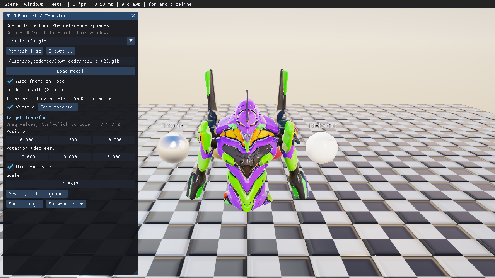

# GLB PBR 查看器与工程审查

验证日期：2026-11-08，macOS，OpenGL / Vulkan（MoltenVK）/ Metal。

## 操作

```bash
cmake --build build -j 6
./build/bin/genesis_demo --backend metal --scene result

# 本次提供的新文件，无需复制到 assets 或修改场景 JSON
./build/bin/genesis_demo --backend metal --scene result \
  --model '/Users/bytedance/Downloads/result (2).glb'
```

入口是 **Scene → GLB PBR viewer**，面板入口是 **Windows → GLB model / Transform**。

1. 下拉框优先列出两辆车 `result.glb`、`result (1).glb`，选择后替换当前目标。四个材质球、地面和环境仍在场景中。
2. **Browse...** 可逐级浏览目录，顶部目录栏也可以直接输入目录；点击 GLB/glTF 文件加载。
3. 路径栏支持任意可访问的本地文件，按 Enter 或 **Load model** 加载。也可从文件管理器将文件拖进 SDL 窗口；同时拖入多个受支持文件时显示最后一个。
4. 放入 `assets/models` 的新文件通过 **Refresh list** 加入列表；从外部目录加载的文件加入当前会话列表。
5. 拖拽 **Position / Rotation (degrees) / Scale** 修改目标的 X/Y/Z。Ctrl+点击数值可键入；**Uniform scale** 切换统一缩放和逐轴缩放。零缩放、负缩放及非有限 UI 数值被限制，避免产生奇异矩阵。
6. **Reset / fit to ground** 根据导入后的完整模型包围盒重新居中、落地，并将最长边适配为 2.8。**Focus target** 对当前变换后的目标取景，**Showroom view** 返回展厅视角。
7. **Auto frame on load** 默认开启，适配车辆与较高模型；可关闭以保持观察视角。**Edit material** 打开原有材质编辑器。

所有网格和内部节点仍使用 glTF 原始层级变换；面板编辑的是模型外层 ECS 实体，因此一次调整会作用于整个模型。新模型可能遮挡部分参考球，可环绕相机查看。



## 实现链路

`Engine::tick` 先处理 SDL 输入与 ImGui，再执行 ECS 的脚本、相机、动画、物理、Transform 和 RenderSystem。
UI 仅登记待加载路径，`DemoApp::tick` 在帧边界执行导入和替换。

- `assets/scenes/result_pbr.scene.json` 只负责展厅、灯光和四个材质球，不再静态放入两辆车。
- `demo/model_viewer.{hpp,cpp}` 管理单个目标、文件路径规范化、CPU/GPU 资源复用、按文件保留 Transform、包围盒适配与相机取景。
- `demo/demo_model_ui.cpp` 提供模型列表、目录浏览、加载状态和 Transform 控件。
- `InputSystem` 复制 SDL_DROPFILE 路径；`WindowSystem` 在事件分发完成后释放 SDL 分配的载荷。
- 先完成解析、校验和上传，再替换旧目标。不存在或无效文件不会清空现有模型。切换不累积 ECS 目标，同一文件不重复上传网格和材质。

## 本次修复的遗留问题

| 问题 | 修复及验证 |
|---|---|
| 缺少法线时，法线累加以 `(0,0,1)` 起始，造成方向偏差 | 改为从零开始面积加权累加；使用不同尺度的 YZ 平面验证法线稳定指向 +X |
| 飞行相机使用“鼠标未捕获或键盘未捕获”，在 UI 输入中仍响应 WASD | 改为由键盘捕获状态决定移动；CPU 测试覆盖键盘捕获且鼠标未捕获的情形 |
| 同一图片作为颜色和数据贴图使用时，缓存忽略 sRGB/线性用途 | 缓存键区分颜色空间和 mipmap；保留公开 source key，兼容材质编辑器的加载成功判定 |
| 内嵌纹理按裸地址缓存，源图释放后地址复用可能命中旧图 | 缓存保留内嵌源图生命周期；GPU 测试验证引用保持与颜色空间隔离 |
| glTF 校验失败后仍读取数据，可能继续使用越界 accessor/index | 校验失败直接拒绝；损坏文件用例验证旧模型和实体仍保留 |
| glTF strip/fan 原样交给 triangle-list 管线，拓扑错误 | 转为三角形列表并保持 strip 绕序；点/线不再被当作三角形；使用生成夹具测试索引 |
| glTF 合法的 `alphaCutoff = 0` 被错误改为 0.5 | 尊重解析值，缺省值继续由 cgltf 提供；新增零值回归 |
| OpenGL 4.1 无 compute 时，光追 CPU 回退被短路，未分配输出纹理 | 将输出资源准备移出 GPU 能力判断；三后端测试包含首次绘制及调整输出尺寸 |

## 验证结果

```bash
GENESIS_TEST_GLB='/Users/bytedance/Downloads/result (2).glb' \
  ./build/bin/genesis_tests --all-backends
./build/bin/genesis_demo --backend metal --headless --selftest
```

| 验证 | 结果 |
|---|---|
| Release 构建 Demo / Tests | 通过 |
| CPU 与三后端 GPU 回归 | 166 tests / 115371 checks，0 failed |
| PBR 与 feature 两组跨后端图像 | 三组后端组合均 MATCH，本机平均差异 0/255 |
| 两车反复切换 | 单目标、参考球实体保持、网格/材质/纹理数量稳定，Transform 恢复 |
| 缺失文件与损坏 glTF | 加载失败保留旧目标 |
| 新 `result (2).glb` | 三后端导入与渲染通过；1 mesh、1 material、3 images、99330 triangles |
| Metal Demo 全部场景、面板及脚本示例遍历 | 0 errors |
| Demo ImGui Transform 拖拽自测 | 实际驱动 DragFloat 控件，确认 Position / Rotation / Scale 写回模型，0 errors |
| 最终 Metal 截图 | 已检查完整模型与面板，无裁切，0 warnings / 0 errors |

完整测试的 12 条 error 日志来自预期的负例（损坏模型、缺失文件、非法 Lua 等），均有断言验证；不代表测试失败。初次在沙箱内运行时 SDL 无显示器、VideoToolbox 无法创建会话，随后在可访问本机图形服务的环境完整复测通过。

当前构建为 `GENESIS_ENABLE_V8=0`，因本机未找到 V8 依赖；JavaScript 专属路径未运行。桌面自动化可读取窗口但未能可靠向 SDL 投递原生点击，因此鼠标控件以直接驱动 ImGui 的自测验证；文件拖入覆盖 SDL 事件载荷测试，仍可按上述步骤做文件管理器端的人工验收。

## 后续优化与能力边界

本次审查围绕资源导入、ECS/Transform、渲染与纹理缓存、UI/输入及公开 API 展开，并用已有测试覆盖材质、CommandBuffer、文字、Lua、物理、动画、媒体和光追；不能据此声称引擎没有其他缺陷。

- **资源回收**：查看器按文件缓存资源，重复切换不增长；加载大量不同文件仍会增长至本次 Engine 生命周期结束。一般场景重载也会向全局 mesh/material 库追加资源（`DemoApp::resetWorld` 未释放 `RenderScene` 资源）。后续宜加入模型资源句柄、引用计数和缓存预算；需同时处理材质编辑器、动画和 CommandBuffer 对资源的引用。
- **大文件响应**：解析与 GPU 上传仍在主线程同步完成。后续可将解析、图片解码放到工作线程，在帧边界上传并提供进度/取消。
- **文件更新**：同一路径本会话复用首次导入的资源，不做文件变更监控；需要查看磁盘上的更新内容时重启 Demo。列表、外部文件历史和 Transform 目前仅在会话内保存。
- **glTF 完整性**：当前并非完整 glTF 播放器。Draco/Meshopt、稀疏 accessor、morph、骨骼动画、顶点颜色和高级材质扩展仍需专门实现；引擎的 compute 顶点动画不等同于 glTF 骨骼动画。当前红色参考球使用金属粗糙度材质，原有 Clearcoat 标签不表示实现了 KHR_materials_clearcoat。
- **平台边界**：macOS OpenGL 仅 4.1，compute 顶点动画走 Metal/Vulkan；光追在 OpenGL 4.1 使用已修复的 CPU 路径。V8 的能力验证需安装依赖后另跑。
