# Genesis-Render 与 Piccolo 引擎统一架构设计文档

> 版本：v2.0（2026-09）
> 本文档统一描述：
> **Part 1** — Genesis-Render 改造前架构分析
> **Part 2** — Piccolo 参考引擎架构分析
> **Part 3** — Genesis-Render v2.0 升级改造后架构（本次新增能力的完整设计）
> **Part 4** — 能力对照与验证报告

---

# Part 1: Genesis-Render 改造前架构分析

## 1.1 项目概况

Genesis-Render 改造前是一个基于 **Vulkan + SDL2** 的最小化渲染实验项目（CMake 工程名 `VULKAN_RENDERER`，命名空间 `Genesis`），实际形态为"macOS 相机采集 + GPU 滤镜 + ImGui 显示"demo（demo1）。代码规模很小：

- **引擎库本身不含任何渲染代码**：全部 Vulkan 图形代码放在 `src/demo1/graphics/` 下；
- 引擎核心只有 `foundation_layer`（基础设施）与 `application_layer`（仅 Window 一个类）；
- 第三方库全部以源码形式 vendored 于 `src/external/`（imgui、VMA、tlsf、stb_image、cglm、meshoptimizer、enkiTS、tracy、json.hpp 等，其中大部分未被使用）。

## 1.2 整体架构图

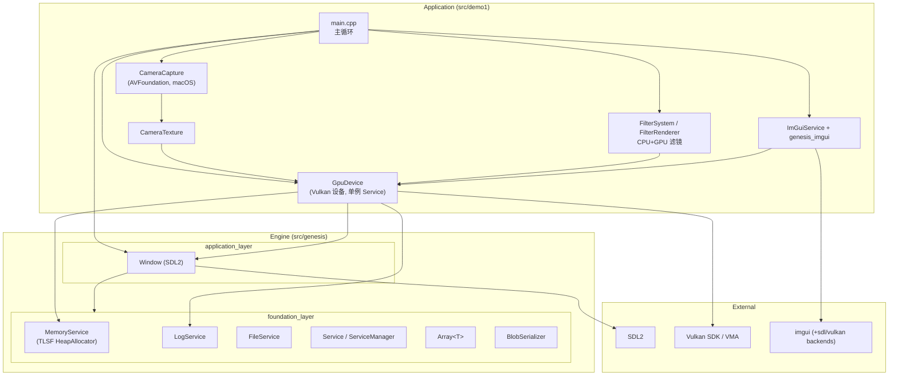

## 1.3 核心类图

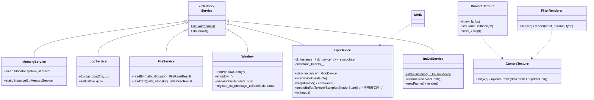

## 1.4 主循环时序图

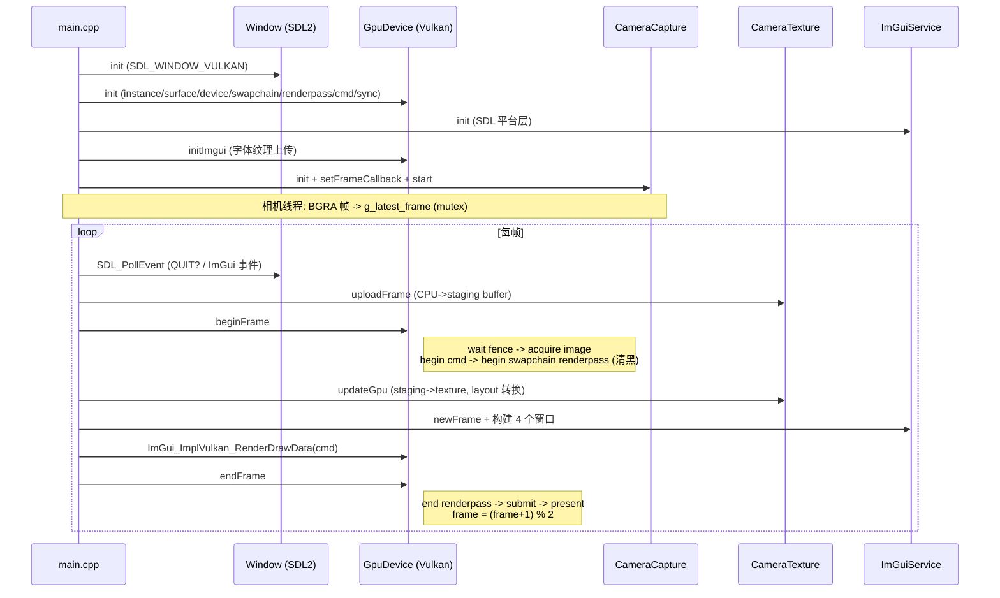

## 1.5 各模块功能说明

| 模块 | 文件 | 功能 |
|---|---|---|
| MemoryService | `foundation_layer/memory.*` | TLSF 堆分配器（默认 32MB 池），`GenesisAlloc/Dealloc` 宏注入 file/line |
| LogService | `foundation_layer/log.*` | `GenesisPrint` 统一日志出口（vsnprintf→printf+回调） |
| FileService | `foundation_layer/file.*` | 文件读写服务（readBin/readText/fileOpen 等） |
| Service 模式 | `foundation_layer/service.hpp` | `GENESIS_DECLARE_SERVICE` 宏 + Meyers 单例，init(void*)/shutdown 生命周期 |
| Array/serialization | `foundation_layer/array.hpp`, `serialization_blob.*` | POD 动态数组（Allocator 注入）、Blob 相对指针序列化框架（预留） |
| Window | `application_layer/window.*` | SDL2 窗口创建（写死 SDL_WINDOW_VULKAN）、事件回调注册（未接好） |
| GpuDevice | `demo1/graphics/gpu_device.*` | Vulkan instance/device/swapchain/renderpass/command/sync/descriptor pool；ImGui Vulkan 后端初始化；资源 createXXX **仅声明未实现** |
| gpu_resources/enum | `demo1/graphics/gpu_*.hpp` | Buffer/Texture/Sampler/ShaderState 结构（Vulkan 类型直接裸露）、Handle typedef（无 Pool）、CreateInfo 链式 setter（无实现） |
| CameraCapture | `demo1/camera/camera_capture.mm` | macOS AVFoundation 相机采集（BGRA、30fps） |
| FilterRenderer | `demo1/graphics/filter_renderer.*` | 离屏全屏 quad GPU 滤镜（8 种滤镜 fragment shader，push constant 传参） |
| ImGui 集成 | `demo1/graphics/genesis_imgui.*` + external | SDL 平台层 + Vulkan 渲染层两段式集成 |

## 1.6 改造前架构的关键缺陷（升级动因）

1. **Vulkan 类型全面裸露**：CreateInfo 参数、资源结构、设备 getter 全部直接使用 VkXXX 类型 → 无法扩展第二后端；
2. **资源管理是空壳**：Handle 只有 typedef 没有 Pool，createBuffer/createTexture 等全部未实现；VMA 仅编译未使用；
3. **渲染流程耦合交换链**：beginFrame 内部直接开启唯一的 swapchain render pass，无深度缓冲，无法组织多 pass（PBR/IBL 烘焙必需）；
4. **已知 bug**：`FileService::readXXX` 条件反转、`Array::push` 未递增 size、Window 回调数组未初始化；
5. **硬编码 macOS**：`"VK_KHR_portability_subset"` 无条件启用、AVFoundation 相机、macOS framework 链接 → Linux 无法构建；
6. **无 ECS / 无模型加载 / 无 PBR / 无脚本 / 无跨平台 UI 渲染层**。

---

# Part 2: Piccolo 引擎架构分析

## 2.1 项目概况

Piccolo（Pilot）是一个教学型迷你游戏引擎（C++17，Vulkan，单后端），由 **editor 可执行 + runtime 静态库 + 编译期代码生成工具（meta_parser/precompile）** 组成。第三方库：glfw、imgui、JoltPhysics、json11、lua-5.4.4 + sol2、spdlog、stb、tinyobjloader、VMA、内置 VulkanSDK（含 glslangValidator）。

## 2.2 整体架构图

```mermaid
graph TB
    subgraph EDITOR["editor (PiccoloEditor)"]
        EUI["EditorUI (imgui)"]
        ESM["EditorSceneManager"]
        EIM["EditorInputManager"]
    end

    subgraph RUNTIME["runtime"]
        ENG["PiccoloEngine<br/>(主循环/FPS)"]
        subgraph GLOBAL["function/global: RuntimeGlobalContext (服务定位器单例)"]
            WM["WorldManager"]
            RSYS["RenderSystem"]
            WINSYS["WindowSystem (GLFW)"]
            INP["InputSystem"]
            PHY["PhysicsManager (Jolt)"]
            PM["ParticleManager"]
            AM["AssetManager"]
            CM["ConfigManager"]
        end

        subgraph FRAMEWORK["function/framework (逻辑层)"]
            LEVEL["Level"]
            GO["GObject<br/>= Entity + vector&lt;Component&gt;"]
            COMP["Component 基类<br/>(Transform/Mesh/Camera/Lua/Motor/Rigidbody/Particle/Animation)"]
        end

        subgraph RENDER["function/render (渲染层)"]
            RSC["RenderScene<br/>(RenderEntity/灯光/可见性)"]
            RRES["RenderResource<br/>(GPU mesh/材质/IBL/per-frame SSBO)"]
            RCAM["RenderCamera"]
            SWAP["RenderSwapContext<br/>(逻辑↔渲染双缓冲)"]
            PIPE["RenderPipeline<br/>(10 个 Pass)"]
            PASS["MainCameraPass<br/>(8 subpass)"]
        end

        subgraph RHI["function/render/interface (RHI)"]
            IRHI["class RHI<br/>~150 纯虚函数"]
            VKRHI["VulkanRHI (唯一实现)"]
        end
    end

    EUI --> ENG
    ENG --> GLOBAL
    WM --> LEVEL --> GO --> COMP
    COMP -- "GameObjectPartDesc" --> SWAP
    SWAP --> RSYS
    RSYS --> RSC & RRES & RCAM & PIPE
    PIPE --> PASS
    PASS --> IRHI
    IRHI <|-- VKRHI
    RSYS --> IRHI
```

## 2.3 核心类图

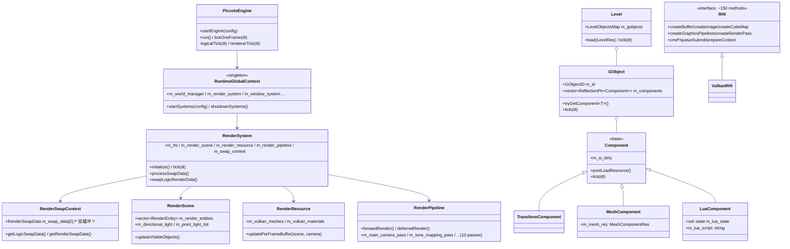

## 2.4 主循环时序图

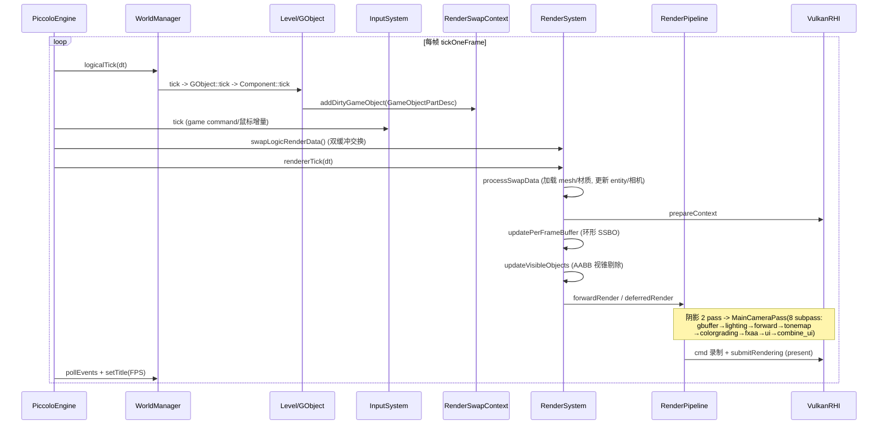

## 2.5 PBR 渲染数据流

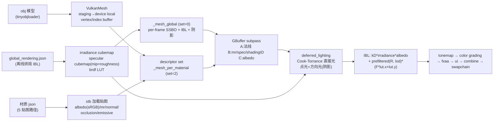

BRDF 数学（`shader/include/mesh_lighting.h`）：`D_GGX` + `G_SchlicksmithGGX (k=(r+1)²/8)` + `F_Schlick`，`F0 = mix(0.04, basecolor, metallic)`；IBL 的镜面项用 `lod = roughness * 8` 采样预滤波 cubemap。

## 2.6 各模块功能说明

| 模块 | 职责 |
|---|---|
| `core/math, core/log, core/meta` | 数学库、spdlog 封装、**反射系统**（配合 meta_parser 生成序列化代码，是资源/编辑器/Lua 绑定的地基） |
| `resource/asset_manager + res_type` | JSON 资源（world/level/object/material/global rendering）的反射式反序列化；大二进制资源由渲染层直接 stb/tinyobj 加载 |
| `function/framework` | GObject-Component 组合模型（**非数据导向 ECS**：组件挂在对象 vector 里按类型名线性查找）、Level/WorldManager |
| `function/render` | RenderSystem 门面 + RenderScene（可见性） + RenderResource（GPU 资源） + RenderSwapContext（逻辑/渲染双缓冲解耦） + RenderPipeline（10 pass，前向/延迟两套 subpass 结构） |
| `function/render/interface` | RHI 纯虚接口（~150 函数），**Vulkan 规范的改名复制**（枚举值与 Vk 一致，接口中仍出现 VmaAllocator/GLFW），唯一实现 VulkanRHI |
| `function/input` | 游戏模式按键位掩码 GameCommand、鼠标增量转 yaw/pitch |
| `function/ui` | WindowUI 抽象，编辑器 EditorUI 实现；ui_pass 直接用 imgui_impl_glfw+vulkan |
| LuaComponent | sol2 绑定极简：`set_float/get_bool/invoke` 三个函数走**引擎反射系统**按字符串访问任意组件字段；每帧重新 `script()` 执行整个脚本字符串 |
| 物理/粒子 | Jolt 封装 PhysicsScene（每 Level 一个）；compute shader 粒子系统经 swap data 与逻辑侧通信 |

## 2.7 Piccolo 的设计特点与短板

**特点**：逻辑/渲染严格分层（swap data 双缓冲）；反射系统一鱼三吃（序列化/编辑器/Lua）；延迟渲染管线 subpass 组织完整（GBuffer→光照→后处理→UI 合成）。

**短板**：① RHI 是"Vulkan 形状的单后端抽象"，接口泄漏 VmaAllocator/GLFW，RenderPipeline 大量 `static_cast<VulkanRHI*>`，**实际不具备多后端能力**；② 模型加载仅 tinyobjloader（OBJ），顶点展开式且 uint16 索引（65535 限制）；③ Lua 每帧重新解释脚本字符串；④ 组件按类型名线性查找；⑤ 单 active level。

---

# Part 3: Genesis-Render v2.0 升级后架构

## 3.1 升级目标与能力对齐

以 Piccolo 为参照，将 Genesis-Render 从"Vulkan 滤镜 demo"升级为具备完整游戏引擎核心能力的跨平台渲染引擎：

| 能力 | Piccolo 现状 | Genesis v2.0 目标 |
|---|---|---|
| ECS 架构 | GObject-Component 组合 | **明确的数据导向 ECS（稀疏集）** |
| 模型导入 | 仅 OBJ（tinyobjloader） | **assimp 多格式（fbx/gltf/glb/obj/dae...）** |
| 实时 UI | imgui（编辑器，仅 Vulkan） | **ImGui 双后端实时交互界面** |
| 脚本系统 | LuaComponent（每帧重解释） | **Lua 5.4 + sol2，per-entity environment + 生命周期** |
| 渲染后端 | 名义 RHI 抽象、实际仅 Vulkan | **真·多后端 RHI：Vulkan + OpenGL** |
| PBR | Cook-Torrance + 离线 IBL | **直接光双模型（BlinnPhong/PBR）+ 运行时 IBL 烘焙** |
| 跨平台 | Win/Linux/mac | **Linux + macOS** |

## 3.2 v2.0 整体架构图

```mermaid
graph TB
    subgraph DEMO["src/demo2 (demo2_pbr 可执行)"]
        MAIN["main.cpp<br/>场景装配/主循环/自检"]
        SHD["shaders/*.vert/.frag<br/>(双后端共享 GLSL)"]
    end

    subgraph ENGINE["src/genesis (GenesisEngine 静态库)"]
        subgraph ECSL["ecs_layer"]
            W2["World<br/>(entity 回收/pool 注册)"]
            POOL["ComponentPool&lt;T&gt;<br/>(稀疏集 sparse set)"]
            COMP2["内置组件<br/>Transform/MeshRenderer/Camera/<br/>DirectionalLight/Script/Name"]
            TSYS["TransformSystem<br/>(层级世界矩阵)"]
        end

        subgraph RHIL["rhi_layer (渲染硬件接口)"]
            IRHID["RHIDevice (纯虚接口)<br/>~40 方法, 零后端类型泄漏"]
            VKD["VulkanDevice<br/>(VMA/池化/管线/描述符/离屏)"]
            GLD["OpenGLDevice<br/>(自研 GL loader/VAO 缓存/FBO)"]
            FACT["createRHIDevice(Backend) 工厂"]
        end

        subgraph RESL["resource_layer"]
            AM2["AssetManager<br/>assimp 模型解析<br/>stb 纹理加载 (含 HDR)"]
        end

        subgraph RENDL["render_layer"]
            RS2["RenderSystem<br/>前向 PBR 渲染器"]
            BAKE["IBLBaker<br/>equirect→cube→irradiance<br/>→prefilter→brdfLUT"]
            SHL["ShaderLibrary<br/>(spv/glsl 双格式加载)"]
        end

        subgraph SCRL["script_layer"]
            SS["ScriptSystem<br/>sol2 + per-entity env<br/>on_create/on_update/on_destroy"]
        end

        subgraph UIL["ui_layer"]
            UIS["UIService<br/>imgui 双后端"]
        end
    end

    subgraph BASE["基础库"]
        APP2["application_layer<br/>Window(双后端 SDL2) + Input"]
        FND["foundation_layer<br/>Memory/Log/File/Array/Service"]
        EXT2["external: imgui/lua-5.4/sol2/<br/>stb/cglm/VMA/assimp(系统)"]
    end

    MAIN --> W2 & RS2 & SS & UIS & AM2
    RS2 --> IRHID & BAKE & SHL
    BAKE --> IRHID
    UIS --> IRHID
    SS --> W2
    TSYS --> W2
    AM2 --> EXT2
    IRHID <|-- VKD
    IRHID <|-- GLD
    FACT --> VKD & GLD
    VKD & GLD --> APP2 & FND
    SHD -.构建期编译.-> SHL
```

## 3.3 RHI 抽象层设计（多后端核心）

### 3.3.1 设计原则

与 Piccolo 的 RHI（Vulkan 改名复制、接口泄漏 `VmaAllocator`/`GLFW`）不同，Genesis v2.0 的 RHI 接口层**完全不出现任何后端原生类型**：

- 资源一律用 **typed handle**（`BufferHandle/TextureHandle/PipelineHandle/DescriptorSetHandle/RenderTargetHandle...`，u32 索引 + 无效值 0xffffffff），后端内部用 `ResourcePool<T>`（索引分配 + 空闲链表）映射到原生对象；
- 枚举/结构全部自定义（`Format/TextureType/BufferUsage/ShaderStage/CullMode/CompareOp/DescriptorType...`），CreateInfo 聚合纯数据；
- 帧语义中性化：`beginFrame/endFrame`（acquire→record→submit→present）与 `beginCommands/endCommands`（帧外一次性 GPU 工作：上传、IBL 烘焙，阻塞完成）；
- 渲染通道显式化：`beginRenderPass(target, clearColor, clearDepth, clear)`（target 为 invalid handle 即交换链），解决旧版"beginFrame 强开 swapchain pass"的耦合；
- 描述符模型统一：Vulkan 用真实 descriptor set；OpenGL 按 `(slot,binding)` 映射为 UBO binding point 与纹理单元（`unit = slot*8 + binding`），布局项带 `name` 供 GL 按名查找 uniform。

### 3.3.2 RHIDevice 接口类图

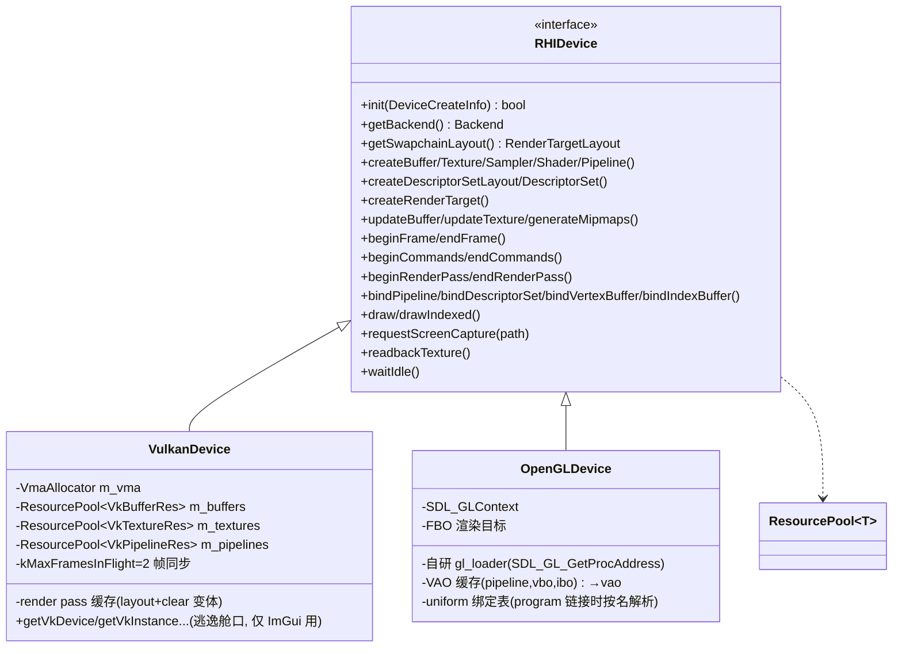

### 3.3.3 双后端语义对齐的关键决策

| 问题 | 决策 |
|---|---|
| NDC 差异 (VK y向下 z∈[0,1] / GL y向上 z∈[-1,1]) | 投影矩阵按后端生成（VK: zo + `proj[1][1]*=-1`）；缠绕方向经实测 VK/GL 保持相同映射（y-flip 与 VK framebuffer y-down 双重抵消） |
| 渲染到纹理的内存布局 | 两后端 NDC y=-1 均落内存第 0 行 → IBL 烘焙贴图内容天然一致，**无需翻转**（翻转只作用于主相机投影） |
| 着色器 | 单一 GLSL 源 + `GENESIS_VULKAN/GENESIS_OPENGL` 宏切换 `LAYOUT_SET`/`gl_VertexIndex`；构建期 python 展开 `#include` → GL 用扁平 .glsl，VK 注入 `#version 450` 编 .spv |
| push constant 缺失 (GL) | 全面使用 UBO（std140），C++ 侧有严格镜像结构体 |
| GL 无 sampler 对象 | bindDescriptorSet 时把采样参数写到纹理上（MAX_LOD 按 mip 链夹取） |
| VAO/VBO 绑定模型差异 | `(pipeline,vbo,ibo)` → VAO 缓存 |
| 截图回读 | VK: swapchain 加 TRANSFER_SRC，帧末 copy→host buffer；GL: swap 前 glReadPixels + 行翻转 |
| GL mipmap 完整性 | 创建时设 `TEXTURE_MAX_LEVEL=mipLevels-1`（mesa 严格要求 mip 链到 1x1 否则 FBO/采样判不完整） |

## 3.4 ECS 层设计

Piccolo 是 Unity 式 GObject-Component 组合（组件存对象内、按类型名线性查找）；Genesis v2.0 采用**数据导向稀疏集 ECS**：

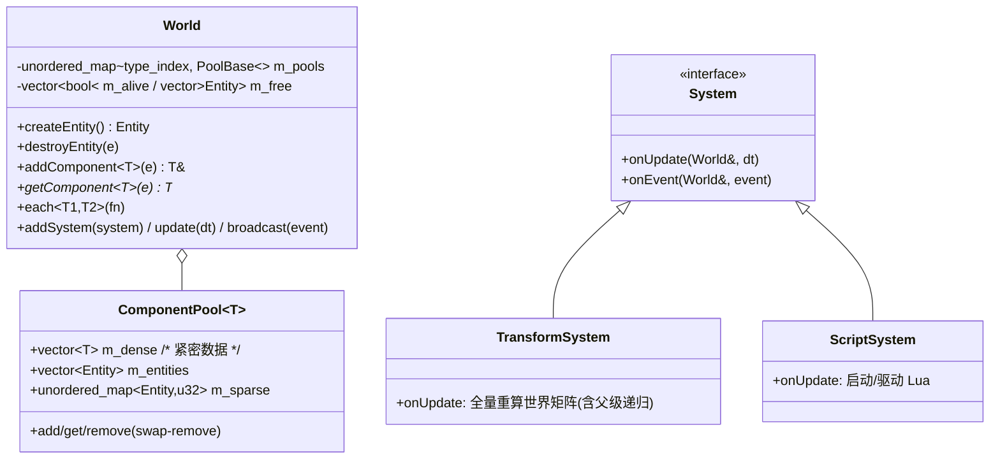

内置组件（`ecs_layer/components.hpp`，对齐 Piccolo 组件语义）：

| 组件 | 字段 | 对应 Piccolo |
|---|---|---|
| NameComponent | name[64] | GObject::m_name |
| TransformComponent | position/rotation(quat)/scale + parent + 缓存世界矩阵 + dirty | TransformComponent |
| MeshRendererComponent | model_id(AssetManager) + visible | MeshComponent |
| CameraComponent | fov/near/far | CameraComponent |
| DirectionalLightComponent | direction/color/intensity | （场景灯光配置） |
| ScriptComponent | script_path + env + started | LuaComponent |

## 3.5 资源层（assimp 模型导入 + 纹理）

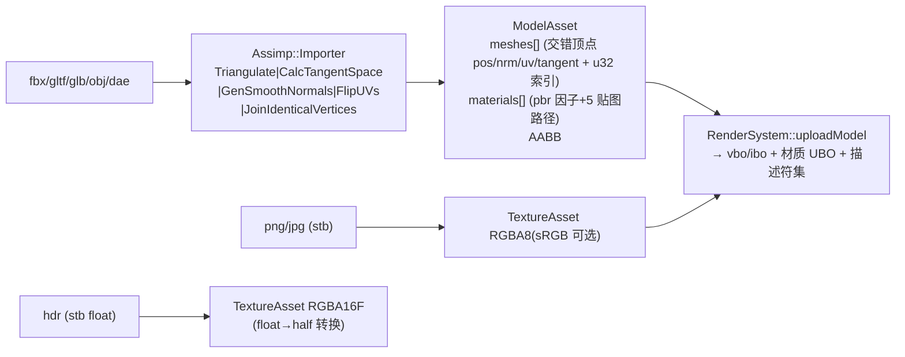

- 顶点交错布局 48B：`pos(3f) normal(3f) uv(2f) tangent(4f，w=手性)`；
- 材质解析覆盖 `AI_MATKEY_BASE_COLOR/METALLIC/ROUGHNESS` 及 `aiTextureType_*`（含 assimp 5.2 把 glTF metallicRoughness 落在 `UNKNOWN` 的兼容）；
- 贴图约定与 glTF/Piccolo 一致：mr 贴图 **G=roughness B=metallic**，albedo 用 sRGB 视图；
- 法线贴图切线手性：`w = sign(dot(cross(n,t), b))`，shader 内正交化 TBN。

## 3.6 渲染层（PBR + IBL）

### 3.6.1 RenderSystem 类与资源组织

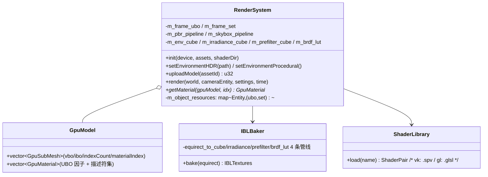

描述符布局（`set/binding`）：

| set | binding | 内容 |
|---|---|---|
| 0 (frame) | 0 | FrameUBO: view/proj/camPos/lightDir/lightColor+exposure/flags（光照模型、IBL开关、天空盒、调试通道） |
| 1 (material) | 0 | MaterialUBO: baseColor/metallic/roughness/ao/emissive/贴图开关 |
| 1 | 1-5 | albedo / normal / metallicRoughness / ao / emissive |
| 1 | 6-8 | **irradianceCube / prefilterCube / brdfLUT** |
| 2 (object) | 0 | ObjectUBO: model + normalMat（**每实体一份**——模型共享网格时变换独立） |

> 关键教训：object UBO 必须按实体分配。Vulkan 命令缓冲延迟执行，若多实体共享同一 UBO，CPU 侧连续 updateBuffer 会让所有绘制读到最后一帧写入的矩阵（GL 立即执行不暴露，VK 暴露——该 bug 由双后端对照截图直接发现）。

### 3.6.2 帧渲染时序

```mermaid
sequenceDiagram
    participant App as demo2 main
    participant Scr as ScriptSystem
    participant W as World/TransformSystem
    participant RS as RenderSystem
    participant Dev as RHIDevice

    App->>Scr: onUpdate(world, dt)  (Lua 驱动 transform)
    App->>W: update(dt)  (TransformSystem 重算世界矩阵)
    App->>Dev: beginFrame
    App->>RS: render(world, camera, settings, time)
    RS->>Dev: updateBuffer(frameUBO) (相机/灯光/flags)
    RS->>Dev: beginRenderPass(swapchain, clear)
    loop 每个 (Transform+MeshRenderer) 实体
        RS->>Dev: updateBuffer(objectUBO[entity])
        RS->>Dev: bindDescriptorSet(0,frame/1,material/2,object)
        RS->>Dev: bindVertexBuffer/bindIndexBuffer/drawIndexed
    end
    RS->>Dev: 天空盒 (depth LEqual, pos.xyww)
    RS->>Dev: endRenderPass
    opt 非无头
        App->>Dev: beginRenderPass(swapchain, clear=false)
        Note right of App: ImGui 叠加 pass (loadOp=LOAD)
        App->>Dev: endRenderPass
    end
    App->>Dev: endFrame (submit+present; 可选截图回读)
```

### 3.6.3 PBR 着色（直接光 + 间接光）

直接光双模型（`pbr.frag`，UI 可切换，flags.x）：

- **Blinn-Phong**：`diffuse = albedo/π`；`spec = pow(NoH, shininess)·(s+8)/8π`（shininess 由 roughness 映射）；**fresnel** Schlick，`F0 = mix(0.04, albedo, metallic)`（metallic 高光染色）；`kD=(1-F)(1-metallic)`；
- **Cook-Torrance PBR**：`D_GGX + G_Smith(Schlick k=(r+1)²/8) + F_Schlick`，`specular = D·G·F / (4·NoV·NoL)`。

间接光（IBL，flags.y，`iblAmbient`）：

- **diffuseIrradiance**：`irradiance = texture(uIrradianceMap, N)`，`kD·irradiance·albedo`；
- **镜面**：`R = reflect(-V,N)`，`prefiltered = textureLod(uPrefilterMap, R, roughness·4)`；`brdf = texture(uBrdfLUT, (NoV, roughness)).rg`；`specular = prefiltered·(F·brdf.x + brdf.y)`；
- AO 贴图/因子调制；环境光关闭时退回 `albedo·0.03·ao`；
- 输出：ACES 色调映射（exposure 可调）+ gamma 2.2。

### 3.6.4 IBL 运行时烘焙（IBLBaker）

与 Piccolo **离线烘焙 IBL 资产** 不同，Genesis v2.0 在引擎内通过 RHI 离屏 pass **运行时烘焙**（双后端同一套代码路径）：

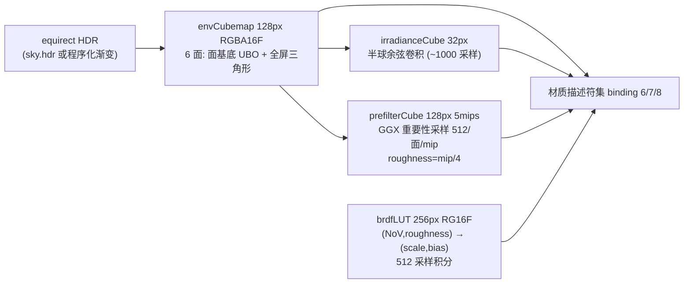

- 面基底法重建方向：`dir = normalize(forward + right·x + up·y)`（x,y∈[-1,1] NDC），避免投影差异；
- 烘焙通过 `beginCommands/endCommands`（阻塞提交）在初始化阶段完成；
- 每个 面/mip 一个 `RenderTarget`（`RenderTargetAttachment{texture, mip, layer}`），烘焙完销毁。

## 3.7 脚本系统（Lua 5.4 + sol2）

对齐并增强 Piccolo LuaComponent：

| | Piccolo LuaComponent | Genesis v2.0 ScriptSystem |
|---|---|---|
| 状态 | 每组件一个 sol::state | 单 sol::state + **每实体 sol::environment** |
| 执行模型 | 每帧 `script(整个字符串)` 重解释 | 文件加载一次，**生命周期函数** `on_create/on_update(dt)/on_destroy` |
| 绑定 | 3 函数走反射字符串 | 实体 API: `entity.get/set_position/translate/set_rotation_euler/set_scale/get_name`；`time.delta/elapsed`；`input.is_key_down/is_mouse_down`；`log()` |
| 热重载 | — | `reloadAll()`（销毁 env→重启） |
| 错误处理 | 无 | protected call + 错误日志 |

`ScriptComponent` 挂到实体上，首帧惰性启动（`startScript`：建 environment→注入 API→`sol::set_environment` 执行脚本主体→调 `on_create`）。

## 3.8 UI 层（ImGui 双后端）

`UIService`：SDL2 平台层 + 按后端选择 `imgui_impl_vulkan` / `imgui_impl_opengl3`：

- Vulkan：经 `VulkanDevice` 逃逸舱口（getVkInstance/Device/Queue/DescriptorPool/MainRenderPass）初始化，字体纹理用 `beginCommands/endCommands` 上传；渲染在**交换链 load pass**（clear=false，loadOp=LOAD，与场景 pass 布局兼容）内录制；
- OpenGL：`imgui_impl_opengl3`（自带 imgl3w loader 独立工作，与引擎自研 loader 互不干扰）；
- demo 控制面板：后端信息/FPS、直接光模型切换、IBL/天空盒开关、曝光、平行光方向/颜色/强度、材质 metallic/roughness/baseColor 覆盖（即时 updateBuffer）、ECS 实体列表、脚本热重载。

## 3.9 应用层与窗口/输入

- `Window`：新增 `WindowGraphicsApi`（Vulkan→SDL_WINDOW_VULKAN / OpenGL→SDL_WINDOW_OPENGL + core profile 属性：Linux 4.5、macOS 4.1），支持 `hidden`（无头）；修复回调数组未初始化问题；
- `Input`：键盘/鼠标状态、增量、滚轮；SDL 事件经 `m_event_callback` 转发给 UI。

## 3.10 构建系统

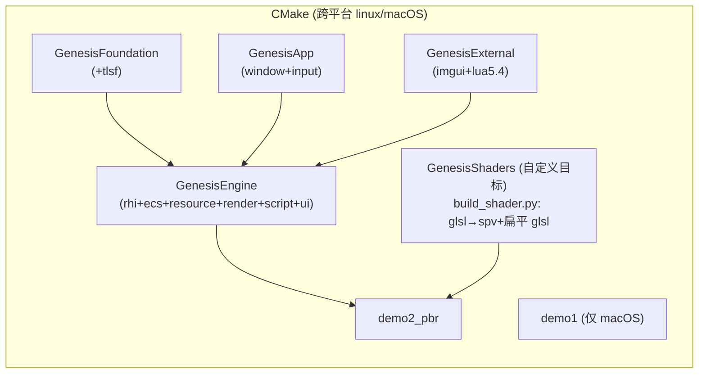

- 依赖：`find_package(Vulkan/SDL2/assimp)` + `glslangValidator` + python3；
- 着色器管线：`tools/build_shader.py` 递归展开 `#include` → 产出 `<name>.<stage>.glsl`（GL 用，运行时注入 `#version 420/410`）与 `.spv`（VK 用，glslangValidator -DGENESIS_VULKAN）；
- 资产生成：`tools/gen_assets.py` 程序化生成 equirect HDR（自写 Radiance RGBE writer）、PBR 贴图（albedo/normal/mr/ao PNG）、glTF UV 球（手写 JSON+BIN，含 TANGENT），`assimp export` 转 FBX 供双格式验证。

## 3.11 验证体系

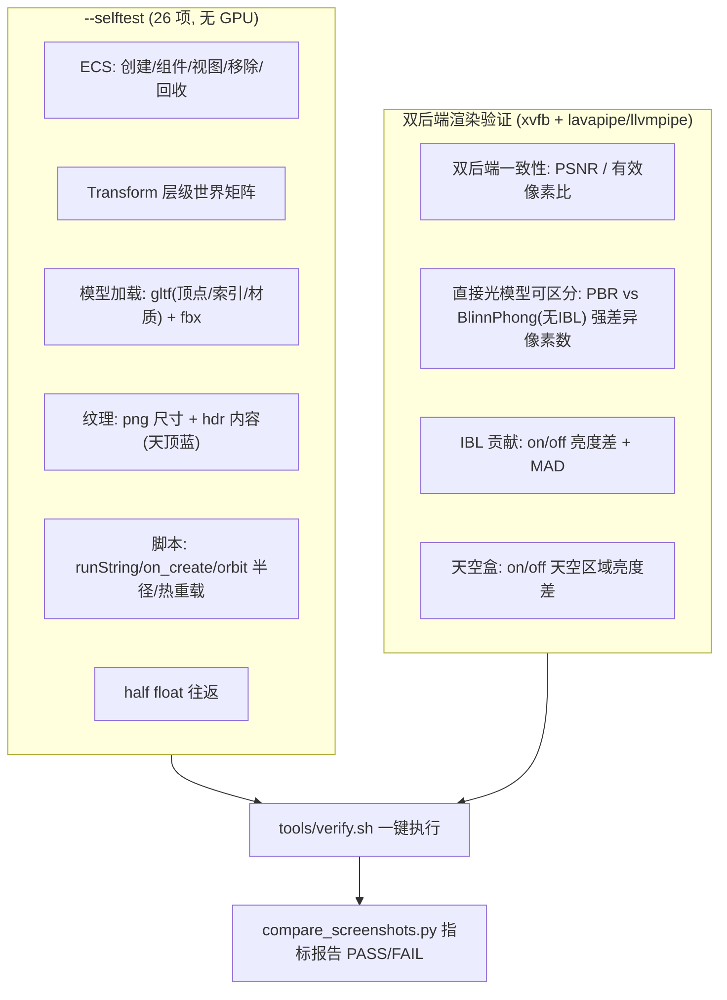

- 无头模式固定 `dt=1/60` 保证双后端截图逐帧可对比；
- 截图：`requestScreenCapture` → VK 帧末 copy 回读 / GL swap 前 readpixels。

---

# Part 4: 能力对照表与验证结果

## 4.1 能力对照

| 能力 | Piccolo | Genesis v1 (改造前) | **Genesis v2.0 (升级后)** |
|---|---|---|---|
| ECS | GObject-Component 组合 | 无 | ✅ 稀疏集数据导向 ECS + System |
| 模型导入 | OBJ (tinyobjloader) | 无 | ✅ assimp: **fbx/gltf/glb/obj/dae** |
| UI | imgui (Vulkan only) | imgui (Vulkan only) | ✅ imgui **Vulkan + OpenGL** 双后端 |
| 脚本 | LuaComponent (每帧重解释) | 无 | ✅ Lua5.4+sol2, env 隔离, 生命周期, 热重载 |
| 渲染后端 | Vulkan (名义抽象) | Vulkan (裸写) | ✅ **真多后端 RHI: Vulkan + OpenGL** |
| PBR 直接光 | Cook-Torrance | 无 | ✅ **BlinnPhong + Cook-Torrance 双模型**（fresnel/specular/diffuse/metallic 全项） |
| PBR 间接光 | IBL (离线烘焙资产) | 无 | ✅ IBL **运行时烘焙**: cubemap + diffuseIrradiance + prefilter + BRDF LUT |
| 跨平台 | Win/Linux/mac | 仅 macOS | ✅ **Linux + macOS** |
| 反射/序列化 | ✅ 完整 | 无 | 未做（超出本次范围） |
| 物理/动画/粒子 | ✅ Jolt/有/compute | 无 | 未做（超出本次范围） |

## 4.2 验证结果（tools/verify.sh 输出）

```
[SELFTEST] === ALL PASS (failures=0) ===     (26 项逻辑自检)
========================================================================
Genesis 渲染功能验证报告
========================================================================
[PASS] 双后端一致性 (PSNR>20dB, 有效像素>50%)
        PSNR=72.77dB MAD=0.0000 有效像素=100.0%
[PASS] 直接光模型可区分 (PBR vs BlinnPhong, 无IBL)
        强差异像素=5271 (阈值>2000) max=0.694
[PASS] IBL 间接光有贡献且提亮
        luma(ibl)=0.618 luma(no-ibl)=0.498 MAD=0.0354
[PASS] 天空盒渲染生效 (天空区域变亮)
        sky(on)=0.817 sky(off)=0.021
========================================================================
VERDICT: ALL PASS
```

渲染效果（Vulkan 与 OpenGL 后端逐帧一致）：

- `verify/vulkan_pbr.png` / `verify/opengl_pbr.png`：3 大球（glTF 金球左 / FBX 金球中 / 塑料红球右+脚本公转）+ 5 个金属度粗糙度渐变小球 + 天空盒 + IBL；
- `verify/vulkan_blinnphong.png`：Blinn-Phong 直接光模型；
- `verify/vulkan_noibl.png` / `vulkan_noskybox.png`：间接光/天空盒关闭对照；
- `verify/vulkan_ui.png` / `opengl_ui.png`：ImGui 实时控制面板（双后端）。

## 4.3 修复的存量缺陷

升级过程中一并修复了改造前代码的存量问题：`FileService::readXXX` 条件反转（4 处）、`Array::push` 未递增 size、`Array` 默认构造未初始化成员、Window 回调数组未初始化导致 shutdown 崩溃、`assert.hpp` 无 include guard 且宏拼接不合法、demo1 仅 macOS 可构建（现 `if(APPLE)` 隔离）、命令池在深度纹理创建之后初始化导致 lavapipe 崩溃、纹理 mip 链上传越界（偶发崩溃根因）。
