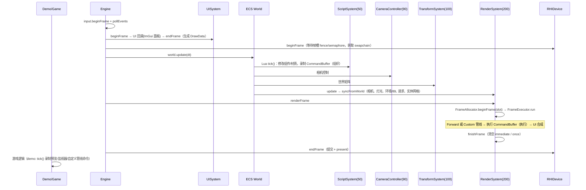
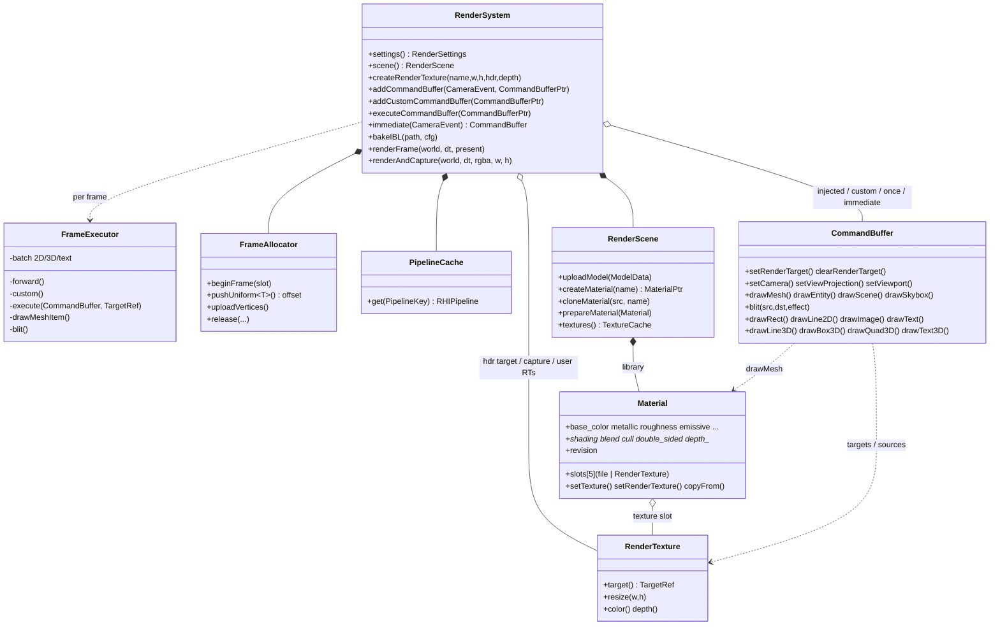

# Genesis Render 架构设计文档（v3：三后端 + RTTI 脚本 + CommandBuffer）

> 适用代码：当前仓库 `src/genesis/**`、`demo/`、`tests/`、`assets/scripts/`。
> 文中类名、函数名、文件路径均取自源码。历史版本文档见 `docs/legacy/`
> （`ARCHITECTURE_v2.0.md` 含 v1 现状分析、Piccolo 参考架构与差距分析）。

---

## 0. 本版本概要

| 维度 | 现状 |
|---|---|
| 渲染后端 | **OpenGL 4.1 core / Vulkan 1.1+（macOS 上为 MoltenVK）/ Metal（原生 Objective-C++）**，同一套 RHI 接口，所有渲染能力三端一致 |
| 跨后端一致性 | 两个参考场景（PBR 球组、特性场景：RT + CommandBuffer + SDF 文字 + 透明/Unlit 材质 + 后处理）三端**逐像素完全一致**（mean diff 0.000/255） |
| 着色器 | 单源 GLSL → GLSL 410 / SPIR-V / MSL 2.1（glslang + SPIRV-Cross 离线生成并入库），共 15 个着色器 |
| 脚本 | Lua 5.4 + **通用 RTTI 绑定**：19 个反射类型（Engine/World/Entity/全部组件/Material/RenderTexture/MeshAsset/CommandBuffer/Renderer/RenderSettings/Input），可纯脚本搭建完整场景 |
| CommandBuffer | 引擎级录制式命令列表：组织（逻辑）与执行（渲染）分离；6 个 CameraEvent 注入点、一次性执行、每帧 immediate、**Custom 管线模式**（用户命令缓冲构建整帧） |
| 材质 | 可编辑 `Material` 对象：PBR 参数、着色模式（CT/BP/Unlit）、混合/剔除/深度状态、5 个纹理槽（文件或 RenderTexture）、UV 变换、克隆；UI 实时编辑 + 实时预览 |
| 文字 | SDF 图集（EDT 距离变换）+ 批处理着色器；2D 屏幕文字、3D 世界文字（公告牌 / 任意矩阵）、`TextComponent` 实体标签、描边 |
| 验证 | 124 个测试（34 CPU + 30 GPU × 3 后端）+ 2 组跨后端比对；Vulkan validation layer / GL 错误检查 / Metal API+Shader validation 全部零告警 |

---

## 1. 分层架构

```
┌───────────────────────────────────────────────────────────────────────────┐
│ demo/  genesis_demo（场景切换、材质编辑器、Inspector、CB 实验室、文字实验室、Lua 控制台）│
│ tests/ genesis_tests（CPU + 每后端 GPU + 跨后端像素比对）                    │
├───────────────────────────────────────────────────────────────────────────┤
│ Engine    帧编排：input → UI 帧 → device.beginFrame → world.update → render   │
├──────────────┬──────────────┬──────────────┬───────────────┬───────────────┤
│ ECS          │ Script       │ Reflection   │ UI            │ Text          │
│ World/Pool/  │ Lua 5.4 VM   │ Value/Object │ ImGui→RHI     │ SDF Font 烘焙  │
│ System 调度  │ 沙箱 start/  │ Ref/TypeInfo │ 渲染器        │ 布局/度量      │
│ 组件         │ tick + RTTI  │ Registry     │ 反射 Inspector│               │
├──────────────┴──────────────┴──────────────┴───────────────┴───────────────┤
│ Renderer  RenderSystem（同步 ECS、IBL 烘焙、执行帧）                          │
│           FrameExecutor（Forward / Custom 管线、CommandBuffer 解释执行、批处理）│
│           CommandBuffer · RenderTexture/TargetRef · Material/RenderScene     │
│           FrameAllocator（每帧 UBO/顶点环） · PipelineCache                   │
├───────────────────────────────────────────────────────────────────────────┤
│ Resource  glTF/GLB(cgltf) · FBX(自研二进制/ASCII + zlib) · OBJ · stb_image · 程序化网格 │
├───────────────────────────────────────────────────────────────────────────┤
│ RHI       RHIDevice / RHICommandBuffer / Buffer / Texture / Sampler / Shader / │
│           Pipeline / RenderPass / Framebuffer / ResourceLayout / DescriptorSet │
│   ┌──────────────────┬──────────────────────┬──────────────────────────┐   │
│   │ OpenGL 4.1 core  │ Vulkan 1.1 (VMA)     │ Metal (ARC Obj-C++, MSL)  │   │
│   └──────────────────┴──────────────────────┴──────────────────────────┘   │
├───────────────────────────────────────────────────────────────────────────┤
│ Platform  SDL2 窗口 / 输入 / 计时器        Foundation  math / log / file    │
└───────────────────────────────────────────────────────────────────────────┘
```

### 1.1 目录与职责

| 目录 | 职责 |
|---|---|
| `src/genesis/rhi/` | 抽象接口 `rhi.hpp`、枚举/描述 `rhi_enums.*`/`rhi_desc.hpp`、工厂 `rhi_factory.cpp` |
| `src/genesis/rhi/opengl/` | GL 4.1 core 后端（VAO 缓存、UBO 绑定点、`GL_COPY_WRITE_BUFFER` 上传） |
| `src/genesis/rhi/vulkan/` | Vulkan 后端（VMA、布局跟踪与自动转换、动态偏移、headless 路径） |
| `src/genesis/rhi/metal/` | Metal 后端 `metal_backend.mm`（ARC、MSL 运行时编译、CAMetalLayer、信号量帧同步） |
| `src/genesis/renderer/` | `render_system*`（系统/帧/IBL）、`frame_resources`、`pipeline_cache`、`render_texture`、`material`、`render_scene`、`command_buffer`、`render_ubo`、`shaders/` |
| `src/genesis/reflection/` | `reflection.*`（RTTI 核心）、`engine_bindings.*`（引擎类型注册） |
| `src/genesis/script/` | `script_system.*`（VM、沙箱、`genesis.*` 兼容 API）、`lua_reflection.*`（通用 RTTI 绑定） |
| `src/genesis/text/` | `font.*`（SDF 烘焙、UTF-8、布局） |
| `src/genesis/ui/` | `ui_system.*`（ImGui RHI 渲染器）、`inspector.*`（反射驱动的属性编辑器） |
| `src/genesis/ecs/` | `ecs.hpp`（稀疏集 World）、`components.hpp`、`systems.*` |
| `src/genesis/engine/` | `Engine` facade |
| `scripts/build_shaders.py` | 单源着色器 → GLSL 410 / SPIR-V / MSL，生成 `shaders/generated/` |
| `assets/scripts/` | `scene_builder.lua`（纯 RTTI 建景）、`commandbuffer_demo.lua`（RT + 自定义管线）、`full_demo.lua`（showcase 脚本内容）、`demo_anim.lua`（旧 `genesis.*` API 兼容示例） |

---

## 2. 运行时序

### 2.1 一帧的时序（`Engine::tick`）



`Engine::captureFrame()`（截图、测试）走相同顺序：UI 帧 → `world.update` → `renderAndCapture`（渲染到 RGBA8 离屏目标并回读，row 0 = 图像顶部）。

### 2.2 帧内顺序（`FrameExecutor`）

**Forward（默认）**

```
run(): 主视图矩阵 → gather（视锥剔除，不透明/透明排序）→ uploadSharedUniforms（PerFrame/Lights/Environment 每帧一次）
forward():
  [BeforeScene]        注入命令（目标默认 camera HDR，尚未清除；常用于离屏 RT）
  场景 pass：clear → skybox → 不透明物体
  [AfterOpaque]
  透明物体 → 调试线 → 世界空间 TextComponent
  [AfterTransparent]   + executeCommandBuffer() 的一次性命令
  [BeforePost]         仍在 camera HDR
  present pass：tonemap/gamma/饱和度/暗角 + 内置 post_effect
  [AfterPost]          目标 backbuffer
  屏幕空间 TextComponent
  [Overlay]            HUD、2D 文字
finish(): ImGui 合成到呈现图像
```

**Custom（`RenderSettings::pipeline_mode = Custom`）**

```
custom():
  [BeforeScene]         离屏准备（与 forward 相同语义）
  所有 custom 命令缓冲（按注册顺序，默认目标 backbuffer）
  一次性命令
  [Overlay]
finish(): ImGui
```

内置场景 pass 不再执行；用户命令自行决定渲染哪些内容、渲染到哪里、如何后处理。

---

## 3. RHI 与三后端

### 3.1 接口

`RHIDevice` 创建全部资源（buffer/texture/sampler/shader/pipeline/render pass/framebuffer/resource layout/descriptor set），管理帧（`beginFrame/endFrame/currentFrameIndex/currentCommandBuffer`）、swapchain、`submitImmediate`（一次性命令，如上传、烘焙）、`waitIdle`、`readTexture`。`RHICommandBuffer` 录制 render pass、管线/顶点/索引/描述符集（**带动态偏移**）、push constants、viewport/scissor、draw、mipmap 生成、纹理拷贝。

### 3.2 `DeviceInfo` 约定（渲染器据此适配，不写后端分支）

| 字段 | GL | Vulkan | Metal | 用途 |
|---|---|---|---|---|
| `clip_depth_zero_to_one` | false | true | true | 投影矩阵深度范围 |
| `present_row0_top` | false | true | true | 显示目标的行序（呈现/回读/2D/UI） |
| `depth_format` | D24S8 | 探测 D24S8→D32S8→D32 | D32S8（M 系列不支持 D24S8） | 所有深度附件 |
| `frames_in_flight` | 1 | 2 | 2 | FrameAllocator 环段数 |

### 3.3 朝向与坐标约定

- **离屏目标统一**：所有后端 NDC y = −1 写入第 0 行（视图底部）。Metal 着色器由 SPIRV-Cross `--flip-vert-y` 生成，Vulkan/Metal 的正面判定 CCW → Clockwise 映射，使三端光栅化完全一致。
- **显示时才考虑方向**：`TargetRef::row0_top` 标记目标行序（swapchain、截图目标为 true）；blit 在 `dst.row0_top && !src.row0_top` 时翻转，2D/UI 投影据此选择 y 方向，viewport/scissor 以"行空间"表示。
- **RenderTexture 采样**：材质把 RT 放入颜色槽时自动附加 v 翻转的 UV 变换（`Material::setRenderTexture`），UI 通过 `RenderTexture::displayUV` 正向显示。

### 3.4 资源绑定映射

- 描述符集 set 0：场景（PerFrame、Lights、Environment + IBL 纹理），set 1：材质（Material UBO + 5 纹理），set 2：PerDraw。
- 所有每帧变化的 UBO 都是 **dynamic uniform buffer**：数据写入 `FrameAllocator` 的环形缓冲，绑定时传偏移 → 描述符集在帧间不可变，避免"GPU 使用中更新描述符"（Vulkan validation 曾报出）。
- GL：UBO 绑定点 / 纹理单元 = `set × 8 + binding`；Metal：`[[buffer]]/[[texture]]/[[sampler]]` 同公式（SPIRV-Cross `--msl-decoration-binding`），push constants 映射 `buffer(24)`，顶点缓冲 `buffer(30)`。

### 3.5 着色器流水线

`scripts/build_shaders.py`：`shaders/**` 单源 GLSL（`common/genesis_shader.h` 方言宏）→ glslang 生成 SPIR-V → SPIRV-Cross 生成 MSL 2.1；GLSL 410 同时经 glslang 校验。结果写入 `shaders/generated/`（`.spv`、`.metal` + `genesis_shaders_generated.cpp` 注册表），入库后构建不依赖工具链；`-DGENESIS_REBUILD_SHADERS=ON` 或 `./build.sh --shaders` 重新生成。

| 着色器 | 用途 |
|---|---|
| `scene/pbr_mesh.{vert,frag}` | Cook-Torrance / Blinn-Phong / Unlit，IBL，法线/AO/自发光，UV 变换，alpha mask/blend |
| `scene/skybox.frag`、`scene/debug_line.*` | 天空盒（程序化/立方体贴图）、调试线 |
| `ibl/*.frag` | equirect→cube、irradiance、prefilter、BRDF LUT |
| `post/effects.frag` | tonemap（None/Reinhard/ACES）+ 12 种效果：none/invert/grayscale/sepia/blur/edge/pixelate/vignette/scanline/chromatic/tint/posterize |
| `ui/batch.{vert,frag}` | 2D/3D 批处理：纯色、纹理、SDF 文字（`fwidth` 抗锯齿 + 描边） |
| `ui/imgui.{vert,frag}` | ImGui |

### 3.6 各后端实现要点

- **OpenGL**：VAO 缓存键含顶点缓冲偏移（`CachedVAO`）；缓冲上传绑定到 `GL_COPY_WRITE_BUFFER`，不会篡改当前 VAO 的 `GL_ELEMENT_ARRAY_BUFFER`；`GENESIS_GL_VALIDATE=1` 时每条命令后检查错误并 `glValidateProgram`。
- **Vulkan**：只请求物理设备实际支持的可选特性（MoltenVK 不支持 `wideLines`）；纹理布局跟踪，render pass begin/end 自动转换到初始/最终布局；render pass 外部依赖；深度格式探测；framebuffer 使用单 mip 视图；headless 时跳过 acquire/present；`GENESIS_VALIDATION=1` 启用 `VK_LAYER_KHRONOS_validation`。
- **Metal**：ARC 管理对象；MSL 源码运行时编译（按源指针缓存 `MTLFunction`）；PSO + 深度模板状态；render/blit encoder 切换；`writeTexture`/回读经 staging blit；`dispatch_semaphore` 控制 2 帧并行；headless 不创建 layer。

---

## 4. 渲染器核心

### 4.1 类关系



### 4.2 FrameAllocator

每个在飞帧一段 8 MB 的 uniform 环与 16 MB 的顶点环：`pushUniform<T>()` 返回动态偏移，`uploadVertices()` 用于批处理 2D/3D 图元与 ImGui；`release(...)` 延迟销毁资源直到该帧槽再次开始（安全释放仍被 GPU 引用的对象）。

### 4.3 PipelineCache

`PipelineKey` = 着色器 + 资源布局 + 顶点布局（Mesh/Fullscreen/Line/Batch/ImGui）+ 混合预设（Opaque/Alpha/Additive/Premultiplied）+ 剔除/深度/线框 + 颜色/深度格式。同一材质绘制到 HDR 场景、LDR 预览、backbuffer 时自动取到对应格式的管线。

### 4.4 RenderTexture / TargetRef

`RenderTexture` 持有颜色（RGBA8 或 RGBA16F）+ 可选深度、clear/load 两种 render pass 与 framebuffer；创建时立即清除（内容始终已定义），`resize` 重建并通过延迟释放回收旧对象，`generation` 变化让引用它的材质重建描述符集。`TargetRef` 是执行期的目标描述（pass、framebuffer、格式、尺寸、`row0_top`、`hdr`）。引擎内置 `camera.hdr`（场景 HDR + 深度）和 capture 目标。

---

## 5. 材质系统

### 5.1 数据

`Material`（`renderer/material.hpp`）：

- PBR 参数：`base_color`（含 alpha）、`metallic`、`roughness`、`emissive` × `emissive_strength`、`normal_scale`、`occlusion_strength`、`alpha_cutoff`、`uv_scale/uv_offset`。
- 渲染状态：`shading`（Default=跟随全局 / CookTorrance / BlinnPhong / Unlit）、`blend`（Opaque/Masked/Transparent/Additive）、`cull`、`double_sided`、`depth_test`、`depth_write`。
- 纹理槽：BaseColor / MetallicRoughness / Normal / Occlusion / Emissive；每槽可为文件（经 `TextureCache` 去重，颜色槽 sRGB）或 `RenderTexture`，可单独启用/禁用。
- 簿记：`revision`（任意编辑 +1）、`texture_revision`（槽变化）、缓存的描述符集与每帧 UBO 切片。

### 5.2 生命周期与实时编辑

1. `RenderScene::createMaterial / cloneMaterial / addMaterial` 注册到材质库（glTF/FBX 导入的材质同样进入库）。
2. 编辑（C++ 直接赋值、RTTI `setProperty`、Lua 属性、UI Inspector）只修改 CPU 数据并 `touch()`。
3. 绘制时 `prepareMaterial`：纹理槽变化或 RT generation 变化 → 重建（不可变的）set 1；`buildUBO` 每帧最多上传一次（按 `exec_serial` 缓存偏移）。
4. 因此编辑在**下一帧**即生效，所有引用同一材质的实体同步变化，无需重传网格。

Demo 的 Material Editor：材质库列表（过滤、New、Duplicate、Assign to selected），**实时预览**——一个注入 `BeforeScene` 的 CommandBuffer 用所选材质把预览网格（球/盒/环/头盔）画进 320² HDR RenderTexture，再 blit（自动 tonemap）到 LDR 纹理由 ImGui 显示；参数区由反射 Inspector 生成；纹理槽下拉可选资产贴图或渲染纹理（安防摄像头 RT、自定义管线 RT）。

---

## 6. CommandBuffer 与可编程管线

### 6.1 组织 / 执行分离

`CommandBuffer` 只是 `DrawCommand` 列表：录制时**复制全部参数**（字符串、矩阵、颜色、材质/RT 智能指针），录制与执行完全解耦——逻辑代码（Lua `tick`、游戏逻辑）在 `world.update` 阶段"组织"，`RenderSystem` 在渲染阶段"执行"，之后对逻辑状态的修改不影响已录制的命令。

### 6.2 提交方式

| API | 语义 |
|---|---|
| `addCommandBuffer(CameraEvent, cb)` | 持久注入 forward 管线的某个时机，每帧执行（内容由用户自行 `clear()`/重录） |
| `executeCommandBuffer(cb)` | 下一帧执行一次 |
| `immediate(CameraEvent)` | 每帧自动清空的内置缓冲，适合一次性 HUD/调试绘制 |
| `addCustomCommandBuffer(cb)` + `pipeline_mode = Custom` | 用户命令缓冲构建整帧 |

### 6.3 命令

- 目标与状态：`setRenderTarget(camera | backbuffer | RenderTexture)`、`clearRenderTarget(color?, depth?)`、`setViewport`（像素，左上原点）、`setCamera(eye, target, fov)`、`setViewProjection`、`setCameraEntity`、`resetCamera`、`setDepthTest3D`。
- 几何：`drawMesh(mesh, matrix, material)`（任意网格 + 任意材质 + 任意矩阵，不依赖 ECS）、`drawEntity`、`drawScene`（按当前视图剔除）、`drawSkybox`。
- 后处理：`blit(src, dst, effect, params, tint)`；HDR→LDR 自动 tonemap；src == dst 时经内部 scratch 目标 ping-pong。
- 2D：`drawRect / drawRectOutline / drawLine2D / drawImage / drawText`（当前目标像素坐标，左上原点，viewport 裁剪）。
- 3D：`drawLine3D / drawBox3D / drawQuad3D / drawText3D`（公告牌或任意矩阵）。

执行器把相邻的 2D/3D 图元合并成批次（统计 `batched_quads`），并在材质采样当前目标时**跳过该绘制**（`feedback_skips`）——读写同一纹理在所有后端都是未定义行为，Vulkan validation 会报错。

### 6.4 示例（Lua，完全通过 RTTI）

```lua
-- 安防摄像头：第二视角渲染进 RT，显示在世界中的网格上
local rt = RenderTexture.new("monitor", 512, 288, true, true)
local cam_cb = CommandBuffer.new("security_camera")
renderer:addCommandBuffer("before_scene", cam_cb)
local screen = renderer:createMaterial("screen", "unlit")
screen:setTexture("base_color", rt)

function tick(dt)
  cam_cb:clear()
  cam_cb:setRenderTarget(rt)
  cam_cb:clearRenderTarget(color(0, 0, 0), true)
  cam_cb:setCamera(vec3(7, 3.5, 0), vec3(0, 0.8, 0), 55)
  cam_cb:drawSkybox()
  cam_cb:drawScene()
end

-- 自定义管线：scene → HDR RT → tonemap → edge → backbuffer + 画中画
settings.pipeline = "custom"
cb:setRenderTarget(scene_rt); cb:clearRenderTarget(color(0,0,0), true)
cb:drawSkybox(); cb:drawScene()
cb:blit(scene_rt, ldr_rt)                   -- HDR→LDR 自动色调映射
cb:blit(ldr_rt, fx_rt, "edge")
cb:blit(fx_rt, "backbuffer")
cb:drawImage(ldr_rt, x, y, w, h)            -- 原图画中画
```

完整示例：`assets/scripts/commandbuffer_demo.lua`（C 切换管线、E 切换效果、M 开关监视器）；C++ 对应实现见 `demo/demo_app.cpp` 的 `recordMonitor / recordCustomPipeline / recordMaterialPreview`。

---

## 7. SDF 文字

- `Text::Font::load(device, ttf, 1024, 56px)`：stb_truetype 光栅化 ASCII + Latin-1 字形，逐字形做欧氏距离变换得到有向距离场，打包到单通道图集。
- `layout(utf8, size, align, anchor, y_down)` 产出字形四边形（2D 用 y 向下像素空间，3D 用 y 向上世界单位），`measure` 给出包围盒。
- `ui/batch.frag` 的 SDF 分支：`fwidth` 自适应抗锯齿（任意字号/距离清晰）+ 描边（宽度为 em 比例、独立颜色）。
- 三种入口：CommandBuffer `drawText`（2D）/ `drawText3D`（3D，公告牌或任意矩阵，可关深度测试）；`TextComponent`（实体标签：偏移、对齐、公告牌、屏幕空间、深度测试开关，由渲染器自动绘制）。

---

## 8. RTTI 反射与 Lua 脚本

### 8.1 反射核心（`reflection/reflection.hpp`）

- `Value`：nil/bool/int/float/string/vec2/vec3/vec4/quat/color/mat4/object/list，带宽松转换（数字↔布尔、vec3↔color 等）。
- `ObjectRef`：类型 + 解析函数（返回当前地址；组件在 ECS 池中会移动、实体会死亡）+ 持有者（shared_ptr 保活）+ 身份键。
- `TypeInfo`：属性（getter/setter、类型、范围、枚举名、描述）、方法（类型擦除调用器，自动参数转换，缺省参数为 nil）、构造器、基类、动态成员（如 `entity.Transform`）。
- `ClassBuilder`：`registerClass<T>("Name", "desc").property(...).range(...).enumProperty(...).method(...).constructor(...)`。

### 8.2 引擎类型（`reflection/engine_bindings.cpp`）

| 类型 | 主要成员 |
|---|---|
| `Engine` | fps、frame、time、backend、device、world、renderer、quit、screenshot、spawnModel |
| `World` | entity_count、create、find、entity、destroy、entities、each |
| `Entity` | id、name、parent、children、has/add/get/remove、components、setMesh、setMaterial、material、lookAt、`e.Transform` 等动态访问 |
| 组件 | Transform、Camera、Light、Mesh、Environment、Text、Script、CameraController、Tag |
| `Material` | 全部参数与渲染状态、setTexture（路径或 RT）、clearTexture、enableTexture、texture、clone、`Material.new` |
| `RenderTexture` | name、width、height、hdr、has_depth、resize、`RenderTexture.new` |
| `MeshAsset` | name、sub_meshes、bounds、material(i) |
| `CommandBuffer` | 第 6 节全部命令、count、clear、`CommandBuffer.new` |
| `Renderer` | settings、backend、width/height、统计、createMaterial/findMaterial/materials、createMesh/loadModel、createRenderTexture、add/remove(Custom)CommandBuffer、execute、immediate、bakeIBL、drawLine |
| `RenderSettings` | 着色、tonemap、曝光、gamma、后处理及参数、IBL/天空盒、线框、剔除、文字组件、pipeline |
| `Input` | mouse、mouse_delta、wheel、key、keyPressed、button、mousePressed |

自由函数：`vec2/vec3/vec4/color/euler/axis_angle/look_rotation/trs`。

### 8.3 通用 Lua 绑定（`script/lua_reflection.cpp`）

- 对象是 `Genesis.Object` userdata；`__index/__newindex` 走反射属性、方法、动态成员；`__eq` 比较身份；`__tostring` 打印类型名。方法须用 `:` 调用，错误信息会指出误用 `.`。
- 值类型（vec/color/quat/mat4）以带元表的 Lua 表表示（算术运算、`length/normalized/dot/cross` 等）。
- `reflect.types/describe/typeof/valid/get/set/call/new` 暴露元数据，`TypeName.new(...)` 调构造器。
- 全局：`engine`、`world`、`renderer`、`settings`、`input`、`entity(id)`、`asset(path)`；每个脚本的沙箱环境有 `this`（所属实体）。`print` 输出到引擎日志（demo 的控制台可见）。
- Lua 以 C 方式编译（`longjmp`）：绑定层先把错误写入缓冲、销毁全部 C++ 局部对象后再 `lua_error`，保证不跳过析构。
- 旧的 `genesis.*` 函数式 API 保留（`demo_anim.lua` 使用），内部已改为走 CommandBuffer/材质系统。

### 8.4 纯脚本建景

`assets/scripts/scene_builder.lua` 只通过 RTTI 创建：相机 + 轨道控制器、方向光与两个动画点光、HDR 环境（IBL）、带 4 张贴图的地面材质、金属度×粗糙度球阵列、glTF 模型、自发光/Unlit/透明材质、3D 文字标签，以及每帧重录的 HUD CommandBuffer。`genesis_demo --scene lua` 运行它。

---

## 9. UI

- `UISystem` 用 RHI 自己渲染 ImGui（字体图集 RGBA8、`ImTextureID = RHITexture*`、push constants 传缩放/平移、按 `row0_top` 与 HiDPI 缩放处理方向和 scissor），三后端同一实现，截图中 UI 同样正向。
- `UI::image(RenderTexturePtr, w, h)` 正确显示渲染纹理。
- `UI::inspectObject(ObjectRef)`：遍历反射属性生成控件（bool→复选框、有范围数值→滑条、数值→拖动、字符串→输入框、枚举→下拉、vec→拖动、color→取色器、quat→欧拉角、对象→可折叠子面板）；材质、组件、RenderSettings 的编辑界面全部由它生成。

---

## 10. Demo 功能入口

`genesis_demo [--backend gl|vulkan|metal] [--scene showcase|lua|commandbuffer|empty] [--lab material|commandbuffer|custom|text|inspector] [--script file.lua]`

| 入口 | 内容 |
|---|---|
| 菜单 Scene | C++ showcase / Lua 纯脚本场景 / Lua CommandBuffer 场景 / 空场景（运行时切换，帧间安全重建） |
| Engine | 后端、设备、深度格式与深度范围、帧时间、draw/tri/pass、命令缓冲统计、UBO 用量、截图、生成 Duck 模型 |
| Render settings | 反射生成的全部渲染设置、太阳方向、重烘焙 IBL |
| Hierarchy / Inspector | 实体树、反射编辑实体与全部组件、添加/移除组件、销毁、跳转材质 |
| Material editor | 第 5.2 节 |
| CommandBuffer lab | 安防摄像头 RT（显示在世界中的显示器网格与面板）、内置后处理及参数、Custom 管线（两级效果链、画中画、分屏）、已注册命令缓冲与统计 |
| SDF text lab | 2D 文字（内容/字号/位置/颜色/描边/对齐 + 字号阶梯）、3D 文字（公告牌/旋转/深度测试/描边）、SDF 图集预览 |
| Lua console | 示例片段（列类型、describe、生成物体、改材质、后处理、持久 overlay 命令缓冲…），表达式自动打印 |
| 快捷键 | F1 UI、F2 着色模型、F3 线框、F4 IBL、F5 自定义管线、F6 下一个后处理 |

---

## 11. 测试与验证

| 层级 | 内容 |
|---|---|
| CPU（34） | math、ecs、procedural、glTF、FBX、image、resource、shaders（三方言齐全）、script、render_ubo（std140 布局）、reflection（注册表、值转换、属性/枚举/只读、方法调用）、command_buffer（参数复制、名称往返） |
| GPU（30 × 3 后端） | rhi、render（含调试线逐帧清空）、pbr、ibl（BRDF LUT 对照 CPU 参考）、commandbuffer（RT + drawMesh + 方向、2D 像素坐标、Custom 管线、全部 blit 效果、反馈跳过）、text（2D 位置/包围盒/描边、3D 公告牌/深度/组件）、material（反射编辑、贴图、RT 采样、透明混合）、lua（RTTI 建景渲染、错误报告、自带脚本零错误）、ui（ImGui 截图方向） |
| 跨后端 | PBR 球组 + 特性场景，三端两两逐像素比对 |
| 验证层 | `./build.sh --test --validation`：Vulkan layer / GL 错误检查 / Metal API + shader validation |

详见 `docs/TEST_REPORT.md`、`docs/VERIFICATION.md`。

---

## 12. 本轮修复的问题（根因）

| 问题 | 根因 | 修复 |
|---|---|---|
| macOS 上 Vulkan demo 无法创建窗口：`VK_ERROR_FEATURE_NOT_PRESENT`（第 16 个特性 `wideLines`） | 设备创建时无条件请求 MoltenVK 不支持的特性 | 只请求物理设备报告支持的特性 |
| Vulkan 画面整体偏暗、背光 | framebuffer 空间 y 翻转后正面绕序相反，背面被当成正面 | CCW → `VK_FRONT_FACE_CLOCKWISE` 映射（Metal 同理） |
| Vulkan 深度附件创建失败（MoltenVK） | 硬编码 D24S8，Apple GPU 不支持 | 深度格式探测，`DeviceInfo::depth_format` 全局使用 |
| Vulkan validation：描述符集在 GPU 使用中被更新；图像布局不匹配；headless 呈现未渲染图像 | 每帧改写同一描述符集；缺少布局跟踪；headless 仍走 acquire/present | 动态 UBO 环 + 不可变描述符集；布局跟踪与自动转换、mip 级转换；headless 跳过 swapchain |
| Metal 后端无法启动（非法深度格式），后续 `writeTexture` 崩溃 | 旧实现不完整；`pixelFormatBytesPerPixel(RGBA16F)` 返回 16 | 按 ARC 完整重写 Metal 后端；修正像素字节数（RGBA16F=8、RGBA32_UINT=16） |
| GL：批处理与 PBR 绘制 `GL_INVALID_OPERATION` | 上传缓冲时绑定 `GL_ELEMENT_ARRAY_BUFFER` 改写了当前 VAO；VAO 缓存忽略顶点偏移 | 上传改用 `GL_COPY_WRITE_BUFFER`；VAO 缓存包含偏移 |
| HiDPI 下截图/测试尺寸不符、UI 倒置 | 窗口像素与点混用；UI 未考虑目标行序 | headless 关闭 HiDPI；UI 按 `row0_top` + 缩放渲染 |
| 自定义管线下 `before_scene`/`overlay` 注入的命令不执行；首个 backbuffer pass 读取未定义内容 | Custom 模式只执行 custom 列表；切回 backbuffer 时使用 load pass | Custom 模式执行 BeforeScene 与 Overlay 事件；每帧首次使用呈现目标强制清除 |
| RT 被自身材质采样时的读写冲突（Vulkan validation 报 `VUID-VkDescriptorImageInfo-imageLayout-00344`） | 场景包含采样该 RT 的网格，同时渲染到该 RT | 执行器检测反馈并跳过该绘制（`feedback_skips`） |
| 截图中的 UI 为上一帧或缺失 | `captureFrame` 未构建 UI 帧 | `captureFrame` 与 `tick` 相同顺序构建 UI |
| 实体 id 复用时可能沿用旧网格绑定 | 绑定仅按 id 查找 | 同时校验 generation |
| Lua `print` 多输出 `userdata` | `luaL_buffinit` 在 5.4 中会压栈占位 | 先取参数个数再初始化缓冲 |

---

## 13. 已知限制与后续方向

- 光照为前向渲染，无阴影贴图；灯光数量上限由 Lights UBO 决定（8 个）。
- 材质为固定 PBR 着色器的参数化，不支持用户自定义着色器图；CommandBuffer 提供管线级可编程性。
- Metal 使用运行时 MSL 编译（首帧有编译开销），后续可改为离线 `metallib`。
- 文字字形集为 ASCII + Latin-1，CJK 需按需烘焙字形页。
- 场景切换时通过 `waitIdle` 保证安全；资源（网格/材质库）按引擎生命周期保留。
